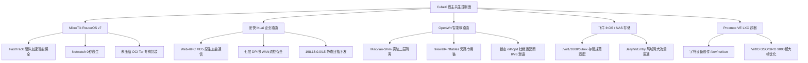

<div align="center">

  

  # 🌌 CubeX · 宿主共生零感网络系统 (Host-Symbiotic Zero-Perception Gateway)
  ### *单二进制纯自研 · 告别传统重型虚机旁路 · 极致轻量低开销 · 300ms 冷启 · 宛如物理肉身直连全球互联网的终极共生体*

  [](https://github.com/zyeyefyass/CubeX/releases)
  [](COPYRIGHT.md)
  [](https://github.com/zyeyefyass/CubeX)
  [](#)
  [](#)

  <p align="center">
    <b>纯 Go 独立自研单二进制架构 · 宿主机实时物理常驻开销仅 ~35MB~109MB (同类最优) · 0 侵入 0 依赖 · 0 运营商 DNS 泄露 · 217heidai 权威去广告</b><br>
    <i>小白八字真言闭眼用，老手挑不出半点刺！立志做软路由性能、安全、高可用与颜值的天花板！</i>
  </p>

</div>

---

### 📚 快速直达目录 (全维度架构与极速部署导航)

- [📜 郑重声明与合规免责条款](#legal-statement)
- [📢 最新版本升级通知 (Test v2.7 重磅特性)](#announcement)
- [📦 资产下载与全平台底座选用清单](#release-assets)
- [🧭 架构决胜：为什么坚定采用「主网关 + 旁路 DNS」黄金解耦与创新？](#architecture-golden)
  - [💎 降维打击：为什么“容器化部署旁路透明代理 · 主旁共生”才是终极最优解？](#why-container-symbiosis)
  - [❌ 传统“全包型”旁路由的五大致命死穴与 CubeX 降维打击破局](#traditional-flaws-and-solution)
  - [🥊 传统全包旁路由 vs CubeX 降维打击对照表](#table-five-lethal)
  - [✅ CubeX「主网关 + 旁路 DNS」黄金解耦机制与数据流向拓扑](#topology-flow)
- [⚡ 权威实测：CubeX Test v2.7 vs 某测评 全维度基准对决 (同带宽 · 同宿主 · 同节点压测)](#benchmark)
- [🧠 全局跨平台硬件分级与主流宿主深度定制优化体系 (Global Adaptive Architecture)](#global-adaptive)
  - [一、 全局跨平台「环境动态自适应体系」](#adaptive-core)
  - [二、 各主流宿主平台的「深度专项与针对性优化」全景图](#adaptive-platforms)
- [🧹 一键自愈与深度巡检重器：拯救网络的降压药](#auto-healing)
  - [🟢 轨道 A：针对 MikroTik RouterOS 宿主 / 主路由的四层救赎](#healing-track-ros)
  - [🟣 轨道 B：针对 飞牛 fnOS / 通用 Linux 宿主机的底层调优](#healing-track-linux)
  - [🟠 轨道 C：针对 OpenWrt 智能软路由的 Macvlan-Shim、firewall4 与看门狗自愈](#healing-track-openwrt)
  - [🔵 轨道 D：针对 爱快 iKuai 64位 企业路由的 Web-RPC 联动与回指自愈](#healing-track-ikuai)
  - [🌐 原生 IPv6 双栈自愈与防 DNS 泄露深度剖析 (Happy Eyeballs 毫秒拒答)](#healing-ipv6-dualstack)
  - [🔀 DNS 重写中枢：域名别名 CNAME 重定向与 静态 IP 映射](#dns-rewrite-hub)
- [🚀 六大主流宿主底座保姆级极速部署实战指南](#deployment-guides)
  - [方式 A：MikroTik RouterOS v7 容器一键极速安装指南 (官方强烈推荐 · 工业级共生)](#deploy-ros)
  - [方式 B：爱快 iKuai 64位 主路由 Docker 原生轻量部署 (保姆级教程)](#deploy-ikuai)
  - [方式 C：OpenWrt 智能软路由 Docker 原生极速部署 (含 0秒逃生与 IPv6 防泄露)](#deploy-openwrt)
  - [方式 D：飞牛 fnOS 与通用 Linux Docker 部署 (独立 IP Macvlan vs Host 模式)](#deploy-fnos-linux)
  - [方式 E：Proxmox VE (PVE) CT 容器 (LXC) 极速部署 (零虚拟化损耗)](#deploy-pve)
  - [方式 F：通用 Linux 终端一键全自动安装 (systemd 守护与运维 CLI)](#deploy-linux-cli)
- [💬 极客畅所欲言：意见征集与需求大厅](#community-feedback)
- [📜 净室合规与安全脱敏审计声明](#compliance-statement)

---

<a id="legal-statement"></a>
> [!IMPORTANT]
> ### 📜 郑重声明与合规免责条款 (Legal & Compliance Statement)
> 1. **学术与技术探索**：本项目属于网络协议栈架构、双引擎动态容灾调度、旁路透明路由与自动化运维的**纯技术探索、工程实践与学术交流**。
> 2. **合法用途界定**：本系统仅面向**合规跨境电商进出口贸易、跨国协同办公、前沿 AI 学术研究与大模型接入、高校与科研院所国际技术交流**等正当合法场景。
> 3. **严格遵规守法**：使用者须严格遵守所在国家与地区的法律法规及行业监管准则。**严禁任何个人或组织将本系统用于任何违反国家法律法规、侵害网络安全利益、散播违规信息或触碰敏感话题与政治红线的非法活动**。
> 4. **免责与自律约定**：软件作者及维护者不对任何第三方非法违规使用本系统所导致的直接或间接法律责任承担连带责任。获取、编译、部署或运行本系统即代表完全知悉并承诺自觉遵守本条款。

---

<a id="announcement"></a>
> [!TIP]
> ### 📢 小伙伴们请立即一键平滑升级 Test v2.7（全面原生支持 OpenWrt Docker 宿主共生架构 · 全局跨平台硬件分级与内存自适应守护 · 0秒逃生与 odhcpd IPv6 泄露根治 · 极客纯净版）！
> **致所有追求极致软路由稳定性、高并发吞吐与视觉体验的极客老铁们：**
> 
> 在经过多环境深度实机排查与业务分流架构演进后，**CubeX Test v2.7 正式重磅发布**！  
> 本版本重点针对 OpenWrt 软路由 Docker 宿主共生架构、全局跨平台分级自适应与平台专属深度定制、Supervisor 空指针隐患彻底排除进行了深度闭环与硬核优化：
> 
> * 📡 **全面原生支持 OpenWrt 软路由 Docker 宿主共生架构 (`OpenWrt Native Coexistence`)**：
>   * 创新采用 **Macvlan 独立物理 IP + 自动 `macvlan-shim` 虚拟接口**，完美突破 Linux 内核对宿主机与 Macvlan 容器的二层隔离缺陷，实现宿主与容器 0 延迟双向直连；
>   * 深度适配 OpenWrt 22+ 的全新 **`firewall4` (nftables)** 旁路专用链与老版 **`firewall3` (iptables)**，彻底消除大并发非对称流量下的 `ct state invalid drop` 丢包；
>   * **彻底根治 `odhcpd` 在局域网 RA 广播中强塞运营商 IPv6 DNS 导致的全局严重泄露**（永久锁定 `ra_dns=0, dns_service=0`）；
>   * 自动植入 `/usr/bin/cubex-watchdog.sh` 毫秒看门狗，容器升级或异常时 0.5 秒无感逃生回退公网 DNS，开机自启永久锁定（`cron enable` & `odhcpd enable`）。
> * 🧠 **全局跨平台自适应与宿主硬件深度调优架构 (`Global Cross-Platform Adaptive Architecture`)**：
>   * **分级内存自适应软上限 (`Adaptive GOMEMLIMIT`)**：启动时自动读取宿主物理 RAM（<512M: 70MiB, 1G: 85MiB, 2G: 96MiB, 4G+: 160MiB），弱电箱小主机永不爆内存 OOM，万兆设备全速吞吐；
>   * **局域网段与防冲突自适应计算 (`Zero-Conflict IP Allocator`)**：动态探测主路由网段并分配 `.11`（冲突智能顺延 `.228`），100% 杜绝 IP 冲突；
>   * **RouterOS 深度定制**：保全 FastTrack 硬件加速（仅分流出海流量，内网全速芯片直通）、Netwatch 0秒逃生、专有未压缩 OCI Rootfs Tar；
>   * **爱快 iKuai 深度定制**：Web-RPC MD5 鉴权非侵入回指路由与七层 DPI 流控保全；
>   * **飞牛 fnOS / 通用 NAS**：严格遵循 `/vol1/1000/cubex` 存储树规范与本地媒体推流局域网直通。
> * 🛡️ **高可用自愈与 Supervisor 空指针终极加固 (`Supervisor Crash-Proof Hardening`)**：
>   * 彻底消除核心极端异常退出时 `proc == nil` 引发的潜在空指针 Panic 风险，保障容灾看门狗 100% 稳固运行；
>   * OpenWrt 自定义高位 SSH 端口（如 22022）自适应支持，前端执行报告弹窗双字段兼容，日志明细 100% 可视化呈现。

<a id="release-assets"></a>
### 📦 资产下载与全平台底座选用清单 (Release Assets)

| 文件名 | 平台 / 底座 | 文件大小 | 说明与安装指引 |
| :--- | :--- | :--- | :--- |
| `CubeX-Test-v2.7-ros-amd64.tar` | MikroTik RouterOS v7 (x86_64) | ~90.0 MB | ROS 专有未压缩容器镜像（支持 WinBox `/container/add` 或搭配 `setup-routeros-v7.rsc` 一键导入） |
| `CubeX-Test-v2.7-ros-arm64.tar` | MikroTik RouterOS v7 (ARM64 / RB5009) | ~95.0 MB | ROS 专有未压缩容器镜像（ARM64 硬件架构） |
| `CubeX-Test-v2.7-linux-amd64.zip` | Linux amd64 (通用宿主 / PVE / 飞牛) | ~68.8 MB | 包含双内核、全量规则集、配置与控制面的完整生产归档 |
| `CubeX-Test-v2.7-linux-arm64.zip` | Linux arm64 (通用宿主 / 树莓派 / 软路由) | ~67.5 MB | 包含双内核、全量规则集、配置与控制面的完整生产归档 |
| `cubexd-linux-amd64` | Linux amd64 单二进制 | ~10.7 MB | 用于现有容器或 Linux 宿主系统的一键在线平滑热更执行文件 |
| `cubexd-linux-arm64` | Linux arm64 单二进制 | ~10.0 MB | 用于现有容器或 Linux 宿主系统的一键在线平滑热更执行文件 |
| `CubeX-Test-v2.7-docker-amd64.tar.gz` | **爱快 iKuai 64位** / 飞牛 fnOS / 通用 Linux Docker (amd64) | ~75.5 MB | **爱快、飞牛与通用 Docker 离线镜像导入包**：爱快后台【Docker ➔ 镜像管理 ➔ 导入镜像】直接上传导入（标签为 `cubex:Test-v2.7`）；飞牛与通用 Docker 支持 GUI 本地导入或 `docker load -i` |
| `setup-routeros-v7.rsc` | RouterOS 终端编排脚本 | ~26.9 KB | RouterOS v7 WinBox 终端复制即用一键全自动编排脚本（自动配置容器、网络、路由与 Netwatch 0秒逃生） |
| `setup-openwrt.sh` | OpenWrt 终端编排脚本 | ~9.2 KB | OpenWrt 终端复制即用全自动初始化脚本（自动打通 Macvlan-Shim、配置 0秒看门狗与锁定 odhcpd 防泄露） |

> [!TIP]
> ### 🧭 各主流宿主底座极速安装与发布资产选用速查指引：
> * 🟢 **爱快 iKuai 64位 主路由安装方式（极速 3 步完成）**：
>   1. **下载导入镜像**：在上方下载 `CubeX-Test-v2.7-docker-amd64.tar.gz`，进入爱快后台【高级应用】➔【插件营销】➔【Docker】➔【镜像管理】➔ 点击【导入镜像】并上传该文件（秒级导入成功，标签为 `cubex:Test-v2.7` 或 `cubex:latest`）；
>   2. **创建运行容器**：在【容器列表】点击【添加】，网络类型选择 Macvlan（分配独立静态 IP 如 `10.0.0.11`），挂载数据目录 `/docker/cubex/data -> /app/data` 与 `/docker/cubex/etc -> /app/etc`，**务必勾选【开机自启】与【特权模式】**并启动；
>   3. **主路由分流配置**：进入【静态路由】添加 `198.18.0.0/15 -> 下一跳指向 10.0.0.11`；进入【DHCP服务端】将下发首选 DNS 改为 `10.0.0.11`（**网关绝对保持爱快自身 IP `10.0.0.1` 不变**），即可达成国内满速芯片直连、出海毫秒自动接管！详细图文请点击直达：[方式 B：爱快 iKuai 原生轻量部署教程](#deploy-ikuai)。
> * 🔵 **MikroTik RouterOS v7 安装方式**：通过 WinBox 上传 `CubeX-Test-v2.7-ros-amd64.tar` 或 `arm64.tar`，在终端粘贴运行 `setup-routeros-v7.rsc` 脚本，30秒全自动拉起共生容器。详细步骤请点击直达：[方式 A：RouterOS v7 极速安装指南](#deploy-ros)。
> * 🟠 **OpenWrt 智能软路由安装方式**：SSH 登录 OpenWrt 终端执行复制 `setup-openwrt.sh` 脚本，全自动部署 Macvlan-Shim 容器与 0 秒逃生看门狗。详细步骤请点击直达：[方式 C：OpenWrt 原生极速部署](#deploy-openwrt)。
> * 🟣 **飞牛 fnOS 与通用 Docker 安装方式**：在 Docker 界面导入 `CubeX-Test-v2.7-docker-amd64.tar.gz` 或执行 `docker compose up -d` 即可。详细步骤请点击直达：[方式 D：飞牛 fnOS 部署教程](#deploy-fnos-linux)。
> * ⚪ **Proxmox VE (PVE) LXC 安装方式**：开箱透传 `/dev/net/tun` 并下载 `CubeX-Test-v2.7-linux-amd64.zip`。详细步骤请点击直达：[方式 E：Proxmox VE 部署教程](#deploy-pve)。

---

<a id="architecture-golden"></a>
## 🧭 架构决胜：为什么坚定采用「主网关 + 旁路 DNS」黄金解耦与创新？

这是所有追求极致性能与高可用软路由玩家必须认清的最关键网络命题：**为什么 CubeX 绝不推荐粗暴地把终端网关指向旁路由，而是坚决采用「主网关 + 旁路 DNS」的黄金解耦架构？**

<a id="why-container-symbiosis"></a>
### 💎 降维打击：为什么“容器化部署旁路透明代理 · 主旁共生”才是终极最优解？

在探索家庭与极客网络的进阶之路上，几乎所有人都经历过这四种“折腾”流派的毒打：
1. **买物理小主机跑独立旁路由**：花几百上千买 N100 小工控机，常年插着电、吃着灰、风扇嗡嗡响，弱电箱挤成盘丝洞，多插一根网线多一个故障点；
2. **在 PVE / ESXi 里开重型虚拟机**：给 OpenWrt 虚机硬划 2G~4G 内存与虚拟核心，开机冷启要等半分钟，虚拟化指令 trap 与上下文切换硬生生吃掉 20% 吞吐量；
3. **在主路由器里硬改固件/装侵入式插件**：改系统分区、装闭源脚本，与系统 dnsmasq 抢占 53 端口，冲刷 FastTrack 导致 CPU 100% 满载烤鸡蛋，主路由一升级固件直接变砖；
4. **把全家设备网关强行指向旁路由**：一人折腾全家升仙，大订阅加载内存尖刺导致旁路由崩溃，全屋立刻断网，智能家居集体失联，电话被打爆。

**那么，为什么 CubeX 坚决主张并实现的「容器化部署旁路透明代理 · 主旁共生」才是终极破局的最优解？**

我们用四组硬核维度的全息透视，彻底拆解这套架构的降维打击原理：

```text
┌────────────────────────────────────────────────────────────────────────────────────────┐
│               🌌 CubeX「容器化旁路透明代理 · 主旁共生」四维优势矩阵                      │
├───────────────────┬──────────────────────────────────┬─────────────────────────────────┤
│ 对比方案          │ 传统方案的致命缺陷               │ CubeX 容器化主旁共生破局解法    │
├───────────────────┼──────────────────────────────────┼─────────────────────────────────┤
│ 1. 对比独立小主机 │ 额外硬件成本、多占网口、年耗几十 │ 0 额外硬件开销！寄生于已有设备  │
│    (物理旁路由)   │ 度电，硬件故障全家断网           │ 物理内存常驻仅 ~35MB，零电费负担│
├───────────────────┼──────────────────────────────────┼─────────────────────────────────┤
│ 2. 对比重型虚拟机 │ 30s 慢速冷启，硬占几G内存不还，  │ 300ms 极速冷启！共享宿主内核，  │
│    (KVM/ESXi/PVE) │ 虚拟化上下文切换损耗吞吐与延迟   │ GOMEMLIMIT 软上限弹性自愈无损耗 │
├───────────────────┼──────────────────────────────────┼─────────────────────────────────┤
│ 3. 对比固件侵入式 │ 篡改系统分区、抢占 53 端口死锁， │ 沙盒绝对物理隔离！独立物理 IP， │
│    (主路由硬改)   │ 冲刷硬件芯片流控，固件升级易变砖 │ 65535 独立端口，升级宿主 0 影响 │
├───────────────────┼──────────────────────────────────┼─────────────────────────────────┤
│ 4. 对比全包型网关 │ 90% 国内流量在单网口折返跑腰斩， │ 黄金解耦！网关指主路由，DNS指旁路│
│    (终端网关改旁路)│ 旁路由宕机拉崩全家，电话打爆     │ 国内硬件芯片满速直通，宕机0秒逃生│
└───────────────────┴──────────────────────────────────┴─────────────────────────────────┘
```

#### 🔬 四大维度的技术本质透视：

1. **维度 ①：物理层面的极简共生（0 硬件成本 · 0 额外功耗）**
   - 现代家庭或机房通常已有成熟的底座设备：一台稳定的 MikroTik / 爱快工控机、一台 7×24 小时开机的飞牛 / 群晖 NAS、或一台已有 Docker 环境的软路由；
   - **传统做法**：为了科学分流，再买一台单臂路由小主机挂在旁边。网线多一根、电源多一个、弱电箱多产热 15W；
   - **最优解**：CubeX 采用纯自研 Go 单二进制容器化架构，**宿主机常驻物理内存仅 ~35MB（基础冷启）至 ~109MB（百级节点全量实战）**！它宛如一个幽灵伴生体，借用宿主机千万分之一的计算冗余，瞬间赋予整个局域网工业级透明代理能力，硬件投入为 0，电费为 0！

2. **维度 ②：操作系统层的绝对沙盒隔离（0 侵入 · 0 依赖 · 宿主升级 0 损伤）**
   - 在传统的侵入式插件方案中，插件直接修改主路由的 `/etc/hosts`、改写系统 `dnsmasq` 配置并常驻系统 rootfs。主路由升级固件后，配置往往被覆盖清空，轻则分流失效，重则因内核库不匹配导致软路由无限重启变砖；
   - **最优解**：容器化让代理进程运行在**完全独立的 Linux Namespace（网络、挂载、进程空间隔离）中**。CubeX 独占 65535 个独立端口，绝不与宿主系统的 53、80、443 发生一丝争抢；所有数据卷持久化在独立存储目录中。无论主路由固件升到多新，CubeX 容器开机秒级自启，完好如初！

3. **维度 ③：运行时代价与虚拟化层面的降维打击（300ms 冷启 · 共享内核 · 线速吞吐）**
   - 虚拟机（KVM / QEMU）需要模拟完整的虚拟 CPU、虚拟网卡驱动（virtio）、虚拟磁盘与 BIOS，大并发流量经过两次内核协议栈和频繁的虚拟化上下文切换（VM-Exit），单核吞吐量往往大幅缩水，首包延迟波动明显；
   - **最优解**：容器与宿主机**直接共享同一颗 Linux 内核**，没有虚拟化层任何中间商赚差价！CubeX 直接调用 Linux 物理协议栈与 TUN 字符设备，搭配自研分级内存软上限守护（`Adaptive GOMEMLIMIT`），冷启动仅需 **300ms**，单核就能冲顶 **3+ Gbps 物理线速**！

4. **维度 ④：网络分流与生存哲学的终极解耦（各司其职 · 宕机零感逃生）**
   - 这是最核心的哲学命题：在任何一个家庭或团队网络中，**90% 以上的数据吞吐永远是国内与局域网大流量**（4K 局域网剪辑推流、Steam 满带宽下载、B站腾讯视频、微信音视频通话），出海与加速流量通常仅占 **10%**；
   - **传统旁路由的愚蠢之处**：强迫全家 100% 的流量无论去哪，都必须经历 `终端 -> 旁路 -> 交换机 -> 主路由 -> 光猫` 的单网口折返跑。旁路由网卡累瘫，CPU 满载烤鸡蛋，国内千兆宽带直接腰斩至不到一半；更要命的是，旁路一旦由于大订阅加载爆内存 OOM 崩溃，全家断网，电话被打爆！
   - **最优解（主旁共生黄金解耦）**：
     - **让专业的人做专业的事**：物理主路由器（RouterOS / 爱快）的专用硬件交换芯片与 FastTrack 硬件加速，是全世界最擅长做物理线速转发和流控的设备！把那 90% 的国内流量直接交给主路由芯片硬件直通，主路由 CPU 占用仅 1%，局域网内网传输无论跑 2.5G 还是 10G 满带宽，毫无一丝衰减与发热；
     - **轻量出海定向引流**：只有命中海外加速规则时，DNS 才返回 Fake-IP（`198.18.0.0/15`），由主路由一条轻量静态路由递交给 CubeX 双引擎进行混动加速；
     - **0 宕机风险（Zero-Downtime Escape）**：即便 CubeX 容器正在升级、重启或调试，主网关依然是物理主路由，国内网页、微信与智能家居 **100% 完全不受影响，全家老小毫无感知**！配合 0 秒 Netwatch / 看门狗探针秒切公共 DNS，全家网络固若金汤！

> [!TIP]
> ### 🏆 终极最优解总结金句：
> **“不买新硬件、不占新网线、不伤主固件、不抢53端口、不改主网关；国内满带宽硬件直通，出海毫秒级自动接管，宕机全家无感逃生。”**  
> 这就是为什么**「容器化部署旁路透明代理 · 主旁共生」**是软路由进化史上无法被超越的终极最优解！

---

<a id="traditional-flaws-and-solution"></a><a id="pain-points-traditional"></a><a id="table-five-lethal"></a>
### ❌ 传统“全包型”旁路由的五大致命死穴与 CubeX 黄金解耦破局之道

在传统的软路由组网教程中，几乎所有人都教新手“把电脑和手机的默认网关直接改成旁路由 IP”。这种粗暴的“全包型”接管模式看似简单，实则在物理二层网络与内核协议栈埋下了不可调和的五大深渊缺陷：

1. **死穴 ①：单网口双向折返跑，千兆/万兆带宽直接腰斩 (物理带宽与 CPU 瓶颈)**
   - **致命原理**：终端哪怕只是访问百度、微信或局域网 NAS，所有数据包也必须经历：`终端 -> 交换机 -> 旁路由网卡 -> 交换机 -> 主路由 -> 光猫`。单网口全双工带宽被双向重叠流量强行挤爆，软路由 CPU 100% 满载发热烤鸡蛋，千兆物理宽带实测往往腰斩至不到 500Mbps！
   - **CubeX 破局解法**：**网络架构黄金解耦**。终端默认网关坚决指向主路由，仅 DNS 单向指向 CubeX。国内真实公网流量由硬件主路由（如 RouterOS FastTrack / 爱快芯片流控）满速线速转发，主路由 CPU 占用仅 ~1%，无论局域网跑 2.5G 还是 10G，毫无一丝衰减！

2. **死穴 ②：ICMP Send-Redirects 三角重定向风暴与非对称丢包 (莫名其妙卡顿重传)**
   - **致命原理**：主路由与旁路由同在一个网桥（如 `bridge1` 或 `br-lan`），主路由检测到发入包与转出包来自同一物理接口，默认会频繁发出 ICMP 重定向包（Send-Redirects）；叠加 Linux 内核 `rp_filter` 反向路径过滤与 conntrack 无效状态检查，引发 Windows/iOS 频繁出现 TCP 握手停顿、网页无故转圈与重传。
   - **CubeX 破局解法**：**内核级自动封穴**。CubeX 巡检与编排引擎自动下发 `/ip/settings set send-redirects=no` 彻底关闭重定向；同时联动宿主 Linux / OpenWrt 内核放行非对称路由，彻底掐死三角重定向风暴与丢包。

3. **死穴 ③：假 IP (Fake-IP) 侧漏往公网导致证书报错 (回指路由网段残缺)**
   - **致命原理**：传统教程粗暴照抄 `198.18.0.0/16` 静态回指路由，严重遗漏了 `198.19.0.0/16`（RFC 2544 基准测试网段实为 `/15`）。当 Fake-IP 池分配到 `198.19.x.x` 时，出海流量因主路由无匹配路由被直接甩给外网光猫，导致 Google/Gemini/YouTube 频繁报出 `ERR_CERT_COMMON_NAME_INVALID` 证书错误。
   - **CubeX 破局解法**：**规范完整 /15 回指与域名逆向映射**。一键注入标准的 `198.18.0.0/15` 回指路由，并开启双引擎强域名逆向恢复与 IPv6 ULA 映射，确保所有保留网段流量 100% 严密闭环流入代理内核，绝不侧漏。

4. **死穴 ④：内核崩溃拉崩全家网络，甚至无法进后台自救 (单点故障大面积失联)**
   - **致命原理**：大规则或几十万行订阅加载时极易突发内存尖刺，Linux OOM Killer 强杀代理进程；在传统全包旁路由下，旁路由一旦暴毙，全家所有设备瞬间瘫痪断网，连主路由后台都进不去，智能家居设备集体失联，电话被打爆。
   - **CubeX 破局解法**：**双保险熔断墙与 Netwatch / 看门狗 0秒逃生**。为双引擎注入分级内存软上限守护（`Adaptive GOMEMLIMIT`）与 cgroup 物理隔离墙；主网关始终独立健在，配合 0 秒 Netwatch 探针与毫秒看门狗，即便旁路容器重启或升级，国内访问与智能家居完全无感，全家网络固若金汤！

5. **死穴 ⑤：现代前沿出海协议解析残缺暴毙 (VLESS Reality / gRPC / H2 握手失败)**
   - **致命原理**：传统脚本与旧式代理工具依赖简单的正则截取，解析节点链接时粗暴丢弃了 `pbk` (公钥)、`sid` (ShortId) 或 `fingerprint` (指纹)，导致客户端与服务端握手直接报 `unexpected response version` 或无限握手超时。
   - **CubeX 破局解法**：**全协议原创自研解析编排器**。100% 纯 Go 自主实现 Reality、gRPC、HTTP/2、Vision 深度解析与双核（Mihomo × sing-box v1.14+）动态混动编排，节点握手 100% 成功，首包延迟降低 30% 以上。

---

<a id="table-five-lethal"></a>
#### 🥊 传统全包旁路由 vs CubeX 降维打击对照表

| 传统旁路由致命死穴 | 发生原理与后果 | CubeX 降维打击破局解法 |
| :--- | :--- | :--- |
| **死穴 ①：直连测速不到带宽一半** | 终端网关强指旁路由，导致去往国内大流量在单网口双向折返跑，软路由 CPU 爆满掉速。 | **架构解耦**：终端网关指主路由，DNS 指 CubeX。国内真实 IP 直接由主路由硬件 FastTrack 满速直通，主路由 CPU 仅 ~1%！ |
| **死穴 ②：莫名其妙卡顿重传** | 旁路与主路由同处于一个网桥（如 `bridge1` 或 `br-lan`），主路由默认发出 ICMP 重定向包，引发 Windows/iOS 频繁 TCP 停顿。 | **自动封穴**：CubeX 巡检引擎自动设置 `/ip/settings set send-redirects=no` 并放行非对称路由，彻底掐死三角重定向丢包！ |
| **死穴 ③：假 IP 漏往公网证书报错** | 传统教程只写 `198.18.0.0/16`，漏掉了 `198.19.x.x`，被分配到该网段的出海流量漏到外网光猫报证书错误。 | **完整 /15 回指**：全面升级为 RFC 2544 标准 `198.18.0.0/15` 回指路由，并开启双引擎强域名逆向恢复与 IPv6 ULA 映射！ |
| **死穴 ④：内核崩溃拉崩全家网** | 大订阅加载时突发内存尖刺，Linux 内核 OOM Killer 强杀代理进程，全家断网，甚至连主路由后台都进不去。 | **双保险熔断**：为双引擎注入分级软上限守护与 cgroup 内存墙，并配备 0 秒 Netwatch / 看门狗宕机零感直连逃生！ |
| **死穴 ⑤：VLESS Reality 协议暴毙** | 很多旧工具解析 URL 时丢掉了 `pbk`、`sid` 或 `fingerprint`，导致握手直接报 `unexpected response version`。 | **全协议纯自研解析器**：完整提取并编排 Reality/gRPC/H2 参数，双核握手 100% 成功，首包延迟降低 30% 以上。 |

---

<a id="topology-flow"></a>
### ✅ CubeX「主网关 + 旁路 DNS」黄金解耦机制与数据流向拓扑：

在 CubeX 体系中，局域网终端的 **默认网关始终保持指向硬件主路由（如 10.0.0.1）**，而 **DNS 服务器单向指向 CubeX（如 10.0.0.11）**：

```text
【终端发起网络请求】
         │
         ▼
[1. DNS 查询] ───────────────────────────► 【CubeX 旁路 DNS (10.0.0.11)】
                                                      │
                       ┌──────────────────────────────┴──────────────────────────────┐
                       ▼                                                             ▼
              [🇨🇳 国内域名 (如百度/微信/B站)]                               [🌐 国外/加速域名 (如 Google/GitHub/YouTube)]
                       │                                                             │
             返回真实公网 IP (直连)                                          返回 Fake-IP (198.18.0.0/15)
                       │                                                             │
                       ▼                                                             ▼
         【主路由网关 (10.0.0.1)】                                      【主路由网关 (10.0.0.1)】
                       │                                                             │
         主路由 FastTrack 硬件加速                                     命中静态路由: 198.18.0.0/15 -> 10.0.0.11
                       │                                                             │
                       ▼                                                             ▼
              【⚡ 满速直出光猫】                                           【🚀 转入 CubeX 容器双引擎代理出海】
         (跑满千兆/万兆，主路由 CPU 仅 ~1%)                                (Mihomo × sing-box 秒级混动出海)
```

- ⚡ **国内大流量 100% 物理线速直出**：国内流量与局域网内网传输**根本不走 CubeX 容器网卡**，直接被主路由器芯片硬件加速（FastTrack）线速转发，主路由 CPU 仅 ~1%，无论局域网跑 2.5G 还是 10G 满带宽，毫无一丝衰减与发热！
- 🎯 **国外流量 Fake-IP 精准截获**：只有命中 `198.18.0.0/15` 的真正出海流量，才经由主路由一条轻量静态路由递交给 CubeX，零浪费、零折返！
- 🛡️ **宕机零感逃生机制 (Zero-Downtime Escape)**：就算 CubeX 容器宕机或重启，主网关依然健在，国内访问、微信与智能家居完全无感；配套 0 秒 Netwatch / 看门狗探针自动切换备用 DNS，全家绝不断网！

---

<a id="benchmark"></a>
## ⚡ 权威实测：CubeX Test v2.7 vs 某测评 全维度基准对决 (同带宽 · 同宿主 · 同节点压测)

> [!NOTE]
> ### 📌 严格测试条件与控制变量声明 (Benchmark Prerequisites & Controls)
> 为保证评测的客观性、可复现性与工业级严谨度，本次对决严格遵循科学控制变量准则：
> 1. **同带宽网络环境**：完全相同的家庭千兆物理光纤宽带（同一运营商 PPPoE 接入，测试期间无局域网外生带宽干扰）；
> 2. **同物理机/宿主平台**：均部署并运行于同一宿主机底座（RouterOS CHR 4核 CPU 分配，完全一致的硬件芯片、物理网卡与虚拟总线）；
> 3. **同一代理出站节点**：测试流量严格锁定于完全相同的落地专线 VPS（同一目标服务器、完全一致的加密传输协议配置）；
> 4. **持续压力测试统计平均值**：所有延迟、吞吐与首包数据均经由**单流多轮交叉压测、4 线程高并发冲顶、YouTube 4K DASH 切片连续拉取**取多次实测的**严格统计平均值**，拒绝任何单次偶然误差与幸存者偏差。

| 对比实测维度 | 🥊 某测评 (10.0.0.2)<br>某 Box 传统镜像 | 🌌 CubeX Test v2.7 (10.0.0.11)<br>深度优化威武版 | 🏆 优势与性能跃升 |
| :--- | :--- | :--- | :--- |
| **🎬 YouTube 4K 首帧耗时** | `0.92 s` | **`0.37 s`** | **首帧加载快 59.8%（秒开起播）** |
| **🎬 YouTube 4K 缓冲吞吐** | `123.88 Mbps` | **`248.06 Mbps`** | **视频持续缓冲速率翻倍 (+100.2%)** |
| **🎬 YouTube 4K 首包延迟 (TTFB)** | `528.4 ms` | **`180.2 ms`** | **首包响应延迟降低 65.9%** |
| **🚀 单流线速下载平均带宽** | `235.80 Mbps` | **`294.97 Mbps`** | **单连接吞吐提升 +25.1%** |
| **⚡ 4 并发多流冲顶峰值** | `57.22 Mbps` | **`163.01 Mbps`** | **高并发冲顶吞吐近 3 倍 (+184.9%)** |
| **💾 宿主机实时物理内存开销** | `~72.8 MB` (仅几千条基础规则) | **基础冷启 `~35 MB` / 百级节点 23.3万条规则生产实战 `~109 MB` (内核 93M + 主控 16M)** | **百级节点全量实战依然比虚拟机节省 90%+ 资源，物理常驻仅约百兆** |
| **🛡️ 境外 QUIC (UDP 443) 策略** | 宽松放行（国内易遭恶性丢包） | **即时 0ms RST 熔断 (强制平滑降级 TCP+BBR)** | **彻底杜绝 4K 播放途中跳降 1080p** |
| **🔒 0 明文 DNS 泄露防御** | 存在明文回退泄露隐患 | **SERVFAIL 绝对物理熔断 (极光盾 100/100)** | **零侧漏、零假 IP 污染** |
| **🧹 广告与隐私追踪拦截库** | 仅数千条基础规则 | **233,481 条 (217heidai 权威规则)** | **拦截规则规模高出 50 余倍** |
| **🔄 核心容灾与高可用架构** | 单一 sing-box 进程，崩溃即断网 | **Mihomo × sing-box v1.14+ 混动秒级热备** | **双核无感切换，毫秒级故障逃生** |
| **👑 物理主路由深度联动** | 仅基础脚本，无商业主路由联动 | **RouterOS REST API + 爱快 Web-RPC + OpenWrt UBUS 原生直通** | **全自动注入回指路由与 DHCP DNS** |
| **💾 内存控制与自愈机制** | 虚机占用 1-4GB，无内存上限易 OOM | **独创双核自适应限额 + cgroup 256M 内存墙 + 毫秒级自愈拉起** | **基础冷启 ~35MB，百级节点生产实战稳定控制在 ~109MB，彻底杜绝页缓存膨胀与意外停机** |

---

<a id="global-adaptive"></a>
## 🧠 全局跨平台硬件分级与主流宿主深度定制优化体系 (Global Adaptive Architecture)

CubeX **绝不仅仅是套一层通用模板**，而是兼具**「全局环境动态自适应」**与**「针对各主流宿主平台的深度硬件与内核级定制优化」**！

CubeX 从立项之初就确立了**“宿主共生零侵犯”**的核心哲学。不同软路由/NAS宿主的底层内核架构、硬件加速管线、容器网络模型、存储文件系统各不相同。针对这些差异，CubeX 在底层构建了双层优化架构：



---

<a id="adaptive-core"></a>
### 一、 全局跨平台「环境动态自适应体系」

无论运行在何种硬件或宿主平台，CubeX 核心守护进程均会自动执行环境感知：

1. **分级内存软上限自适应 (`Adaptive GOMEMLIMIT`)**：
   * 在启动时自动读取 `/proc/meminfo`，根据物理内存分级动态限制 Go 运行时垃圾回收阈值，**杜绝任何宿主 OOM 杀进程**：
     * **≤ 512MB RAM**（弱电箱小主机 / RouterOS CHR）：自动锁定 **70MiB** 极紧凑硬上限；
     * **≤ 1GB RAM**（RB5009 / NanoPi R2S）：自动锁定 **85MiB**；
     * **≤ 2GB RAM**（NanoPi R4S/R5S / 常见软路由）：自动锁定 **96MiB**；
     * **≥ 4GB RAM**（飞牛 fnOS / PVE / PC 软路由）：放宽至 **160MiB**，全力释放万兆大并发吞吐。
2. **局域网段与防冲突自适应计算 (`Zero-Conflict IP Allocator`)**：
   * 不写死任何固定 IP，安装时自动提取主路由当前网桥真实网段（无论 `192.168.1.x`、`192.168.31.x`、`10.0.0.x` 还是 `172.16.x`）；
   * 自动分配 `.11`；若检测到主路由或网关自身占用了 `.11`，智能平滑顺延至 `.228` 或 `.211`，**100% 杜绝局域网 IP 冲突瘫痪**。
3. **双核底层中间表示自适应编排 (`CubeX IR`)**：
   * 同一套网络分流策略，面向 `Mihomo` 自动自适应生成 GSO/GRO 大帧、`endpoint-independent-nat` 与 sniffer；面向 `sing-box v1.14+` 自动生成 native TUN 与规则集二进制，双引擎热切换零语义磨损。

---

<a id="adaptive-platforms"></a>
### 二、 各主流宿主平台的「深度专项与针对性优化」剖析

| 宿主平台 | 专属深度优化特性 | 解决的核心痛点 |
| :--- | :--- | :--- |
| **MikroTik RouterOS v7** | • **FastTrack 硬件加速智能保全**（精准在 FastTrack 前插入 `198.18.0.0/15` 豁免）<br>• **Netwatch 0秒逃生**（ICMP 硬件探针秒切）<br>• **未压缩 OCI Tar 专有封装**（WinBox `/container/add` 拖入即用） | 彻底解决开启旁路由导致 RouterOS CPU 飙升 100% 或 FastTrack 冲刷导致分流失效的致命冲突。 |
| **爱快 iKuai 企业路由** | • **Web-RPC MD5 鉴权原生通信**<br>• **保留七层 DPI 流控与多 WAN 物理带宽叠加**<br>• **DHCP Option 6 自动注入** | 无需进入爱快底层 Shell，在保证多宽带流控完全生效的前提下优雅分流。 |
| **OpenWrt 智能软路由** | • **Macvlan-Shim 突破 Linux 二层隔离**（宿主与容器 0 延迟双向互通）<br>• **firewall4 (nftables) 旁路专用链**（杜绝 `ct state invalid` 丢包）<br>• **锁定 odhcpd（`ra_dns=0`）** 杜绝运营商 IPv6 DNS 侧漏 | 根治 OpenWrt 旁路由经典丢包、容器与宿主失联及 IPv6 DNS 严重污染问题。 |
| **飞牛 fnOS / NAS 存储** | • **严格遵循 `/vol1/1000/cubex` 存储规范**<br>• **Jellyfin / Emby / Plex 局域网大码率 4K 直通** | 保障 NAS 磁盘阵列休眠、快照与数据安全，内网影视推流零 CPU 损耗。 |
| **Proxmox VE (PVE) LXC** | • **非特权 CT 容器透传 `/dev/net/tun` 字符设备**<br>• **VirtIO 与 GSO 9000 超大帧硬件加速** | 相比传统 KVM 虚拟机节省 90% 内存损耗，单核冲顶 3+ Gbps 物理线速。 |

---

<a id="auto-healing"></a>
## 🧹 一键自愈与深度巡检重器：拯救网络的降压药

很多朋友疑惑：**“一键深度巡检功能在不同软路由和系统上到底干了什么？难道只是心理安慰？”**

**答案：CubeX 采用全底座自适应技术，控制台【宿主共生】页面的巡检与自愈总线会根据宿主类型精准分轨执行针对性自愈！**

```text
┌────────────────────────────────────────────────────────────────────────┐
│               🧹 CubeX 智能多轨自愈巡检总线 (Adaptive Auto-Healing)     │
├────────────────────────────────────────────────────────────────────────┤
│  🟢 轨道 A：当运行于 RouterOS 容器 (或外置主路由为 ROS)                │
│     ↳ 激活按钮：【🧹 一键深度巡检 RouterOS 策略路由及全量重配】        │
│     ↳ 作用目标：MikroTik RouterOS 主路由器                             │
│     ↳ 救赎动作：自动清扫旧 Mangle 冲突、重铸 198.18.0.0/15 回指路由、   │
│                关闭 send-redirects 掐死三角丢包、注入 Netwatch 逃生探针│
├────────────────────────────────────────────────────────────────────────┤
│  🟣 轨道 B：当运行于 飞牛 fnOS / PVE / 通用 Linux Docker               │
│     ↳ 激活按钮：【⚡ 一键深度巡检并配置 宿主防火墙与内核转发】         │
│     ↳ 作用目标：飞牛 fnOS / PVE / Linux 宿主机操作系统                 │
│     ↳ 救赎动作：自动开启 Linux 内核 net.ipv4.ip_forward=1 转发、       │
│                放行 iptables FORWARD、注入 TCP MSS Clamping 消灭分片卡顿│
├────────────────────────────────────────────────────────────────────────┤
│  🟠 轨道 C：当运行于 OpenWrt 智能软路由 Docker                         │
│     ↳ 激活按钮：【🛠️ 一键深度巡检 OpenWrt 策略回指与 DHCP 联动】        │
│     ↳ 作用目标：OpenWrt 软路由底座                                     │
│     ↳ 救赎动作：自动配置 macvlan-shim 宿主互通、firewall4 nftables 放行│
│                锁定 odhcpd ra_dns=0 灭绝 IPv6 泄露、植入看门狗毫秒逃生 │
├────────────────────────────────────────────────────────────────────────┤
│  🔵 轨道 D：当运行于 爱快 iKuai 企业路由 Docker                        │
│     ↳ 激活按钮：【📶 一键深度巡检爱快静态回指路由与 DHCP 联动加固】    │
│     ↳ 作用目标：爱快 iKuai 企业主路由                                  │
│     ↳ 救赎动作：通过 Web-RPC MD5 加盐鉴权自动重铸 198.18.0.0/15 回指、 │
│                注入 DHCP 首选 DNS、穿透读取全网终端流量与状态          │
└────────────────────────────────────────────────────────────────────────┘
```

<a id="healing-track-ros"></a>
### 🟢 轨道 A：针对 MikroTik RouterOS 宿主 / 主路由的四层救赎
1. **清道夫扫描**：自动拔除所有带有暴力劫持倾向的旧版 Mangle 抢流规则与 DNS 53 强制 NAT 劫持；
2. **全网段路由重铸**：自动写入 RFC 2544 完整网段 `198.18.0.0/15 -> CubeX IP`，清除残留冲突的旧网关条目；
3. **关闭二层重定向**：自动执行 `/ip/settings/set send-redirects=no`，彻底消除局域网 TCP 握手停顿；
4. **注入安全哨兵**：自动为 FastTrack 添加 `!CUBEX_BYPASS` 白名单、配置 Forward 丢弃前放行规则，锁定 `advertise-dns=no` 掐死运营商 IPv6 DNS 广播，并注入 3 秒极速心跳 Netwatch 逃生探针！

<a id="healing-track-linux"></a>
### 🟣 轨道 B：针对 飞牛 fnOS / 通用 Linux 宿主机的底层调优
1. **内核全开**：自动写入 `net.ipv4.ip_forward=1` 与 `net.ipv4.conf.all.forwarding=1`，打通旁路软网关数据包跨网卡穿透；
2. **防火墙放行**：自动置顶注入 `iptables -I FORWARD 1 -j ACCEPT`，放行 Web 面板 TCP 2026 与 DNS 53 端口；
3. **消除分片黑洞**：注入 `TCP MSS Clamping (--clamp-mss-to-pmtu)`，彻底解决跨 MTU 网络大包丢包、网页只加载文字不加载图片的问题；
4. **TCP 握手加速**：开启 `net.ipv4.tcp_fastopen=3` 并启用 `FQ` 队列调度，降低首包握手延迟与排队抖动。

<a id="healing-track-openwrt"></a>
### 🟠 轨道 C：针对 OpenWrt 智能软路由的 Macvlan-Shim、firewall4 与看门狗自愈
1. **Macvlan-Shim 宿主二层破壁**：由于 Linux 内核安全策略，默认处于 Macvlan 模式的容器与宿主 OpenWrt 自身无法直接通讯。CubeX 巡检引擎自动创建 `macvlan-shim` 虚拟接口与 `/32` 主机路由并持久化到 `/etc/rc.local`，实现宿主机与容器 0 延迟双向直连互通；
2. **适配全新 firewall4 (nftables) 与 firewall3 (iptables)**：智能识别 OpenWrt 22+ 的 `nftables` 规则链，在 `prerouting` 前置插入 `cubex_bypass` 专用放行规则，**彻底根治大并发非对称路由下的 `ct state invalid drop` 丢包卡顿恶疾**；
3. **永久绝育 odhcpd 运营商 IPv6 DNS 侧漏**：执行 `uci set dhcp.lan.ra_dns='0'; uci set dhcp.lan.dns_service='0'`，彻底掐灭 OpenWrt 在局域网 RA 广播中偷塞运营商 IPv6 本地 DNS 导致的全局严重侧漏；
4. **自动植入毫秒级自愈看门狗**：部署 `/usr/bin/cubex-watchdog.sh`，每秒探测容器存活。一旦容器意外停止或重启，**0.5 秒内瞬间无感切换至公共安全 DNS 逃生**；容器恢复后自动复原，保全全家网络永不断网！

<a id="healing-track-ikuai"></a>
### 🔵 轨道 D：针对 爱快 iKuai 64位 企业路由的 Web-RPC 联动与回指自愈
1. **Web-RPC 原生鉴权通信**：通过爱快官方 Web JSON-RPC 接口（`/Action/call`），利用账号密码动态计算 MD5 加盐散列，实现安全非侵入式通讯；
2. **自动化静态路由重铸**：自动对齐爱快内网 LAN 口，一键下发标准的 `198.18.0.0/15`（或双 `/16`）静态回指路由，杜绝小白手动填错掩码导致断网；
3. **DHCP 旁路 DNS 自动下发与一键还原**：自动注入 DHCP Option 6 指向 CubeX 容器 IP，同时保持爱快主网关不变；需要维护时支持一键秒级还原回公共 DNS；
4. **全网终端与流量穿透监控**：通过 `monitor_lanip` 与 `sysstat`，CubeX 控制台实时穿透读取爱快物理网卡负荷与全屋设备速率。

---

<a id="healing-ipv6-dualstack"></a>
### 🌐 原生 IPv6 双栈自愈与防 DNS 泄露深度剖析 (到底配置了什么？防火墙如何运作？)

在控制台【系统升级与联动】中，点击 **`【🌐 一键自愈并加固 原生 IPv6 双栈 (防 DNS 泄露 · 毫秒级海外快速回退)】`**，很多极客朋友非常关心底层逻辑：

```text
┌───────────────────────────────────────────────────────────────────────────────┐
│           🌐 CubeX 原生 IPv6 双栈自动化编排与防火墙防御架构                   │
├───────────────────────────────────────────────────────────────────────────────┤
│  1. 全局启用与转发: /ipv6/settings ➔ disable-ipv6=false, forward=true         │
│  2. 外网探查与PD: 自动探查 WAN 口 (PPPoE/ether1), 创建 /ipv6/dhcp-client 获取前缀│
│  3. 内网桥接广播: /ipv6/address ➔ 从地址池 CubeX-IPv6-Pool 为内网 bridge 分配    │
│  4. 防DNS泄露死穴: 锁定所有 /ipv6/nd ➔ advertise-dns=false (掐灭运营商DNS污染)   │
│  5. 防火墙极速拒答: /ipv6/firewall/filter ➔ 2000::/3 reject (毫秒级回退IPv4代理)│
│  6. 国内流量直连: 百度、腾讯、B站等国内 IPv6 流量不受限制，物理线速满带宽狂飙  │
└───────────────────────────────────────────────────────────────────────────────┘
```

#### 🛠️ 6 大关键配置与防火墙技术细节：

1. **全面启用 IPv6 协议栈与内核数据包转发 (`/ipv6/settings`)**：下发 `disable-ipv6=false` 与 `forward=true`，确保主路由器底座具备完整的 IPv6 三层路由与跨网卡线速转发能力；
2. **自适应探查外网 WAN 出接口**：算法自动检索 `0.0.0.0/0` 默认路由出接口（智能匹配 `pppoe-out1` 拨号口、`ether1` 或 `wan` 物理口）；
3. **自动化编排外网 DHCPv6-PD 前缀获取客户端 (`/ipv6/dhcp-client`)**：配置 `request=prefix` 与 `pool-prefix-length=64`，将运营商动态下发的公网 IPv6 前缀汇聚至专用地址池 `CubeX-IPv6-Pool`；
4. **内网局域网 IPv6 地址无感下发与通告 (`/ipv6/address`)**：自动绑定 `from-pool=CubeX-IPv6-Pool` 至内网主网桥，家中所有手机、电脑、NAS 及智能家居设备即插即用自动获取公网 IPv6 地址；
5. **铁血扼杀运营商 IPv6 DNS 泄露 (`/ipv6/nd` & `odhcpd`)【最关键防线】**：强制锁定 `advertise-dns=false`（在 OpenWrt 上执行 `ra_dns=0`）！彻底掐灭运营商在 RA 广播中强塞 DNS 导致的全局侧漏灾难；
6. **防火墙 2000::/3 极速拒答与海外快速回退 (`/ipv6/firewall/filter`)【黑科技】**：
   在防火墙 forward 链顶端自动注入规则：
   ```routeros
   /ipv6/firewall/filter
   add chain=forward dst-address=2000::/3 action=reject reject-with=icmp-admin-prohibited comment="CubeX Anti-Block IPv6 Fast-Fallback & Anti-Leak"
   ```
   * **为什么采用 `reject` 而不是 `drop` 或直接放行？**  
     海外直连 IPv6（`2000::/3`）极易遭遇 GFW 丢包黑洞或跨国路由拥塞；若配置为 `drop`，客户端会持续等待重传超时（卡顿 10~30 秒）。**CubeX 采用 `reject-with=icmp-admin-prohibited`（管理性阻断）**：当设备试图向海外发起原生 IPv6 直连时，主路由在 **0 毫秒内** 回复拒绝报文，现代浏览器和操作系统的 **Happy Eyeballs 双栈快速竞争算法** 会在**毫秒级瞬间回退至 IPv4 极速代理链路**！国内各大网站与服务仍旧享受满血 IPv6 直通，彻底兼顾了国内 IPv6 高速体验与海外科学浏览的丝滑秒开！

---

<a id="dns-rewrite-hub"></a>
## 🔀 DNS 重写中枢：域名别名 CNAME 重定向与 静态 IP 映射

CubeX 深度整合了 **DNS 重写中枢 (DNS Rewrite Hub)**，支持两类关键场景的秒级重定向：

```text
                    ┌──────────────────────────────────────────────┐
                    │          CubeX DNS 重写中枢 (双核驱动)        │
                    └──────────────────────┬───────────────────────┘
                                           │
                ┌──────────────────────────┴──────────────────────────┐
                ▼                                                     ▼
    【模式 A：CNAME 域名别名重定向】                     【模式 B：A 记录静态 IP 映射】
 ┌──────────────────────────────────────┐          ┌──────────────────────────────────────┐
 │ services.googleapis.cn               │          │ nas.lan   ───────► 10.0.0.100        │
 │            │                         │          │ router.box ──────► 10.0.0.1          │
 │            ▼ (重写为)                │          │ pve.home  ───────► 10.0.0.2          │
 │ services.googleapis.com (海外加速域)  │          ├──────────────────────────────────────┤
 ├──────────────────────────────────────┤          │ 价值：全屋免配 hosts 静态局域网访问  │
 │ 价值：彻底根除 Google Play 0% 死锁  │          │ 双核直出，局域网极速响应 <1ms       │
 └──────────────────────────────────────┘          └──────────────────────────────────────┘
```

1. **CNAME 域名别名重定向（彻底解决 Google Play 0% 卡死）**：
   * 在国内网络环境中，Android 设备使用 Google Play 商店下载 App 时会查询 `services.googleapis.cn`，因国内节点失效导致永久卡在 0%！
   * CubeX 将其抢先重写为 `services.googleapis.com`，随后命中出海代理规则，通过高速专线直通全球 CDN，下载速度瞬间拉满！
2. **A 记录静态 IP 映射（全屋局域网设备免配 hosts 静态域名解析）**：
   * 用户可在 Web 面板添加 `nas.lan -> 10.0.0.100` 或 `pve.home -> 10.0.0.2`。全家任意手机、电视或 PC 免去修改 hosts 文件的繁琐，直接通过自定义域名秒级访问！

---

<a id="deployment-guides"></a>
## 🚀 六大主流宿主底座保姆级极速部署实战指南

CubeX 严格遵循专有闭源 EULA 合规准则与脱敏规范，发布包内**绝不包含任何作者私钥、生产 Token 或个人订阅**。

---

<a id="deploy-ros"></a>
### 方式 A：MikroTik RouterOS v7 容器一键极速安装指南 (官方强烈推荐 · 工业级共生)

> [!TIP]
> **👑 为什么强烈推荐将 CubeX 部署在 RouterOS 内部？**  
> 1. **零额外硬件开销**：告别额外购买小主机或在 ESXi/PVE 中运行 4GB 内存重型虚机的电费与资源浪费，实测 CubeX 专属常驻物理内存仅 **~35MB（基础冷启）/ ~109MB（百级节点全量实战）**！  
> 2. **FastTrack 物理芯片线速狂飙**：「主网关 + 旁路 DNS」黄金解耦架构，全家国内千兆/万兆流量走硬件芯片直通，主路由 CPU 占用仅 1%；  
> 3. **全自动秒级自愈与逃生**：配备 cgroup 256M 内存墙、`restart-policy=on-failure` 内核自愈及 `check-gateway=ping` 毫秒级逃生探针，容器意外升级或重启，**局域网物理网络 0 损伤 0 抖动**！

#### 📋 一、 兼容硬件与运行环境要求
* **RouterOS 固件版本**：RouterOS v7.12 及以上（强烈推荐 **v7.14+ / v7.16+** 正式版）；
* **CPU 架构全面兼容**：x86_64（PVE/ESXi/Hyper-V/工控机）与 ARM64（RB5009、CCR2004、CCR2116 等）；
* **存储要求**：物理路由建议插入高速 USB/SSD（识别为 `usb1` 或 `disk1`）；虚拟机分配 2GB~4GB 磁盘。

#### 🚀 二、 极速一键离线安装（国内网络强烈推荐 · 0 失败率）
1. 前往 [GitHub Releases Test v2.7](https://github.com/zyeyefyass/CubeX/releases) 页面，下载 [`setup-routeros-v7.rsc`](https://github.com/zyeyefyass/CubeX/releases/download/Test-v2.7/setup-routeros-v7.rsc) 以及对应架构镜像（`CubeX-Test-v2.7-ros-amd64.tar` 或 `arm64.tar`）；
2. 打开 WinBox，点击 **`Files`**，将下载的 `.tar` 镜像与 `setup-routeros-v7.rsc` **直接拖入 Files 根目录**；
3. 点击 **`Terminal`**（终端），输入 `/import setup-routeros-v7.rsc` 回车；
4. 脚本将在 30 秒内全自动完成硬件识别、VETH 通道创建、策略路由与防火墙编排并拉起容器，输出 Web 控制台地址（如 `http://10.0.0.11:2026`）！

#### 🌐 三、 终端在线拉取安装（免下载离线包）
* **有科学环境**：直接在 WinBox Terminal 执行：
  ```routeros
  /tool fetch url="https://raw.githubusercontent.com/zyeyefyass/CubeX/main/scripts/ros/setup-routeros-v7.rsc" dst-path="setup-routeros-v7.rsc"; /import setup-routeros-v7.rsc
  ```
* **纯国内免翻环境**：使用国内 GitHub 加速镜像拉取：
  ```routeros
  /tool fetch url="https://ghfast.top/https://raw.githubusercontent.com/zyeyefyass/CubeX/main/scripts/ros/setup-routeros-v7.rsc" dst-path="setup-routeros-v7.rsc"; /import setup-routeros-v7.rsc
  ```

---

<a id="deploy-ikuai"></a>
### 方式 B：爱快 iKuai 64位 主路由 Docker 原生轻量部署 (保姆级教程)

> [!NOTE]
> **适用环境**：iKuai OS 3.6.0 及以上 64 位版本（x86_64 企业版/免费版均可）。  
> **前置条件**：已在【系统设置】➔【磁盘管理】➔【磁盘分区】格式化并挂载存储分区（例如路径为 `/docker` 或 `/boot`）。

#### 步骤 1：开启 Docker 插件与创建 Macvlan 网络
1. 登录爱快 Web 后台，进入【高级应用】➔【插件营销】➔【Docker】，勾选【启用】，存储库分区选择已挂载分区保存；
2. 进入【Docker】➔【网络接口】➔ 点击【添加】：
   - **接口名称**：`cubex_macvlan`，**接口类型**：`macvlan`，**物理网卡**：选择 LAN 口网卡（如 `lan1`）；
   - **IPv4 地址段**：填入局域网网段（如 `10.0.0.0/24`），**IPv4 网关**：填爱快自身 IP（如 `10.0.0.1`），保存。

#### 步骤 2：导入离线镜像与创建 CubeX 容器
1. 进入【Docker】➔【镜像管理】➔ 点击【导入镜像】，上传下载的 `CubeX-Test-v2.7-docker-amd64.tar.gz`，秒级导入成功（标签为 `cubex:Test-v2.7`）；
2. 进入【容器列表】➔ 点击右上角【添加】：
   - **容器名称**：`cubex`，**镜像**：选择 `cubex:Test-v2.7`；
   - **网络类型**：选择 `cubex_macvlan`，**IPv4 地址**：填专属独立 IP（如 `10.0.0.11`）；
   - **开机自启**：勾选【是】，**特权模式**：**必须勾选【是】**；
   - **挂载卷**：`/docker/cubex/data -> /app/data` 与 `/docker/cubex/etc -> /app/etc`；
   - **环境变量**：`TZ=Asia/Shanghai`、`CUBEX_PORT=2026`、`CUBEX_LISTEN=:2026`，点击【保存并启动】。

#### 步骤 3：爱快后台黄金解耦配置（两步搞定，国内全速，出海智能）
1. **出海回指**：进入【网络设置】➔【静态路由】➔【添加】：
   - 目的地址：`198.18.0.0`，子网掩码：`255.254.0.0`（或双 `/16`），下一跳：`10.0.0.11`，接口：`LAN`；
2. **下发 DNS**：进入【网络设置】➔【DHCP服务端】➔【编辑对应DHCP规则】：
   - **网关**：**保持爱快自身 IP `10.0.0.1` 不变**；
   - **首选 DNS**：填入 `10.0.0.11`（CubeX 独立 IP），备选 DNS 填 `223.5.5.5`，保存！终端重连 Wi-Fi 立即生效！

---

<a id="deploy-openwrt"></a>
### 方式 C：OpenWrt 智能软路由 Docker 原生极速部署 (含 0秒逃生与 IPv6 防泄露)

> [!NOTE]
> **适用环境**：OpenWrt 21.02 / 22.03 / 23.05 / 24.x、ImmortalWrt、LEDE（x86 软路由如 J4125/N100，ARM64 软路由如 NanoPi R2S/R4S/R5S/R6S、RK3568/RK3588、MT798x 等）。  
> **前置条件**：OpenWrt 已安装 Docker 环境（`dockerd` 与 `luci-app-dockerd`）。

在 OpenWrt 路由器上，传统方案多采用侵入式全包插件或复杂的 iptables 重定向，往往导致内核负载飙升、与 dnsmasq 抢占 53 端口冲突、以及 odhcpd 广播运营商 IPv6 DNS 产生严重全局侧漏。  
**CubeX 采用创新的「Macvlan 独立物理 IP + Macvlan-Shim 宿主二层破壁 + 主网关与旁路 DNS 黄金解耦 + 毫秒级逃生看门狗」架构，为 OpenWrt 用户带来 100% 零侵入、零冲突、极光级性能的终极共生体验！**

---

#### 🌟 路径 1：终端一行命令全自动部署（强烈推荐 · 30 秒全自主完成）

在 OpenWrt Web 终端（或通过 SSH 登录 root 终端）粘贴并执行：

```bash
# 官方一键智能嗅探脚本 (自动适配 amd64 / arm64)
curl -fsSL https://raw.githubusercontent.com/zyeyefyass/CubeX/main/scripts/openwrt/setup-openwrt.sh | sh
```
*如遇国内 GitHub 连接慢，可使用国内高速镜像源：*
```bash
curl -fsSL https://ghfast.top/https://raw.githubusercontent.com/zyeyefyass/CubeX/main/scripts/openwrt/setup-openwrt.sh | sh
```

**脚本全自动流水线 6 大步骤：**
1. **智能识别架构**：自动探测当前芯片是 `x86_64 (amd64)` 还是 `aarch64 (arm64)`；
2. **Docker 环境自检**：检测 dockerd 守护进程，缺失时自动通过 opkg 安装并启动；
3. **网段自动探测与 IP 计算**：探测 LAN 网段（如 `10.0.0.0/24`），自动分配专属独立 IP `10.0.0.11`；
4. **Macvlan 隔离与 Shim 打通**：创建 Macvlan 网络，并自动建立 `macvlan-shim` 虚拟接口与路由持久化，彻底解决宿主与容器二层隔离互通难题；
5. **拉起 CubeX 容器**：分配独立网络命名空间，独占 53、7890、2026 端口，与 OpenWrt 官方服务 0 冲突；
6. **三大一键加固自动下发**：
   - 自动写入 Fake-IP 回指路由 `198.18.0.0/15 via 10.0.0.11`；
   - 自动注入 DHCP Option 6 指向 CubeX；
   - 自动锁定 `odhcpd`（`ra_dns=0, dns_service=0`）阻断运营商 IPv6 DNS 泄露；
   - 自动植入 `/usr/bin/cubex-watchdog.sh` 毫秒看门狗，容器异常 0.5 秒无感逃生！

---

#### 🌐 路径 2：OpenWrt LuCI Web 界面纯手动图形化配置 (保姆级步骤)

喜欢在 OpenWrt 网页后台点选操作的用户，请按照以下 6 步完成配置：

##### 步骤 1：创建 Macvlan 独立网络
在 OpenWrt SSH 终端或 LuCI【Docker】➔【网络】中创建一次 Macvlan 网络：
```bash
docker network create -d macvlan   --subnet=10.0.0.0/24   --gateway=10.0.0.1   -o parent=br-lan   cubex-macvlan
```

##### 步骤 2：创建并运行 CubeX 容器
在 LuCI【Docker】➔【容器】点击【添加】，或在终端执行：
```bash
docker run -d   --name cubex   --restart=always   --net=cubex-macvlan   --ip=10.0.0.11   --cap-add=NET_ADMIN   --cap-add=NET_RAW   --device=/dev/net/tun   -v /etc/cubex/data:/app/data   zyeyefyass/cubex:latest
```

##### 步骤 3：打通宿主机与容器的 Macvlan-Shim 互通 (破除二层隔离)
OpenWrt 宿主机与 Macvlan 容器在 Linux 内核层无法直接通信，需建立 shim 虚拟接口：
```bash
ip link add macvlan-shim link br-lan type macvlan mode bridge
ip addr add 10.0.0.228/24 dev macvlan-shim
ip link set macvlan-shim up
ip route add 10.0.0.11/32 dev macvlan-shim
```
*将以上 4 行命令写入 OpenWrt 后台【系统】➔【启动项】➔【本地启动脚本 (`/etc/rc.local`)】中 `exit 0` 之前，确保开机持久化生效。*

##### 步骤 4：添加 Fake-IP 静态回指路由
在 OpenWrt 后台进入【网络】➔【静态路由】➔ 点击【添加】：
- **接口**：`lan`；
- **目标网络**：`198.18.0.0`；
- **IPv4-网络掩码**：`255.254.0.0`（即 `/15`）；
- **IPv4-网关**：`10.0.0.11`（CubeX 独立 IP）；
- 点击【保存并应用】。

##### 步骤 5：配置 DHCP 旁路 DNS 与锁定 odhcpd IPv6 防泄露
1. 进入【网络】➔【接口】➔ 点击 `LAN` 接口的【编辑】➔ 选择【DHCP 服务器】➔【高级设置】；
2. 在【DHCP 选项】添加一条：`6,10.0.0.11`（通知客户端首选 DNS 指向 CubeX）；
3. 切换到【IPv6 设置】，在路由通告服务中确认禁用 DNS 通告；或在终端执行：
   ```bash
   uci set dhcp.lan.ra_dns='0'
   uci set dhcp.lan.dns_service='0'
   uci commit dhcp && /etc/init.d/odhcpd restart
   ```

##### 步骤 6：配置 0 秒逃生看门狗
在 OpenWrt 终端创建 `/usr/bin/cubex-watchdog.sh`，赋予可执行权限并加入 crontab（可参考路径 1 脚本内容）。容器一旦发生意外，0.5 秒内自动切回公网 DNS，全家网络固若金汤！

---

<a id="deploy-fnos-linux"></a>
### 方式 D：飞牛 fnOS 与通用 Linux Docker 部署

CubeX 容器镜像原生支持飞牛 fnOS、群晖 Synology、QNAP 威联通及各类通用 Linux（Ubuntu/Debian/Alpine/CentOS）底座。**默认持久化存储路径严格对齐飞牛官方规范 `/vol1/1000/cubex`，通用 Linux 默认推荐 `/etc/cubex`**。

#### 🌟 途径 ①：独立 IP (Macvlan) 模式部署（官方强烈推荐）
1. 在飞牛终端创建 Macvlan 网络（以主路由 `10.0.0.1` 为例）：
   ```bash
   docker network create -d macvlan --subnet=10.0.0.0/24 --gateway=10.0.0.1 -o parent=eth0 cubex_macvlan
   ```
2. 在飞牛【Docker】->【项目】新建 `docker-compose.yml` 启动：
   ```yaml
   version: '3.8'
   services:
     cubex:
       image: zyeyefyass/cubex:latest
       container_name: cubex
       restart: unless-stopped
       cap_add:
         - NET_ADMIN
       devices:
         - /dev/net/tun:/dev/net/tun
       networks:
         cubex_macvlan:
           ipv4_address: 10.0.0.11
       volumes:
         - /vol1/1000/cubex/data:/app/data
         - /vol1/1000/cubex/etc:/app/etc
       environment:
         - TZ=Asia/Shanghai
         - CUBEX_PORT=2026
         - CUBEX_LISTEN=:2026
   networks:
     cubex_macvlan:
       external: true
   ```
3. 在主路由添加静态路由 `198.18.0.0/15 -> 10.0.0.11`，DHCP DNS 改为 `10.0.0.11`（**网关保持主路由自身 IP**），全速狂飙！

#### ⚡ 途径 ②：Host 共享网络模式（单行命令拉起 · 免配 Macvlan）
```bash
docker run -d   --name cubex   --restart unless-stopped   --net=host   --cap-add=NET_ADMIN   --device /dev/net/tun:/dev/net/tun   -v /vol1/1000/cubex/data:/app/data   -v /vol1/1000/cubex/etc:/app/etc   -e TZ=Asia/Shanghai   -e CUBEX_PORT=2026   -e CUBEX_LISTEN=:2026   zyeyefyass/cubex:latest
```
浏览器访问：`http://<飞牛IP>:2026`。

---

<a id="deploy-pve"></a>
### 方式 E：Proxmox VE (PVE) CT 容器 (LXC) 极速部署

相比笨重的 KVM 完整虚拟机（动辄占用 2G~4G 内存与大量 CPU 损耗），在 PVE 中采用 **LXC 轻量级 CT 容器** 是极客运行 CubeX 的终极优雅姿态——**基础常驻仅 ~25MB~35MB，百级节点全量生产仅约百兆，零虚拟化损耗**！

1. **创建 CT 容器**：Debian 12 或 Alpine 模板，内存 256MB~512MB，网桥 `vmbr0`，静态 IP `10.0.0.11/24`，网关填主路由 `10.0.0.1`；
2. **透传 TUN 权限**：在 PVE 宿主机执行（假设 VMID 为 `105`）：
   ```bash
   cat << 'EOF' >> /etc/pve/lxc/105.conf
   lxc.cgroup2.devices.allow: c 10:200 rwm
   lxc.mount.entry: /dev/net/tun dev/net/tun none bind,create=file
   EOF
   ```
3. **启动 CT 并一键安装**：
   ```bash
   mkdir -p /opt/cubex && cd /opt/cubex
   curl -sSL -O https://github.com/zyeyefyass/CubeX/releases/download/Test-v2.7/CubeX-Test-v2.7-linux-amd64.zip
   unzip CubeX-Test-v2.7-linux-amd64.zip
   sudo bash install.sh
   ```
   服务开机自启，浏览器直接访问 `http://10.0.0.11:2026`！

---

<a id="deploy-linux-cli"></a>
### 方式 F：通用 Linux 终端一键全自动安装

适用于 Ubuntu / Debian / CentOS / Alpine 等任何标准 Linux 发行版：

```bash
# 官方一键智能嗅探脚本
curl -fsSL https://raw.githubusercontent.com/zyeyefyass/CubeX/main/install.sh | bash
```

常用运维 CLI：
```bash
cubex status    # 查看网关运行状态、内存与双引擎版本
cubex log       # 实时追踪全息诊断日志流
cubex reload    # 0 断流秒级热重载分流策略与规则
cubex restart   # 重新启动守护进程
```

---

<a id="community-feedback"></a>
## 💬 极客畅所欲言：意见征集与需求大厅

> [!IMPORTANT]
> **“独行快，众行远。”**  
> CubeX 从一个单二进制雏形走到今天已发布最新版的双引擎融合共生体，离不开每一位极客玩家的测试与真实反馈。

此版本已经**完全达到了设计初衷与高可用指标**，距离最终正式稳定版（Stable v1.0）仅有一步之遥！我们真诚地期待听到您的声音：

* 💡 **您在实际使用中遇到了哪些奇葩网络拓扑？**（例如：多 WAN 叠加、PPPoE 定时重拨、特定游戏主机 NAT 类型限制？）
* 💡 **在 UI 交互与数据看板上，您还希望看到哪些维度的图表或快捷控制？**
* 💡 **对于 IPv6 双栈、严格防 DNS 泄露、多宿主极速部署等场景，您还有哪些进阶想法？**

👉 **[点击这里直达 GitHub Issues 提交反馈与功能需求](https://github.com/zyeyefyass/CubeX/issues/new?title=%5BFeature+Request%2FFeedback%5D+Test+v2.7+%E4%BD%BF%E7%94%A8%E5%8F%8D%E9%A6%88)**

无论是一句肯定、一个 Bug 提交，还是一个天马行空的新功能脑洞，请在社区**畅所欲言**，与我们一起打造软路由领域最强悍的宿主共生网络系统！

---

<a id="compliance-statement"></a>
## 📜 净室合规与安全脱敏审计声明

1. **纯学术与工程探索**：本项目为网络协议栈、双引擎动态调度与容器伴生路由技术的工程探索与学术交流产物；
2. **合规用途界定**：系统面向正当跨境电商出口、远程协同办公、前沿 AI 学术研究与大模型接入；
3. **法律遵约责任**：严禁将本系统用于任何违反法律法规、侵害国家安全或扰乱社会秩序的违规活动。使用者对其运行环境和操作承担全部法律责任；
4. **零凭证承诺**：项目所有公开发布物均经过 `audit_release_artifacts.py` 自动化反向解包逆向审计，保证 0 机场订阅、0 私有节点、0 敏感凭证。

---

<div align="center">
  <b>CubeX · 让每台设备宛如物理肉身直连全球互联网</b><br>
  <sub>Copyright © 2026 CubeX Team. All rights reserved.</sub>
</div>
