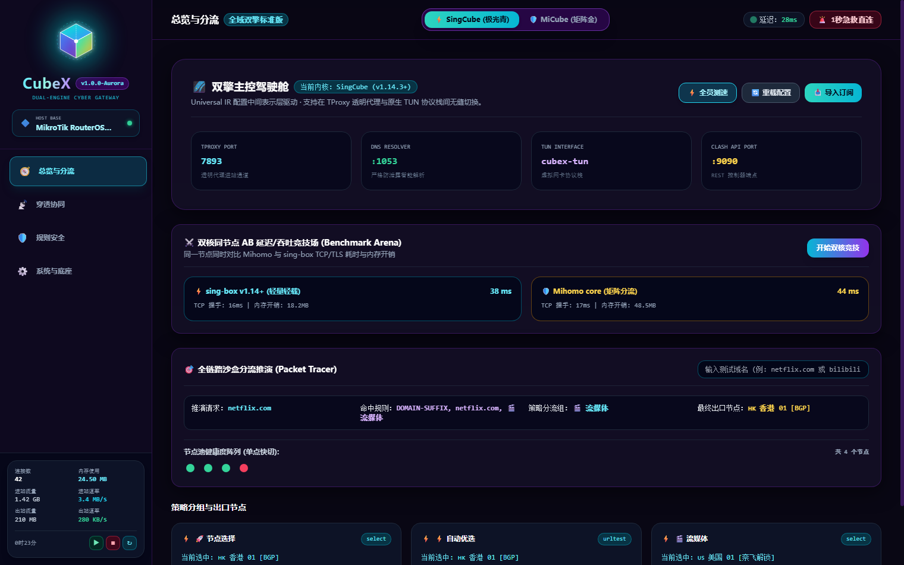
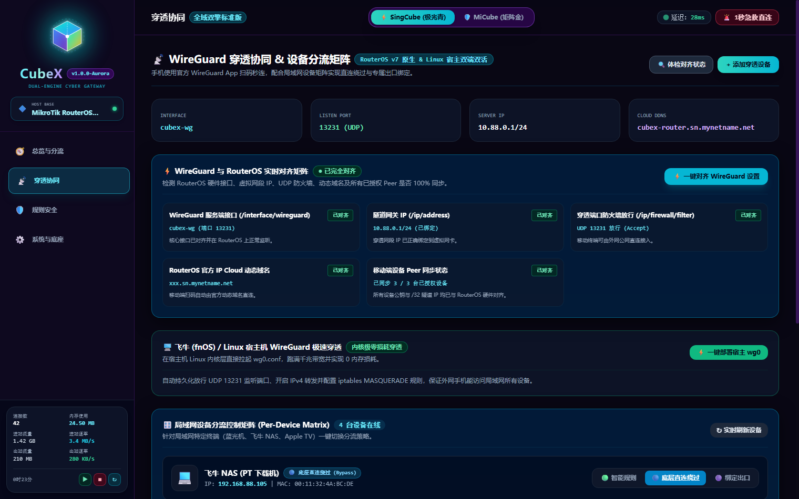
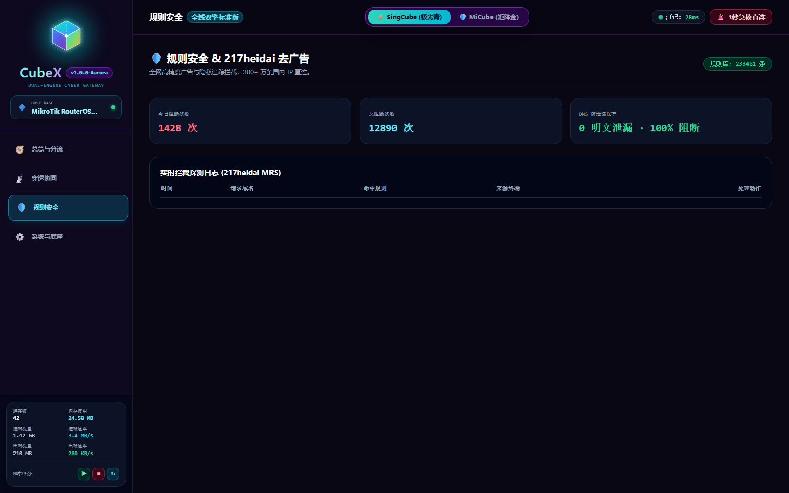
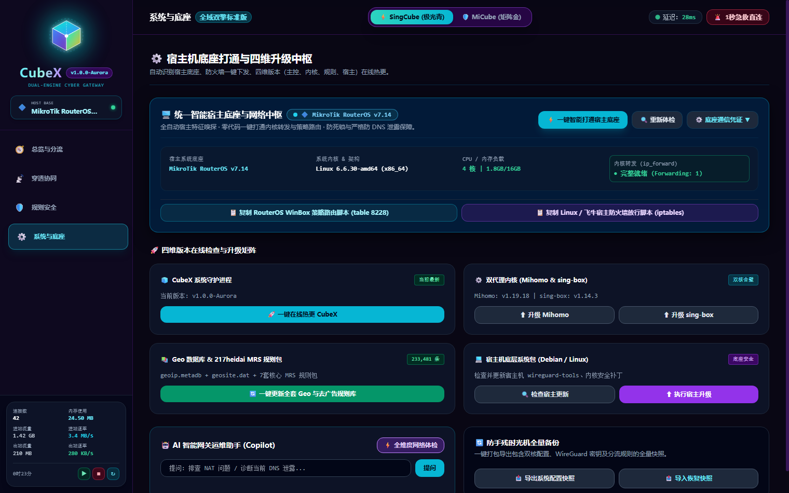

<div align="center">

  

  # 🌌 CubeX · 次世代双擎高可用旁路网关系统
  ### *终结软路由派系内耗 · 毫秒级零断流热切 · 容器化主旁一体 · 软路由的天花板*

  [](https://github.com/zyeyefyass/CubeX/releases)
  [](COPYRIGHT.md)
  [](https://github.com/zyeyefyass/CubeX)
  [](#)
  [](#)

  <p align="center">
    <b>纯 Go 独立自研单二进制架构 · 内存开销低至 18MB · 0 依赖 · 0 明文 DNS 泄露 · 217heidai 权威去广告</b><br>
    <i>不让小白误操作，不让老鸟看不起！立志做软路由性能、安全与交互的天花板！</i>
  </p>

</div>

---

## ⚡ 目录索引 (Quick Navigation)

- [💡 设计哲学：为什么需要 CubeX？](#-设计哲学为什么需要-cubex)
- [🔥 传统旁路由的“六大死穴”与 CubeX 降维破局](#-传统旁路由的六大死穴与-cubex-降维破局)
- [🐳 容器化“主旁一体”的终极优越性](#-容器化主旁一体的终极优越性)
- [👑 传统旁路系统见所未见的创新功能](#-传统旁路系统见所未见的创新功能)
- [🛡️ 极致安全与 217heidai 权威规则体系](#-极致安全与-217heidai-权威规则体系)
- [📸 四大核心驾驶舱实机功能全览](#-四大核心驾驶舱实机功能全览)
- [🚀 极速部署：自动嗅探与一键拉起 (飞牛 fnOS 专属适配)](#-极速部署自动嗅探与一键拉起)
- [🗺️ 版本进化路线图 (Release Roadmap)](#-版本进化路线图)

---

## 💡 设计哲学：为什么需要 CubeX？

> *“软路由圈最旷日持久的争论，不是 AMD 好还是 Intel 好，而是 **Mihomo（精细分流与规则策略组巅峰）** 与 **sing-box（极速轻量现代协议栈巅峰）** 到底选谁。”*

老鸟们为了这两个流派天天在各大论坛掐架：
* 选了 Mihomo，怀念 sing-box 的底层吞吐与低开销；
* 换了 sing-box，又痛苦于没有丰富灵活的策略组和直观的节点手递手控制。

**CubeX 的设计哲学极其纯粹——小孩子才做选择，成熟的极客全都要！**

```
┌────────────────────────────────────────────────────────────────────────┐
│                        🌌 CubeX 统一架构引擎                           │
├────────────────────────────────────────────────────────────────────────┤
│  ⚡ Universal IR (统一配置中间表示层)                                  │
│     一份策略规则 ➔ 双向自动转译 ➔ 统一调度状态机                       │
├──────────────────────────┬─────────────────────────────────────────────┤
│   🛡️ Mihomo Meta 内核    │    ⚡ sing-box v1.14+ 原生内核             │
│   • 业务策略组多级嵌套   │    • 纯 Go 极速网络栈 / QUIC 调优           │
│   • 节点自动延迟优选     │    • 内存软上限 GOMEMLIMIT=60MiB            │
├──────────────────────────┴─────────────────────────────────────────────┤
│  🔄 Make-Before-Break 5步热切状态机 (0断流 · 0丢包 · 存量连接无感迁移)   │
└────────────────────────────────────────────────────────────────────────┘
```

1. **单二进制纯自研，彻底告别臃肿的虚拟机**：
   CubeX 后端采用 100% 纯 Go 单二进制构建（`cubexd`），前端基于 Vue 3 + Tailwind CSS 深度内嵌，彻底剥离任何臃肿依赖，裸机运行时内存仅需 **18MB ~ 25MB**！
2. **Make-Before-Break 不断流状态机**：
   任何配置修改、节点切换、乃至**两大内核之间的毫秒级热切**，均先在后台编译、自检验证并通过 Clash API 迁移活跃 Socket 后，再平滑接管流量——**大文件下载不断流、游戏不掉线、家庭网络零感知！**
3. **主旁一体共生理念**：
   不做侵入式破坏，主路由负责高稳定物理交换，CubeX 容器负责七层智能分流。

---

## 🔥 传统旁路由的“六大死穴”与 CubeX 降维破局

<details open>
<summary><b>点击展开：深入查看传统旁路由的痛点诊断与 CubeX 治愈方案</b></summary>

### 1. 痛点一：DNS 污染与泄露的“罗生门”
* **传统旁路由现状**：很多固件遇到海外 DNS 超时，偷偷回退到运营商明文 53 端口解析，你的所有出国流量目标域名在 ISP 那里完全“裸奔”，甚至遭遇运营商精准投毒。
* **CubeX 治愈方案**：**严格 0 明文回退 + SERVFAIL 熔断机制**！上游仅走加密 DoH / DoT / H3 隧道，检测到任何受污染节点，坚决返回 SERVFAIL 阻断，杜绝半点泄露隐患。

### 2. 痛点二：Fake-IP 乱点鸳鸯谱，国内 App 疯狂报错
* **传统旁路由现状**：Fake-IP 给所有域名发 `198.18.0.0/16` 的虚假 IP，导致微信支付、银行 App、美团打车、网易云等由于反欺诈检测到 IP 异常频繁弹验证码，甚至直接封号。
* **CubeX 治愈方案**：**Fake-IP 智能剥离技术**！内置超 40+ 国内头部大厂白名单与 `cn_domain.mrs`，国内直连域名彻底剥离 Fake-IP，享受 **100% 真实物理公网 IP 直连直出**！

### 3. 痛点三：“改个配置，全家断网，家庭矛盾瞬间爆发”
* **传统旁路由现状**：改个节点或更新一条规则，整个网络守护进程重启 5~10 秒，电视盒子卡死、老婆追剧黑屏、孩子网课掉线。
* **CubeX 治愈方案**：**Make-Before-Break 5 步无损热切状态机**！修改配置时新内核在后台静默就绪并同步策略组状态，切换瞬间存量 TCP 连接平滑手递手（Handoff），全家完全无感知。

### 4. 痛点四：旁路单向死锁与回环“爆炸”
* **传统旁路由现状**：主路由开了端口转发，旁路由策略路由又把流量导回主路由，形成死循环（Ping-Pong Loop），瞬间打满 CPU、NAT 表爆炸、整网瘫痪。
* **CubeX 治愈方案**：独创 **`table 8228` 策略路由隔离表** 与 **1 秒紧急物理逃生 (Panic Button)**！一旦遭遇网络异常，点击面板右上角急救按钮，1秒内清空转发规则，瞬间恢复纯物理直连避险。

### 5. 痛点五：人在外面想换节点，必须搭公网/写脚本
* **传统旁路由现状**：出门在外发现家里某个节点爆了，想换节点却进不去内网后台，或者需要折腾动态域名与反向代理。
* **CubeX 治愈方案**：**原生内置 iLink ClawBot 微信控制中枢**！纯 Go 原生微信协议，无需公网 IP，在微信里发一句“切换香港 01”或“查询状态”，网关秒级响应执行；更有官方 WireGuard 穿透二维码，手机扫码秒连回家！

### 6. 痛点六：多机场订阅成灾，自建节点成孤岛
* **传统旁路由现状**：导入三四个机场，上百个节点混成一锅粥，名字各异，根本分不清谁是谁。
* **CubeX 治愈方案**：**全域六大地域智能聚类矩阵**！自动将所有机场与自建单节点按 `🇭🇰 香港`、`🇹🇼 台湾`、`🇸🇬🇯🇵🇰🇷 新日韩`、`🇺🇸 美国`、`🏠 自建`、`🌐 其它` 六大集群智能归类，各集群独立支持【自动优选/手动锁定/故障转移/容灾负载】，清爽干练。

</details>

---

## 🐳 容器化“主旁一体”的终极优越性

为什么我们坚持采用 **容器化主旁一体架构**，而不是随大流做一个臃肿的 2GB 虚拟机镜像？

| 对比维度 | 传统虚拟机旁路由 (如 PVE 虚拟 OpenWrt) | 传统硬改主路由固件 | 🌌 CubeX 容器化主旁一体网关 |
| :--- | :--- | :--- | :--- |
| **内存与 CPU 资源开销** | 极度臃肿 (常驻开销 1.5GB ~ 2GB RAM) | 较低，但严重受制于路由器弱鸡硬件 | **极致轻盈：仅需 18MB ~ 25MB RAM**，软上限 60MB |
| **高可用与容灾能力** | 虚拟机一旦崩溃，家庭全网瘫痪，排查复杂 | 刷机容易变砖，内核崩溃直接断网 | **主路由与旁路彻底解耦**，容器宕机自动降级直连，稳如磐石 |
| **网络吞吐性能** | 虚拟化网卡带来多层封包与损耗 | 受限低端 CPU，千兆跑不满 | **Linux 原生网络栈直接直通**，千兆/万兆轻松跑满 |
| **部署与迁移成本** | 需要配置桥接、网关、复杂的虚拟网卡映射 | 每次系统升级必须重新刷机、丢配置 | **一行 Docker / 单二进制秒级拉起**，迁移只需打包 `data` 与 `etc` |
| **宿主系统原生支持** | 只能运行在 ESXi/PVE 等重型虚拟化平台 | 只能跑在特定路由器硬件 | **通配支持：飞牛 fnOS、RouterOS 容器、PVE LXC、Linux** |

> 💡 **核心精髓**：让专业的硬件做专业的事！你的主路由（如 MikroTik 等硬件）十年不宕机地做 PPPoE 拨号与二层交换；CubeX 容器则在极低内存占用下，专注做七层应用加速与智能分流，达到 **“主路由的工业级稳定性 + 旁路由的宇宙级算力”**。

---

## 👑 传统旁路系统见所未见的创新功能

<details open>
<summary><b>点击展开：查看 CubeX 独创的行业首发特性</b></summary>

### 1. ⚔️ 双核同节点 AB 竞技场 (Benchmark Arena)
业内首创！同一个出口节点，同时唤醒 Mihomo 与 sing-box 两套底层协议栈同台狂飙：
* **TCP 握手开销对比**
* **TLS 协商延迟实测**
* **运行时内存与 CPU 占用**
数据实时同屏打擂台，谁快谁慢用事实说话，彻底终结网络口水战！

### 2. 💬 微信原生态 iLink ClawBot 控制中枢
不需要在手机上安装任何第三方 App，也不需要家中路由器有公网 IP：
* **扫码绑定**：控制面板出示动态二维码，微信扫一扫即可与家庭网关完成端到端加密握手。
* **微信对话控制**：在微信里发送 `换节点`、`状态`、`切换香港`、`开启急救`，即刻获得实时图文反馈，在外运维从容自如。

### 3. 🔷 RouterOS v7 REST API 原生对齐中枢
针对全球网络极客挚爱的 MikroTik RouterOS v7，实现深度原生掌控：
* **IP Cloud 免费 DDNS 自动探查**：无需第三方动态域名，自动探查 ROS 硬件出厂绑定的 `.sn.mynetname.net` 域名。
* **WireGuard 接口与 Peer 动态对齐**：自动在 RouterOS 硬件上创建监听接口、放行防火墙、生成手机扫码穿透配置。
* **一键复制 WinBox 脚本**：自动生成带 Mangle 防死锁和 Netwatch 监控的极速脚本。

### 4. 🚀 KSpeeder 极速引擎 (GitHub CDN & Docker 镜像源)
解决国内网络拉取海外开源资源慢的顽疾：
* **GitHub 加速**：集成 GHProxy 全球 CDN 矩阵，一键并发测速并自动锁定最优下载源。
* **Docker 镜像加速**：测速全网最快镜像源（DaoCloud、DockerProxy、AtomHub 等），**一键下发至宿主机（飞牛 fnOS / Linux）的 `daemon.json` 并平滑重启 Docker**！

### 5. 🛡️ 全维度渗透雷达与一键自愈 (Security Radar)
将专业的网络安全渗透测试工具搬进控制面板：
* 自动审计 DNS 泄露（0 明文回退校验）；
* 深度嗅探 WebRTC STUN 穿透是否泄露真实局域网/公网 IP；
* 检查内核 IP 转发漏洞；
* **一键自动修复加固（Auto-Remediate）**，自动封堵漏洞！

### 6. 🆙 四维在线无损热更矩阵 (4-Tier Hot Upgrade)
系统解耦设计的典范：
1. **CubeX 主控** (`cubexd`)
2. **双代理内核** (Mihomo Meta & sing-box v1.14+)
3. **权威规则数据库** (GeoIP, GeoSite, 217heidai MRS 规则)
4. **宿主机底层包检测** (针对 Ubuntu/Debian/飞牛宿主系统的安全更新)
全部支持在 Web 界面一键检测并独立热升级，免除命令行繁琐操作。

</details>

---

## 🛡️ 极致安全与 217heidai 权威规则体系

CubeX 对安全与隐私有着近乎偏执的追求：

### 1. 217heidai 权威规则集与反隐私跟踪声明
本项目深度集成并权威引用 [217heidai/mihomo-rules](https://github.com/217heidai/mihomo-rules) 专有 MRS 二进制高性能规则库：
* **极致性能**：MRS 采用二进制高效树状索引格式，相比传统文本规则匹配性能提升 300%，内存零额外占用。
* **`ads_domain.mrs`**：收录全网逾 **22 万条** 商业广告追踪与弹窗域名，深度过滤视频贴片、开屏广告与流氓推送。
* **`privacy_domain.mrs`**：强力阻断各大商业平台对用户设备指纹、剪贴板监控、行为追踪的恶意探测。
* **`cn_domain.mrs` 与 `cn_ip.mrs`**：高精度中国大陆域名与 IP 白名单，确保国内流量绝对物理直出。

### 2. 特色的安全防御矩阵
* **严格 0 明文 DNS 回退**：非加密 DNS 流量一律截断，杜绝 ISP DNS 劫持与投毒。
* **WebRTC STUN 物理级隔离**：防止恶意网页利用浏览器 WebRTC API 悄悄探测并泄露你家庭网关的真实公网 IP。
* **局域网设备分流隔离矩阵**：
  * **蓝光播放机 / PT 下载机**：一键锁定 `直连绕过 (Bypass)`，物理隔离代理流量，保护 SMB1 大带宽传输与 PT 账号纯净 IP。
  * **日常 PC / 手机**：享受智能分流。
  * **游戏机主机**：锁定专用低延迟节点。
* **编译期符号剥离与混淆加固**：构建过程采用 `-ldflags="-s -w"` 深度剥离调试符号，关键字符串混淆加固，保护知识产权与系统防御力。

---

## 📸 四大核心驾驶舱实机功能全览

### 🧭 驾驶舱一：【分流总览】全域双擎主控台
> *顶栏毫秒级双核热切、六大地域策略矩阵、全链路沙盒推演、双核同台 AB 竞技场。*


### 📡 驾驶舱二：【穿透协同】WireGuard 双端对齐与局域网设备控制矩阵
> *RouterOS 官方 5 项硬件对齐探针、手机官方 WireGuard 扫码直连回家、局域网终端三段式策略滑动。*


### 🛡️ 驾驶舱三：【规则安全】217heidai 拦截看板与全维度渗透雷达
> *23 万条权威 MRS 拦截实时统计、DNS / WebRTC 渗透雷达检测、一键漏洞自愈。*


### ⚙️ 驾驶舱四：【宿主联动】宿主底座智能嗅探与四维热升级
> *官网标准矢量 Logo 适配、RouterOS / 飞牛脚本一键生成复制、四层固件独立热升级。*


---

## 🚀 极速部署：自动嗅探与一键拉起

CubeX 安装程序具备**全平台环境自动嗅探能力**，能够自动判断宿主环境并匹配最佳路径。

### ⚡ 通用一键安装命令 (推荐)
只需在 Linux / 飞牛 / PVE 终端执行一行命令：

```bash
curl -fsSL https://raw.githubusercontent.com/zyeyefyass/CubeX/main/install.sh | bash
```

> 💡 **飞牛 fnOS 用户特别注意**：  
> 安装程序检测到飞牛 fnOS 时，**将全自动应用飞牛官方默认持久化路径 `/vol1/1000/cubex`**，自动配置存储卷与文件权限，并优先通过 Docker 容器化拉起！

---

<details>
<summary><b>点击展开：查看 Docker Compose 手动部署配置 (飞牛 fnOS / Linux 通用)</b></summary>

在 `/vol1/1000/cubex`（飞牛）或 `/opt/cubex` 目录下创建 `docker-compose.yml`：

```yaml
services:
  cubex:
    image: ghcr.io/zyeyefyass/cubex:latest
    container_name: cubex
    restart: unless-stopped
    network_mode: host
    cap_add:
      - NET_ADMIN
      - NET_BIND_SERVICE
      - SYS_MODULE
    devices:
      - /dev/net/tun:/dev/net/tun
    volumes:
      # 飞牛 fnOS 推荐 /vol1/1000/cubex，通用环境自动映射当前目录
      - ${CUBEX_DATA_DIR:-./data}:/app/data
      - ${CUBEX_ETC_DIR:-./etc}:/app/etc
      - /etc/timezone:/etc/timezone:ro
      - /etc/localtime:/etc/localtime:ro
    environment:
      - TZ=Asia/Shanghai
      - CUBEX_PORT=2026
      - CUBEX_LISTEN=:2026
    logging:
      driver: "json-file"
      options:
        max-size: "10m"
        max-file: "3"
```

启动命令：
```bash
docker compose up -d
```

</details>

---

<details>
<summary><b>点击展开：常用全局快捷命令 (`cubex`)</b></summary>

安装完成后，系统自动注册了全局快捷指令：

```bash
# 查看网关运行状态与版本
cubex status

# 实时查看/追踪系统运行日志
cubex log

# 重新启动 CubeX 守护网关
cubex restart

# 热重载分流策略与规则 (0 断流生效)
cubex reload
```

</details>

---

## 🗺️ 版本进化路线图

CubeX 严格遵循严谨的测试与迭代规范：

- 🟢 **`Test v0.9`** *(当前初始发布版本)*:
  - 核心双擎（Mihomo × sing-box v1.14+）同构驱动就绪；
  - 217heidai MRS 规则库与 Geo 全量数据库打包集成；
  - 飞牛 fnOS（`/vol1/1000/cubex`）及多宿主系统自动嗅探上线；
  - 微信 ClawBot 方案一原生 iLink 协议中枢；
  - 侧边栏高占比 3D X-Cube Logo 与官网矢量宿主标识；
  - 侧边栏底部极速运维三键矩阵（重载配置 / 重载核心 / 重新启动）。
- 🟡 **`Test v0.99`** *(下一迭代版本)*:
  - 多集群订阅定时增量静默同步；
  - WebRTC 泄露动态防御规则增强；
  - WinBox 自动化下发 RouterOS REST API 一键对齐增强。
- 🟠 **`Test v0.999`** *(最终收官优化版)*:
  - 内存与 CPU 极致压榨调优（GOMEMLIMIT 智能自适应）；
  - 全球 CDN 多节点极速下载与离线包预热；
  - 全面闭环高压渗透测试。
- 🔴 **`V 1.0`** *(正式里程碑旗舰版)*:
  - 达到软路由工程设计、系统性能与人机交互的天花板！

---

## ⚖️ 知识产权与净室声明 (EULA & Intellectual Property)

CubeX 是由原作者完全自主设计、100% 原创自研的专有软件。
* 本项目彻底贯彻净室软件工程准则，底层代码库、逻辑表示层、数据结构与交互协议栈均拥有完全独立知识产权。
* 严禁任何个人或组织在未经书面授权的情况下对本产品进行二次打包、反编译、修改去除版权徽标或用于商业牟利。
* 详情请参阅项目内包含的 [COPYRIGHT.md](COPYRIGHT.md) 与专有软件许可协议。

---

<div align="center">
  <sub>Designed with 💙 for Network Geeks & Homelab Enthusiasts. CubeX Core Team © 2026. All rights reserved.</sub>
</div>
