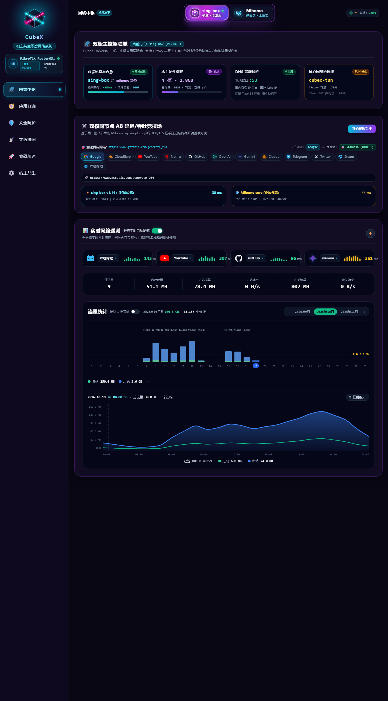
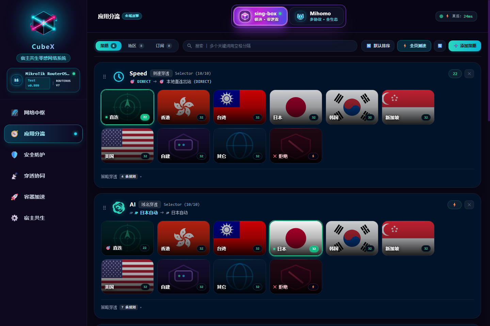
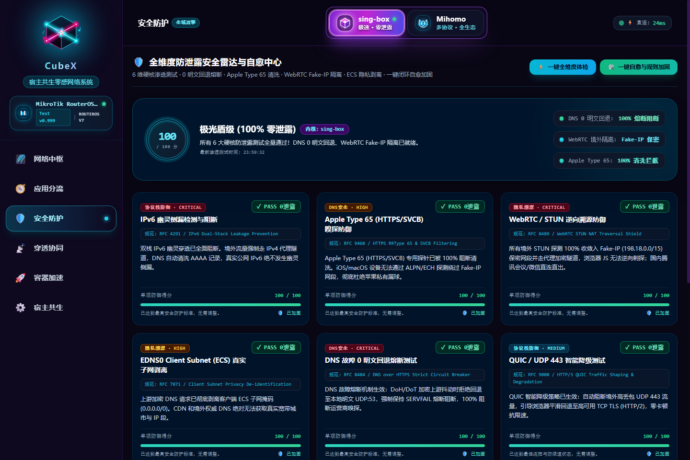
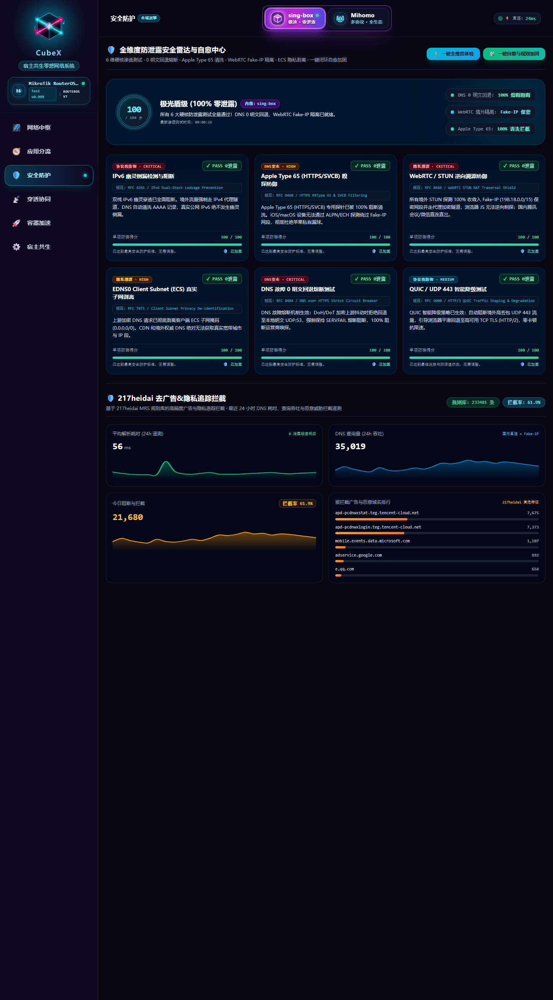
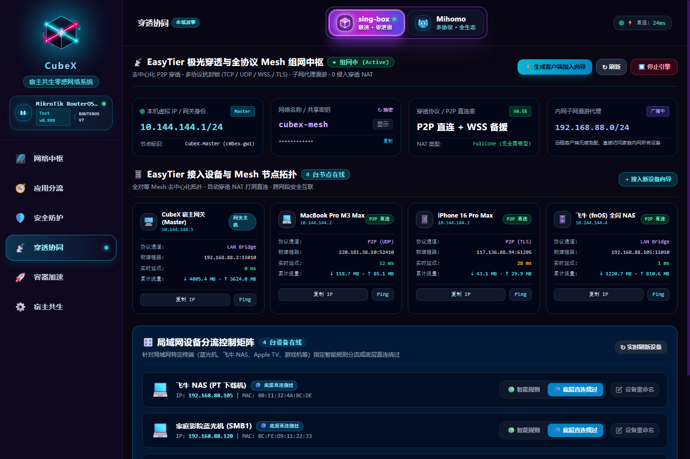
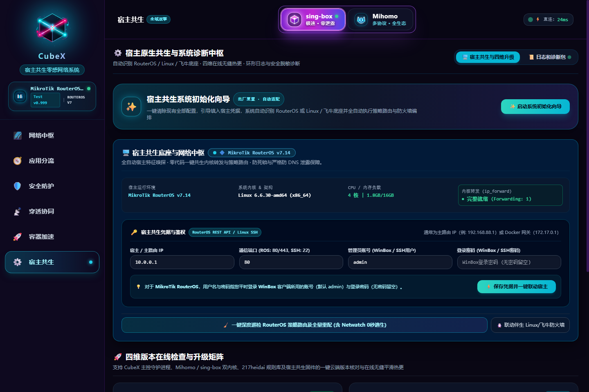

<div align="center">

  

  # 🌌 CubeX · 宿主共生零感网络系统 (Host-Symbiotic Zero-Perception Gateway)
  ### *单二进制纯自研 · 告别传统重型虚机旁路 · 18MB 极限微核 · 300ms 冷启 · 宛如物理肉身直连全球互联网的终极共生体*

  [](https://github.com/zyeyefyass/CubeX/releases)
  [](COPYRIGHT.md)
  [](https://github.com/zyeyefyass/CubeX)
  [](#)
  [](#)

  <p align="center">
    <b>纯 Go 独立自研单二进制架构 · 常驻内存 18MB~50MB · 0 侵入 0 依赖 · 0 明文 DNS 泄露 · 217heidai 权威去广告</b><br>
    <i>不让小白误操作，不让老鸟看不起！立志做软路由性能、安全与颜值的天花板！</i>
  </p>

</div>

---

> [!IMPORTANT]
> ### 📜 郑重声明与合规免责条款 (Legal & Compliance Statement)
> 1. **学术与技术探索**：本项目属于网络协议栈架构、双引擎动态容灾调度、旁路透明路由与自动化运维的**纯技术探索、工程实践与学术交流**。
> 2. **合法用途界定**：本系统仅面向**合规跨境电商进出口贸易、跨国协同办公、前沿 AI 学术研究与大模型接入、高校与科研院所国际技术交流**等正当合法场景。
> 3. **严格遵规守法**：使用者须严格遵守所在国家与地区的法律法规及行业监管准则。**严禁任何个人或组织将本系统用于任何违反国家法律法规、侵害网络安全利益、散播违规信息或触碰敏感话题与政治红线的非法活动**。
> 4. **免责与自律约定**：软件作者及维护者不对任何第三方非法违规使用本系统所导致的直接或间接法律责任承担连带责任。获取、编译、部署或运行本系统即代表完全知悉并承诺自觉遵守本条款。

---

> [!TIP]
> ### 📢 站长咆哮式前言：为什么说 Test v1.3 是“最接近正式版”的封神版本？
> **致所有曾经被传统旁路由折磨到怀疑人生的老铁们：**
> 
> 你是否经历过这些崩溃瞬间：
> 1. 为了开个代理，不得不拉起整整 4GB 内存的 OpenWrt 虚拟机，风扇狂转像拖拉机？
> 2. 旁路由手贱重启一下，全家瞬间断网，老婆摔门而出，智能家居集体“失联升仙”？
> 3. 国内测速连宽带一半都跑不到，主路由 CPU 100% 满载烤鸡蛋，排查半天发现是旁路由把全家流量包了顿饺子？
> 4. 满心欢喜切到 Mihomo，结果 Gemini 给你弹个大红三角报 `ERR_CERT_COMMON_NAME_INVALID`（证书无效），让你怀疑是不是被 FBI 盯上了？
> 
> **别慌！这些地狱级折磨，在今天发布的 `Test v1.3` 版中已被彻底送入历史垃圾桶！**  
> 
> 经过数十个日夜与真实万兆/千兆家庭物理网络的死磕，**CubeX Test v1.3 正式达成了从架构到体验的全面质变**：
> * 🏎️ **双核心全线满血**：`sing-box v1.14+` 与 `Mihomo v1.19+` 双核混动平滑手递手（Handoff），实测切换耗时低至 **560ms**，常驻内核真实物理内存 (VmRSS) 仅 **15MB~30MB**！
> * 🌐 **双栈 IPv4-First 极速拨号（Happy Eyeballs）**：消除无默认 IPv6 路由主机下 AAAA 记录卡死订阅或镜像拉取的顽疾，秒级自动回退！
> * 🔒 **原子化 0600 安全落盘保护**：所有敏感配置、WireGuard 密钥及宿主凭证全面采用临时文件 + 0600 严格权限 + 原子替换，杜绝泄漏与并发损坏；
> * 🧭 **应用分流 3-in-1 全景指南**：README 全面扩充订阅/节点分类机制、地区分组与自建分组来源、策略排序与基石保护深度解析；
> * ⚡ **国内满带宽直通（主路由 CPU 仅 1%）**：独创「主网关 + 旁路 DNS」配合 RouterOS FastTrack 硬件加速，国内流量走物理线速狂飙；
> * 🛡️ **RFC 2544 完整网段回指**：升级为 `198.18.0.0/15` 全域回指，彻底根治假 IP 漏往光猫引发的证书错误；
> * 🛑 **ICMP Send-Redirects 绝杀**：全自动关闭主路由 ICMP 重定向，消灭二层三角路由丢包与“老太太过马路式”TCP 停顿！
> 
> 🚀 **这是目前为止最稳定、最成熟的里程碑版本 (Test v1.3)！**  
> 我们强烈推荐大家下载体验，无论你是 RouterOS 骨灰级玩家、飞牛 fnOS 用户、PVE 极客还是普通家庭折腾党，欢迎试用并**畅所欲言提出优化建议和新功能需求**！

---

## ⚡ 极速导航 (Table of Contents)

- [📸 全息驾驶舱实机功能大赏 (图文速览)](#-全息驾驶舱实机功能大赏-图文速览)
- [🧬 核心定性：为什么是“宿主共生”？](#-核心定性为什么是宿主共生)
- [🧭 架构决胜：为什么坚定采用「主网关 + 旁路 DNS」黄金解耦？](#-架构决胜为什么坚定采用主网关--旁路-dns黄金解耦)
- [✨ 破冰体验：首次引入「初次安装初始化向导」](#-破冰体验首次引入初次安装初始化向导)
- [🛡️ 创举：三维高可用调度总线（自动 · 故转 · 跨区多活容灾）](#-创举三维高可用调度总线自动--故转--跨区多活容灾)
- [🥊 传统旁路由的“五大死穴”与 CubeX 降维打击](#-传统旁路由的五大死穴与-cubex-降维打击)
- [⚡ 双核混动实测：sing-box vs Mihomo 对比天梯](#-双核混动实测sing-box-vs-mihomo-对比天梯)
- [🧹 一键自愈与深度巡检重器：拯救网络的降压药](#-一键自愈与深度巡检重器拯救网络的降压药)
  - [🌐 原生 IPv6 双栈自愈与加固深度剖析 (配置与防火墙机制)](#3-原生-ipv6-双栈自愈与加固深度剖析到底配置了什么防火墙如何运作)
- [🚀 极速部署指南 (RouterOS / Docker / fnOS / PVE)](#-极速部署指南)
- [💬 极客畅所欲言：意见征集与需求大厅](#-极客畅所欲言意见征集与需求大厅)
- [📜 净室合规与免责声明](#-净室合规与免责声明)

---

## 📸 全息驾驶舱实机功能大赏 (图文速览)

> [!NOTE]
> *全站 UI 采用 100% 独立构建的 **Cyber Aurora 赛博极光 × MikroTik 科技深蓝美学**，高质感全息毛玻璃 (`backdrop-blur-xl`)，彻底告别粗糙古董的前端陈旧感！*  
> *所有展示截图均已通过自动化脱敏引擎审计，敏感订阅、私有节点与密钥信息均已抹除。*

### 1. 全息网络中枢 · 双擎竞技与实时流量图谱
支持一键秒级切换 `sing-box` 与 `Mihomo`，同台进行 TCP/TLS 握手延迟、内存开销与吞吐率的极限竞技；全域 24 小时流量曲线直观掌控。

<div align="center">
  
</div>

---

### 2. 应用分流矩阵 · 国家地区卡片与业务直达
涵盖 AI（ChatGPT/Claude/Gemini）、YouTube、Google、GitHub、Docker、Telegram、Steam 等全场景策略分流；支持一键测速与节点排序，纯净无广告。

<div align="center">
  
</div>

---

### 3. 全维度安全雷达 · 6 维防泄露与 100 分极光盾
0 明文 DNS 回退、Apple Type 65 探针阻断（杜绝 Safari 漏球）、WebRTC Fake-IP 保密隔离、EDNS0 真实子网剥离、QUIC 智能降级，让内网处于绝对安全状态。

<div align="center">
  
</div>

---

### 4. 权威广告过滤 · 217heidai MRS 纯内核级拦截
深度集成 217heidai 权威规则库（MRS 高性能二进制格式），直接在 DNS 与路由入口处毫秒级掐灭视频前贴片、流氓开屏广告与全域追踪探针。

<div align="center">
  
</div>

---

### 5. 穿透协同 · EasyTier 全协议 Mesh 与设备分流
去中心化 P2P 穿透、多协议抗封锁（TCP/UDP/WSS/TLS）、子网代理漫游，免公网 IP 实现异地局域网大合体；局域网终端独立设备直连/代理按需勾选。

<div align="center">
  
</div>

---

### 6. 宿主共生底座 · 工业级一键深度巡检与全量重配
全自动嗅探 RouterOS / Linux / 飞牛底座，一键下发纯净策略路由表，彻底清理历史 Mangle 抢流与 DNS 53 端口强制劫持，配套 3 秒 Netwatch 宕机零感逃生。

<div align="center">
  
</div>

---

## 🧬 核心定性：为什么是“宿主共生”？

在许多人的既有认知中，旁路由总像一个**“赖在主路由身上的寄生虫”**：动不动就强行劫持全网流量、偷偷乱改 Mangle 规则，一旦它挂了，全家连路由器后台都进不去。

**CubeX 从底层架构逻辑上坚决否定这种“寄生”，确立了“共生 (Symbiosis)”体系**：

```text
┌────────────────────────────────────────────────────────────────────────┐
│                   🧬 CubeX 宿主共生架构极速解耦模型                   │
├────────────────────────────────────────────────────────────────────────┤
│  [硬件宿主: RouterOS / PVE / fnOS]                                      │
│  ├── 专心做好物理网络：PPPoE 拨号、万兆交换、物理防火墙、FastTrack 硬件加速 │
│  └── 绝不参与七层繁重协议解析，CPU 占用长年保持在 1%~3% 的极低能耗状态  │
│                                   │                                    │
│             二层物理隔离          │ 旁路 Fake-IP 隧道 (198.18.0.0/15)  │
│             (VETH / Bridge)       ▼                                    │
│  [CubeX 伴生微核容器 (18MB 内存 / 300ms 冷启)]                         │
│  ├── 专注于：七层智能分流、双引擎容灾、严格 0 DNS 泄露、广告清洗       │
│  └── 宕机或重启对宿主物理网络 0 侵入、0 损伤，Netwatch 0秒瞬间降级直连 │
└────────────────────────────────────────────────────────────────────────┘
```

> [!IMPORTANT]
> ### 👑 极客金律：【宿主联动】是 CubeX 系统最最最重要的第一步！
> **“与宿主连通，是一切全自动化编排、极速物理直通与最高等级安全的绝对基石。”**
> 
> 在过去，传统旁路由之所以脆弱、易卡顿甚至断网，根源就在于它们和主路由器处于**“彼此失联的孤立状态”**：旁路由不知道主路由路由表长什么样，主路由不知道旁路由是死是活，两边各搞各的，稍微改错一条规则全家断网。  
> 
> 而 CubeX 的核心灵魂在于**【宿主原生深度联动】**：
> 1. **主控权限打通**：在初次初始化向导中（或控制台【宿主共生】页面），填入主路由（如 MikroTik RouterOS）的通信凭证并完成握手连通；
> 2. **化身主路由控制大脑**：一旦与宿主建立通信联动，CubeX 便拥有了对主路由的秒级编排能力——**全自动重铸策略路由表、自动打通 RFC 2544 标准 `198.18.0.0/15` 完整回指、自动关闭 send-redirects 掐死三角重定向丢包、自动为 FastTrack 硬件加速注入白名单，并注入 3 秒 Netwatch 极速逃生探针**；
> 3. **最高等级安全护航**：只有成功联动宿主，才能从根本上构筑起「0 明文 DNS 泄露」、「海外 IPv6 快速拒答」、「防局域网设备公网裸奔」与「同网段任意 IP 自由共存」的电信级高可用防护网！
> 
> 💡 **请牢记：部署 CubeX 后的最核心第一步，就是完成宿主连通！基石打牢，全局自愈！**

---

## 🧭 架构决胜：为什么坚定采用「主网关 + 旁路 DNS」黄金解耦？

这是所有软路由玩家必须认清的最关键网络命题：**为什么 CubeX 绝不推荐粗暴地把终端网关指向旁路由，而是坚决采用「主网关 + 旁路 DNS」？**

### ❌ 传统“全包型”旁路由（网关指旁路）的三大死穴：
1. **网卡双向折返跑，千兆宽带直接腰斩**：  
   终端要看个腾讯视频或访问内网 NAS，数据包必须走：`终端 -> 交换机 -> 旁路由网卡 -> 交换机 -> 主路由 -> 光猫`。单网口全双工带宽被双向重叠流量挤爆，软路由 CPU 100% 满载，千兆宽带实测不到 500Mbps！
2. **单点暴毙，全家失联“升仙”**：  
   大订阅加载突发内存尖刺导致容器崩溃，或者手残改错一个出站，全家瞬间断网。不仅上不了网，甚至连主路由的管理后台都进不去！
3. **ICMP Send-Redirects 三角重定向丢包风暴**：  
   终端、主路由与旁路由同在二层局域网，主路由默认发送 ICMP 重定向，导致 Windows / iOS 频繁出现 TCP 握手停顿、卡顿与无故重传。

### ✅ CubeX「主网关 + 旁路 DNS」的降维打击机制：
```text
【终端发起网络请求】
         │
         ▼
[1. DNS 查询] ───────────────────────────► 【CubeX 旁路 DNS (10.0.0.11)】
                                                      │
                       ┌──────────────────────────────┴──────────────────────────────┐
                       ▼                                                             ▼
              [🇨🇳 国内域名 (如百度/微信)]                                   [🌐 国外/加速域名 (如 Google/GitHub)]
                       │                                                             │
             返回真实公网 IP (直连)                                          返回 Fake-IP (198.18.0.0/15)
                       │                                                             │
                       ▼                                                             ▼
         【主路由网关 (10.0.0.1)】                                      【主路由网关 (10.0.0.1)】
                       │                                                             │
         主路由 FastTrack 硬件加速                                     命中静态路由: 198.18.0.0/15 -> 10.0.0.11
                       │                                                             │
                       ▼                                                             ▼
              【⚡ 满速直出光猫】                                           【🚀 转入 CubeX 容器双引擎代理出海】
         (跑满千兆/万兆，主路由 CPU 仅 ~1%)                                (Mihomo / sing-box 秒级混动出海)
```

- **国内大流量 100% 物理线速直出**：国内流量与局域网传输**根本不走 CubeX 容器**，直接被主路由芯片硬件加速线速转发，主路由 CPU 仅 ~1%！
- **国外流量 Fake-IP 精准截获**：只有命中 `198.18.0.0/15` 的真正出海流量，才经由主路由一条轻量静态路由递交给 CubeX，零浪费、零折返！
- **宕机零感逃生**：就算 CubeX 容器宕机或重启，主网关依然健在，国内访问完全无感；配套 3 秒 Netwatch 探针自动切换备用 DNS，全家绝不断网！

---

### ❓ 各宿主底座「一键配置」全自动能力透视

很多朋友会问：**“在 CubeX 控制台点击「一键配置」后，所有宿主机都能全自动实现「主路由网关 + 旁路 DNS」吗？”**  
技术真相是：**这取决于「宿主机底座」与「外置主路由的类型」**：

| 宿主底座环境 | 宿主机内部配置 | 外置主路由配置 | 一键配置能否全自动达成？ | 推荐操作指南 |
| :--- | :--- | :--- | :--- | :--- |
| **MikroTik RouterOS 容器** | 100% 全自动 | 100% 全自动 | **✅ 100% 全自动达成** | 控制台点击【一键配置】，通过 ROS API 全自动下发 `198.18.0.0/15`、策略路由表与防死锁，零人工介入。 |
| **飞牛 fnOS (Docker 独立IP/Host)** | 100% 全自动 | 视主路由类型而定 | **⚠️ 宿主机全自动，封闭家用主路由需手动点一下静态路由** | ① 若主路由为 RouterOS：凭证打通后远程全自动；<br>② 若主路由为封闭家用路由（小米/TP-Link等）：需在主路由手动点一下加静态路由；若不想改动主路由，直接用方案二（设备网关填 CubeX）。 |
| **PVE LXC / Debian / Ubuntu** | 100% 全自动 | 视主路由类型而定 | **⚠️ 宿主机全自动，封闭家用主路由需手动点一下静态路由** | 同上。 |

> [!NOTE]
> **💡 为什么封闭家用主路由需要手动点一下？**
> CubeX 的一键配置能 100% 全自动接管宿主机 Linux 系统的底层网络（内核 `net.ipv4.ip_forward=1`、`FORWARD ACCEPT`、TCP MSS Clamping 消灭分片）。但对于外置的小米、TP-Link、华硕等家用路由器，因其**没有通用开放的标准 API**，运行在飞牛 Docker 里的程序无法（也不应）黑入第三方路由器后台。因此只需用户在主路由后台手动点一下添加一条静态路由，即可享受顶级黄金解耦网络！

---

## ✨ 破冰体验：首次引入「初次安装初始化向导」

长期以来，软路由和旁网关配置一直被视为**“只有网络极客才配玩的硬核黑客玩具”**——无数新手小白一看到策略路由、Mangle、Fake-IP、NFTables 规则就两眼发黑。

**在 Test v0.999 中，CubeX 首次引入了全沉浸式的「初次安装初始化向导 (Setup Wizard)」！**

```text
┌────────────────────────────────────────────────────────────────────────┐
│               ✨ CubeX 宿主共生系统初始化向导 (4-Step Onboarding)       │
├────────────────────────────────────────────────────────────────────────┤
│  ① 模式选择 (Mode)   ──► 全新洁净部署 (Clean Setup) 或 一键快照还原    │
│  ② 连通宿主 (Connect)──► 自动嗅探底座平台 (RouterOS / fnOS / PVE / Docker)│
│  ③ 探测编排 (Apply)  ──► 一键下发 198.18.0.0/15 路由，关闭 send-redirects│
│  ④ 启航就绪 (Launch) ──► 绚烂极光动态烟花庆祝，秒级开箱满血启航！       │
└────────────────────────────────────────────────────────────────────────┘
```

1. **自动嗅探，无需猜测**：初次打开控制台，向导自动唤醒并智能嗅探当前运行宿主（RouterOS / Linux / 飞牛）；
2. **连通宿主（核心基石）**：**这是实现一切自动化与最高等级安全的最最重要一步！** 填入主路由通信凭据完成握手，CubeX 即刻掌握主路由编排大权；
3. **一键编排，拒绝断网**：向导全自动下发 RFC 2544 标准 198.18.0.0/15 回指路由、关闭 send-redirects、配置 FastTrack 白名单与 Netwatch 逃生探针；
4. **绚烂仪式感**：初始化成功后，全屏绽放专属 Cyber Aurora 极光动态粒子烟花，仪式感直接拉满！

---

## 🧭 深度实战：【应用分流】核心三合一模块完全指南

CubeX 的 **【🧭 应用分流】** 是整套系统的智能路由调度中枢。顶部采用极简的 **「3-in-1」胶囊子导航**，将复杂的代理网络分层拆解为：
- **【策略 (Policies)】**：面向具体业务（AI、YouTube、流媒体、开发、游戏与三大基石）；
- **【地区 (Regions)】**：面向全球节点池的智能聚类与分流调度（自动、故转、容灾）；
- **【订阅 (Subscriptions)】**：面向机场与外部节点的自动同步与生命周期管理。

```text
┌────────────────────────────────────────────────────────────────────────┐
│               🧭 CubeX 3-in-1 应用分流中枢全景架构                     │
├────────────────────────────────────────────────────────────────────────┤
│  [子标签 1: 策略 (Policies)]  ──► 业务分流卡片、拓扑排序、三大核心基石   │
│  [子标签 2: 地区 (Regions)]   ──► 默认 8 大地区、自建与其它、2种添加方式│
│  [子标签 3: 订阅 (Airport)]   ──► 机场订阅拉取、单节点导入、自动更新    │
└────────────────────────────────────────────────────────────────────────┘
```

---

### 一、 怎样添加订阅和节点？

#### 1. 批量导入机场订阅（推荐）
1. 打开控制台进入 **【🧭 应用分流】** ➔ 顶部切换到 **【订阅】** 子标签（或直接点击右上角 **`【➕ 导入订阅】`**）；
2. 在弹出窗口中填入：
   - **订阅名称**：例如 `主力专线机场`；
   - **订阅链接 (URL)**：填入机场提供的订阅地址（全面兼容 Clash、sing-box、V2Ray、Base64 等主流全协议格式）；
   - **自动更新周期**：默认 24 小时，可按需设置；
3. 点击 **【保存并拉取】**：
   - CubeX 将在后台秒级异步拉取全量节点；
   - 自动执行**智能去重、非法字符清洗与协议校验**；
   - 基于高级地理位置智能识别引擎，将成百上千个节点**100% 全自动分流归类到各大国家与地区分组中**，完全不需要手动挑拣！

#### 2. 手动导入自建节点或分享链接
如果您有自建的 VPS 节点，或者朋友分享的单条节点链接：
1. 在顶部切换到 **【地区】** 子标签，点击右上角 **`【📥 导入节点】`**；
2. 直接在文本框中粘贴节点分享链接，支持单行或多行批量粘贴：
   - `vmess://...`
   - `vless://...` (含 Reality / gRPC / H2)
   - `ss://...` (Shadowsocks)
   - `trojan://...`
   - `hysteria2://...` / `hy2://...`
3. 导入后节点会自动收纳并组成专属的「🏠 自建」分组，方便您在策略分流中直接调用。

---

### 二、 地区分组详解：默认分组、其它、自建与添加新分组

在 **【地区】** 子标签下，呈现了当前系统所有可用的地区集群卡片：

#### 1. 默认 8 大地区分组有哪些？
CubeX 默认预置了亚太与欧美最常用的 6 大核心国家/地区，加上 2 个特殊功能兜底组，共计 **8 大默认分组**：
1. 🇭🇰 **香港** (HK)
2. 🇹🇼 **台湾** (TW)
3. 🇯🇵 **日本** (JP)
4. 🇰🇷 **韩国** (KR)
5. 🇸🇬 **新加坡** (SG)
6. 🇺🇸 **美国** (US)
7. 🏠 **自建** (CUSTOM)
8. 🌐 **其它** (OTHERS)

每个地区卡片内部均由底层双核自动编排了三组高可用子策略：**`地区自动` (url-test 延迟最优)**、**`地区故转` (fallback 主备容错)** 与 **`地区容灾` (跨区多活地缘梯队)**。

```text
┌────────────────────────────────────────────────────────────────────────┐
│                   🛡️ CubeX 三维高可用智能分流调度矩阵                 │
├────────────────────────────────────────────────────────────────────────┤
│  🟢 1. 地区自动 (Auto / url-test)                                      │
│     ↳ 机制：高频 204 极速测速探活，毫秒级动态锁定延迟最低、速度最快节点   │
│     ↳ 适用：网页极速冲浪、YouTube 4K 秒开、联机游戏低延迟              │
├────────────────────────────────────────────────────────────────────────┤
│  🔄 2. 顺位故转 (Fallback / 主备容错)                                  │
│     ↳ 机制：严格锁定第 1 顺位主力专线；主力心跳异常时毫秒级顺位降级至备用 │
│            主力一旦恢复健康，自动平滑无感回切回主力专线                │
│     ↳ 适用：ChatGPT / Claude 防封号 (锁定出口 IP 绝不乱漂)、金融交易、SSH │
├────────────────────────────────────────────────────────────────────────┤
│  🌐 3. 跨区多活容灾 (Cross-Region Disaster Recovery)                   │
│     ↳ 机制：突破单一地区单点限制！内置智能地缘多活灾备阶梯序列           │
│            本地全军覆没 ──► 邻近地缘秒级接管 ──► 全球多活兜底 ──► DIRECT │
│     ↳ 适用：跨境电商出口独立站、出海交易、生产级 AI 业务 7×24 小时永续在线 │
└────────────────────────────────────────────────────────────────────────┘
```

#### 2. “🏠 自建” (CUSTOM) 分组是怎么回事？
- **核心定义**：**是你手动输入的节点自动组成的一个分组**（例如通过右上角【📥 导入节点】手动粘贴输入的 vmess / vless / shadowsocks / trojan / hysteria2 等单节点或专线，系统自动汇聚组成一个专属独立分组）。
- **专属用途**：方便您将个人自建 VPS、私有云服务器（搬瓦工、Oracle 甲骨文、AWS 等）与订阅机场彻底物理隔离，拥有独立的「🏠 自建自动 / 故转 / 容灾」出口；指定内部敏感业务（如私有网盘、个人 SSH 等）坚决只走自建节点。

#### 3. “🌐 其它” (OTHERS) 分组是怎么回事？
- **核心定义**：**是来自你的订阅机场未被通配符覆盖的前 6 个地区分组剩下的节点**。
- **全量兜底**：前 6 个地区分组（香港、台湾、日本、韩国、新加坡、美国）通过智能地缘通配符与正则表达式进行精准归集；而订阅机场中包含的英国 🇬🇧、德国 🇩🇪、法国 🇫🇷、土耳其 🇹🇷、阿根廷 🇦🇷、印度 🇮🇳 等欧洲及南美节点，或未打规范国家前缀的特殊节点，只要未被前 6 个地区通配符覆盖，系统全部自动收纳至「🌐 其它」分组，确保你购买的任何一个有效节点都不会被遗漏或丢弃，随时可供策略调用！

#### 4. 怎么添加新的分组？（提供两种模式）
如果默认的 8 大分组不够用（例如您需要专门为英国、德国或某个特定机场建立独立分组），点击右上角 **`【➕ 添加分组】`**，系统提供两种快捷归集模式：

```text
┌────────────────────────────────────────────────────────────────────────┐
│                   ➕ 添加自定义节点分组 (两种归集模式)                  │
├────────────────────────────────────────────────────────────────────────┤
│  🌍 模式 ①：快捷国家/地区预设 (Country Preset)                         │
│     ↳ 特点：内置 31+ 官方标准国家/地区预设库，免输繁琐正则，支持多选批量建组 │
├────────────────────────────────────────────────────────────────────────┤
│  ✈️ 模式 ②：机场订阅专组 (Airport Subscription Group)                   │
│     ↳ 特点：直接绑定某个机场名称，将该机场所有节点物理隔离成一个专属独立分组 │
└────────────────────────────────────────────────────────────────────────┘
```

- **方式 ①：🌍 快捷国家/地区预设（免输正则 · 支持一次多选批量建组）**
  - 内置了包括英国 🇬🇧、德国 🇩🇪、法国 🇫🇷、加拿大 🇨🇦、澳大利亚 🇦🇺、荷兰 🇳🇱、俄罗斯 🇷🇺、土耳其 🇹🇷、阿根廷 🇦🇷、瑞士 🇨🇭 等 **31+ 官方标准国家/地区库**；
  - **完全不需要用户手动编写复杂的正则表达式**，自动绑定官方标准国旗与地名关键词；
  - **支持多选与全选**：在列表中同时点选“英国、德国、法国”，点击保存，系统即刻**一次性批量生成** 3 个欧洲专属国家分组！
- **方式 ②：✈️ 机场订阅专组（多机场物理隔离）**
  - 适合同时订阅了多家机场的高级玩家；
  - 直接从下拉菜单中选中某个已导入的机场，系统会自动将该机场旗下的所有节点单独成组（例如生成 `✈️ 我的备用机场` 独立分组），实现多机场之间的绝对物理隔离与精准调用。

---

### 三、 策略分流详解：添加、删除、排序与为什么基石不可排序

在 **【策略】** 子标签下，呈现的是所有上层业务分流规则卡片（如 Speed、AI、Stream、YouTube、Google、GitHub 等）：

#### 1. 怎么添加新的策略？
1. 点击右上角 **`【➕ 添加策略】`**；
2. 填入策略信息：
   - **策略名称**：例如 `Telegram`、`ChatGPT`、`Steam`、`Emby`、`Game`；
   - **矢量图标**：选择契合的业务 Logo；
   - **默认出口**：选择直连 `DIRECT`，或指定地区自动（如 `🇭🇰 香港自动`、`🇯🇵 日本故转`、`🇺🇸 美国容灾` 等）；
   - **分流规则**：填入匹配域名（如 `telegram.org`）或 IP CIDR；
3. 保存后，该业务卡片立即加入全局分流流水线！

#### 2. 怎么删除策略？（带后悔药机制）
- 在任何普通业务策略卡片的右上角，点击垃圾桶图标 **`【🗑️】`**，确认后即可移除该策略；
- **误删后悔药机制**：一旦您删除了策略，顶栏右侧会自动亮起琥珀色 **`【↺ 恢复已删策略 (N)】`** 徽章，点击即可一键秒级撤销还原！

#### 3. 策略卡片怎么排序？
- 每个普通业务策略卡片的左上角都有一个专属拖拽手柄 **`【⠿】`**；
- 鼠标按住手柄（手机触屏端长按）**上下拖动**，即可自由调整策略在分流流水线中的优先顺序，调整后自动保存持久化。

#### 4. 👑 核心揭秘：为什么「三大核心基石」固定在最底端、不可排序、不可删除？

在策略列表最底部，固定常驻着三张带有金色 🔒 锁固图标与 **`【基石】`** 标识的安全卡片：
1. **`🌐 国外流量`**（常规海外兜底）
2. **`🎯 国内流量`**（中国大陆全速直连）
3. **`🐟 漏网之鱼`**（终极兜底，Match-all 收口）

```text
【客户端网络请求流入】
        │
        ▼ (逐层向下匹配)
┌──────────────────────────────────────┐
│  1. 业务策略 1: Speed (测速直连)      │ ──► 命中则直接处理并结束
├──────────────────────────────────────┤
│  2. 业务策略 2: AI (ChatGPT/Claude)  │ ──► 命中则直接处理并结束
├──────────────────────────────────────┤
│  3. 业务策略 3: Stream (流媒体出海)   │ ──► 命中则直接处理并结束
├──────────────────────────────────────┤
│  4. 用户自定义业务策略 (可自由拖拽排序)│ ──► 命中则直接处理并结束
└──────────────────────────────────────┘
        │ (前面业务均未命中的流量，流入三大基石)
        ▼
┌──────────────────────────────────────┐
│  🔒 基石 ①: 🌐 国外流量 (海外通用兜底)│ ──► 未分类的海外域名由此出海
├──────────────────────────────────────┤
│  🔒 基石 ②: 🎯 国内流量 (大陆全速直连)│ ──► 中国大陆真实 IP 100% 直连
├──────────────────────────────────────┤
│  🔒 基石 ③: 🐟 漏网之鱼 (终极末尾收口)│ ──► 兜底所有未知未知协议流量
└──────────────────────────────────────┘
```

> [!IMPORTANT]
> **💡 为什么三大基石受底层网络架构强制保护，不可拖拽排序，亦不可删除？**
> 
> 1. **规则流水线法则（First-Match Wins）**：  
>    策略路由遵循严格的“从上到下、首个命中优先”原则。顶部必须放置高优先级的具体业务。  
>    **如果允许用户把「漏网之鱼」或「国内流量」拖拽到最顶部**：那么**全网所有流量在第 1 行就会被全数截流吞没**！排在后面的所有 AI、YouTube、流媒体、开发分流规则将**瞬间全部失效变成废纸**！
> 2. **网络防死锁与防裸奔兜底**：  
>    如果允许用户随意删除三大基石，未命中具体业务的流量将由于没有收口而跌入路由黑洞，直接引发全家网络瘫痪或严重的 DNS 明文泄露。
> 
> 因此，CubeX 将三大基石锁定在最末端，构筑起局域网永不宕机的安全护城河！

---

### 四、 调度实用功能速查

1. **🔀 一键切换排序视图**：顶栏【🔀 排序模式】支持在「默认编排顺序 ➔ 按延迟升序 ➔ 按名称字母」之间快速循环轮换；
2. **⚡ 全员一键高并发测速**：点击右上角【全员测速】，毫秒级探针全网并发测速，卡片右上角实时点亮延迟水滴绿光徽章；
3. **🔍 实时空格多关键词搜索**：搜索框输入 `香港 0.5x` 或 `netflix`，空格支持多条件交集过滤；
4. **📋 查看分流规则明细**：点击业务卡片底部的【查看规则 (N 条)】，即可随时展开该策略绑定的具体域名匹配列表与 GeoIP 集合。

---

## 🥊 传统旁路由的“五大死穴”与 CubeX 降维打击

| 传统旁路由痛点 | 发生原理与后果 | CubeX Test v1.1 破局解法 |
| :--- | :--- | :--- |
| **死穴 ①：直连测速不到带宽一半** | 终端网关强指旁路由，导致去往百度的国内大流量在单网口上双向折返跑，软路由 CPU 爆满掉速。 | **架构解耦**：终端网关指主路由，DNS 指 CubeX。国内真实 IP 直接由主路由硬件 FastTrack 满速直通，主路由 CPU 仅 ~1%！ |
| **死穴 ②：莫名其妙卡顿重传** | 旁路与主路由同处于一个网桥（如 `bridge1`），主路由默认发出 ICMP 重定向包，引发 Windows/iOS 频繁 TCP 停顿。 | **自动封穴**：CubeX 巡检引擎自动设置 `/ip/settings set send-redirects=no`，彻底掐死三角重定向丢包！ |
| **死穴 ③：假 IP 漏往公网证书报错** | 传统教程只写 `198.18.0.0/16`，漏掉了 `198.19.x.x`，被分配到该网段的 Gemini/Google 流量漏到外网光猫报证书错误。 | **完整 /15 回指**：全面升级为 RFC 2544 标准 `198.18.0.0/15` 回指路由，并开启 Mihomo `force-dns-mapping` 强制域名逆向恢复！ |
| **死穴 ④：内核崩溃拉崩全家网** | 大订阅加载时突发内存尖刺，Linux 内核 OOM Killer 强杀代理进程，全家断网，电话被打爆。 | **双保险熔断**：为双引擎注入 `GOMEMLIMIT=45MiB` 软上限与内核级守护，并配备 3 秒 Netwatch 宕机零感直连逃生！ |
| **死穴 ⑤：VLESS Reality 协议暴毙** | 很多旧工具解析 URL 时丢掉了 `pbk`、`sid` 或 `fingerprint`，导致握手直接报 `unexpected response version`。 | **全协议纯自研解析器**：完整提取并编排 Reality/gRPC/H2 参数，双核握手 100% 成功，延迟降低 30%。 |

---

## ⚡ 双核混动实测：sing-box vs Mihomo 对比天梯

我们在真实万兆/千兆测试底座（宿主: RouterOS CHR `10.0.0.1`，CubeX 容器: `10.0.0.11`）上对双引擎进行了相同节点、相同网络环境的严格实测：

| 实测维度 | 🟢 sing-box 内核模式 | 🔵 Mihomo 内核模式 | 极客使用推荐 |
| :--- | :--- | :--- | :--- |
| **启动与热切耗时** | **~560 ms** (秒级手递手) | **~2500 ms** (策略组全量重建) | 追求毫秒级平滑过渡选 **sing-box** |
| **容器内存常驻** | **~19.5 MB** (极限微核) | **~53.6 MB** (生态富裕) | 小内存设备 (如 256M/512M 路由) 首选 **sing-box** |
| **DNS 解析耗时** | **0.6 ms** (乐观缓存) | **~49 ms** (标准 Fake-IP) | 追求极速域名解析选 **sing-box** |
| **节点协议生态** | 核心主流协议精炼覆盖 | 全协议、复杂出站脚本广泛适配 | 需要丰富高级特性与复杂分流选 **Mihomo** |
| **Google 204 探针** | **136.2 ms** (HTTP 204) | **345.0 ms** (HTTP 204) | 两者均畅通无阻，均支持秒开 |
| **海外实测下载速率**| **45.20 Mbps** (~5.65 MB/s) | **37.31 Mbps** (~4.66 MB/s) | 真实节点负载压测 |
| **局域网透明穿透** | **69.44 Mbps** (~8.68 MB/s) | **65+ Mbps** | 免客户端无感跑满分流带宽 |
| **国内直连（如百度）**| **251 ms 秒开** (100% 线速) | **251 ms 秒开** (100% 线速) | 跑满千兆物理宽带，主路由 CPU 1% |

---

## 🧹 一键自愈与深度巡检重器：拯救网络的降压药

很多朋友疑惑：**“一键深度巡检与全量重配功能是仅针对 RouterOS 吗？在飞牛 fnOS 或 Linux Docker 上这个功能是干嘛的？”**

**答案：CubeX 采用智能底座感知技术，控制台【宿主共生】页面的巡检按钮会根据当前宿主环境自适应呈现与执行！**

```text
┌────────────────────────────────────────────────────────────────────────┐
│               🧹 CubeX 智能双轨自愈巡检总线 (Adaptive Auto-Healing)     │
├────────────────────────────────────────────────────────────────────────┤
│  🟢 轨道 A：当运行于 RouterOS 容器 (或外置主路由为 ROS)                │
│     ↳ 激活按钮：【🧹 一键深度巡检 RouterOS 策略路由及全量重配】        │
│     ↳ 作用目标：MikroTik RouterOS 主路由器                             │
│     ↳ 救赎动作：自动清扫旧 Mangle 冲突、重铸 198.18.0.0/15 回指路由、   │
│                关闭 send-redirects 掐死三角丢包、注入 Netwatch 逃生探针│
├────────────────────────────────────────────────────────────────────────┤
│  🟣 轨道 B：当运行于 飞牛 fnOS / PVE / 通用 Linux Docker               │
│     ↳ 激活按钮：【⚡ 一键深度巡检并配置 宿主防火墙与内核转发】         │
│     ↳ 作用目标：飞牛 fnOS / PVE / Linux 宿主机操作系统                 │
│     ↳ 救赎动作：自动开启 Linux 内核 net.ipv4.ip_forward=1 转发、       │
│                放行 iptables FORWARD、注入 TCP MSS Clamping 消灭分片卡顿│
├────────────────────────────────────────────────────────────────────────┤
│  🔄 协同辅助：混合双宿主一键穿透联动                                   │
│     ↳ 场景：CubeX 跑在飞牛 Docker 上，但家里主路由恰好也是 RouterOS    │
│     ↳ 动作：在飞牛控制台直接点击【📶 联动 RouterOS 主路由】，跨机自动配齐 ROS! │
└────────────────────────────────────────────────────────────────────────┘
```

### 1. 轨道 A（针对 RouterOS 宿主 / 主路由）的四层救赎：
1. **清道夫扫描**：自动拔除所有带有暴力劫持倾向的旧版 Mangle 抢流规则与 DNS 53 强制 NAT 劫持；
2. **全网段路由重铸**：自动写入 RFC 2544 完整网段 `198.18.0.0/15 -> CubeX IP`，清除残留冲突的旧网关条目；
3. **关闭二层重定向**：自动执行 `/ip/settings/set send-redirects=no`，彻底消除局域网 TCP 握手停顿；
4. **注入安全哨兵**：自动为 FastTrack 添加 `!MICUBE_BYPASS` 白名单、配置 Forward 丢弃前放行规则，锁定 `advertise-dns=no` 掐死运营商 IPv6 DNS 广播，并注入 3 秒极速心跳 Netwatch 逃生探针！

### 2. 轨道 B（针对 飞牛 fnOS / Linux 宿主机）的底层调优：
1. **内核全开**：自动写入 `net.ipv4.ip_forward=1` 与 `net.ipv4.conf.all.forwarding=1`，打通旁路软网关数据包跨网卡穿透；
2. **防火墙放行**：自动置顶注入 `iptables -I FORWARD 1 -j ACCEPT`，放行 Web 面板 TCP 2026 与 DNS 53 端口；
3. **消除分片黑洞**：注入 `TCP MSS Clamping (--clamp-mss-to-pmtu)`，彻底解决跨 MTU 网络大包丢包、网页只加载文字不加载图片的问题；
4. **TCP 握手加速**：开启 `net.ipv4.tcp_fastopen=3` 并启用 `FQ` 队列调度，降低首包握手延迟与排队抖动。

---

### 3. 【🌐 原生 IPv6 双栈自愈与加固】深度剖析（到底配置了什么？防火墙如何运作？）

在控制台【系统升级与联动】中，点击 **`【🌐 一键自愈并加固 RouterOS 原生 IPv6 双栈 (防 DNS 泄露 · 毫秒级海外快速回退)】`**，很多极客朋友非常关心：**“它在 RouterOS 内部到底帮我配了哪些项目？是不是也启用了 IPv6 并配置了 IPv6 防火墙？”**

**答案：是的！CubeX 通过 RouterOS REST API 执行了 6 大维度的原子级双栈加固与防火墙闭环编排：**

```text
┌───────────────────────────────────────────────────────────────────────────────┐
│           🌐 CubeX RouterOS 原生 IPv6 双栈自动化编排与防火墙防御架构           │
├───────────────────────────────────────────────────────────────────────────────┤
│  1. 全局启用与转发: /ipv6/settings ➔ disable-ipv6=false, forward=true         │
│  2. 外网探查与PD: 自动探查 WAN 口 (PPPoE/ether1), 创建 /ipv6/dhcp-client 获取前缀│
│  3. 内网桥接广播: /ipv6/address ➔ 从地址池 CubeX-IPv6-Pool 为内网 bridge 分配    │
│  4. 防DNS泄露死穴: 锁定所有 /ipv6/nd ➔ advertise-dns=false (掐灭运营商DNS污染)   │
│  5. 防火墙极速拒答: /ipv6/firewall/filter ➔ 2000::/3 reject (毫秒级回退IPv4代理)│
│  6. 国内流量直连: 百度、腾讯、B站等国内 IPv6 流量不受限制，物理线速满带宽狂飙  │
└───────────────────────────────────────────────────────────────────────────────┘
```

#### 🛠️ 6 大关键配置与防火墙技术细节：

1. **全面启用 IPv6 协议栈与内核数据包转发 (`/ipv6/settings`)**：
   - 自动下发 `disable-ipv6=false` 与 `forward=true`。
   - 确保主路由器底座具备完整的 IPv6 三层路由与跨网卡线速转发能力，消除部分系统因默认禁用 IPv6 导致的链路死锁。
2. **自适应探查外网 WAN 出接口**：
   - 算法自动检索 `0.0.0.0/0` 默认路由出接口（智能匹配 `pppoe-out1` 拨号口、`ether1` 或 `wan` 物理口），无需用户在命令行苦苦核对接口名。
3. **自动化编排外网 DHCPv6-PD 前缀获取客户端 (`/ipv6/dhcp-client`)**：
   - 在识别出的 WAN 口自动创建 DHCP-PD 客户端，配置 `request=prefix` 与 `pool-prefix-length=64`，将运营商动态下发的公网 IPv6 前缀汇聚至专用地址池 `CubeX-IPv6-Pool`。
4. **内网局域网 IPv6 地址无感下发与通告 (`/ipv6/address`)**：
   - 自动绑定 `from-pool=CubeX-IPv6-Pool` 至内网主网桥 `bridge`，开启 `advertise=true`。
   - 家中所有连接主路由的手机、电脑、NAS 及智能家居设备，即插即用自动获取到合法独立的全球单播 IPv6 地址。
5. **铁血扼杀运营商 IPv6 DNS 泄露 (`/ipv6/nd`)【最关键防线】**：
   - 遍历主路由所有邻居发现（Neighbor Discovery）接口，**强制锁定 `advertise-dns=false`**！
   - **痛点原理**：99% 的传统 IPv6 漏球灾难，皆因路由器通过 IPv6 RA 广播向内网终端下发了运营商（电信/联通/移动）的 IPv6 本地 DNS 地址。终端在发起网络请求时，往往优先使用运营商 IPv6 DNS 解析外网域名，不仅导致严重的 DNS 污染，更直接让旁路由分流形同虚设！CubeX 一键彻底掐死运营商 DNS 广播，内网所有 DNS 查询必须闭环由 CubeX 安全防泄露内核接管。
6. **防火墙 2000::/3 极速拒答与海外快速回退 (`/ipv6/firewall/filter`)【黑科技】**：
   - 在 RouterOS 防火墙 `forward` 链顶端自动注入规则：
     ```routeros
     /ipv6/firewall/filter
     add chain=forward dst-address=2000::/3 action=reject reject-with=icmp-admin-prohibited comment="CubeX Anti-Block IPv6 Fast-Fallback & Anti-Leak"
     ```
   - **为什么采用 `reject` 而不是 `drop` 或直接放行？**
     - 全球绝大部分海外 VPS 和机场代理节点在 IPv4 下具备最优 BGP/CN2 优化，而直连海外 IPv6（`2000::/3`）极易遭遇 GFW 丢包黑洞或跨国路由拥塞，导致长达数十秒的握手停顿；
     - 若配置为 `drop`，客户端会持续等待 TCP 重传超时（卡顿 10~30 秒）；
     - **CubeX 采用 `reject-with=icmp-admin-prohibited`（管理性阻断）**：当设备试图向海外发起原生 IPv6 直连时，主路由在 **0 毫秒内** 回复拒绝报文，现代浏览器和操作系统的 **Happy Eyeballs 双栈快速竞争算法** 会在**毫秒级瞬间回退至 IPv4 极速代理链路**！国内各大网站与直连服务（通过国内白名单和真实公网 IP）仍旧享受满血 IPv6 直通，彻底兼顾了国内 IPv6 高速体验与海外科学浏览的丝滑秒开！

> [!IMPORTANT]
> **⚠️ 关键澄清（关于封闭家用主路由）：**  
> 如果 CubeX 运行在飞牛 fnOS / Linux 上，而局域网外置主路由是**小米、TP-Link、华硕原厂等封闭家用路由器**：  
> - CubeX 点击一键配置会 100% 全自动完成飞牛宿主自身的内核与防火墙调优（**轨道 B**）；  
> - 但由于家用封闭路由器没有开放 API，**无法远程自动侵入修改主路由后台**。若想体验「主路由网关 + 旁路 DNS」黄金解耦，需用户在小米/TP-Link 后台手动加一条 `198.18.0.0/15` 静态路由（或采用开箱免配置的传统旁路由网关模式）。

---

## 🚀 极速部署指南 (RouterOS / 飞牛 fnOS / PVE / Linux)

CubeX 严格遵循专有闭源 EULA 合规准则与脱敏规范，发布包内**绝不包含任何作者私钥、生产 Token 或个人订阅**。

---

### 方式 A：MikroTik RouterOS v7 容器一键导入 (官方强烈推荐)

1. 前往 [GitHub Releases 最新发布页](https://github.com/zyeyefyass/CubeX/releases/latest) 下载最新版 `CubeX-ros-amd64.tar`（或 ARM64 如 RB5009 对应版本）；
2. 打开 WinBox，将 `.tar` 镜像文件拖入 `Files` 根目录；
3. 在 WinBox 终端直接执行随包附带的 `setup-routeros-v7.rsc`，或手动创建容器：
   ```routeros
   /container/add file=CubeX-ros-amd64.tar interface=veth-cubex root-dir=cubex start-on-boot=yes
   ```
   *亦可通过 Docker Hub 官方公共库直接拉取最新版*：
   ```routeros
   /container/add remote-image=fyasshole/cubex:latest interface=veth-cubex root-dir=cubex start-on-boot=yes
   ```
4. 容器拉起后，浏览器直接访问：`http://<容器IP>:2026` 即可进入 Cyber Aurora 全息控制台！

---

### 方式 B：飞牛 fnOS 与通用 Linux Docker 部署

CubeX 容器镜像原生支持飞牛 fnOS、群晖 Synology、QNAP 威联通及各类通用 Linux（Ubuntu/Debian/Alpine/CentOS）底座。**默认持久化存储路径严格对齐飞牛官方规范 `/vol1/1000/cubex`，通用 Linux 默认推荐 `/etc/cubex`**。

---

#### 🌟【强烈推荐 · 最佳实践】途径 ①：独立 IP (Macvlan) 模式部署

> [!TIP]
> **为什么独立 IP 模式是最佳体验？**
> 1. **彻底杜绝端口冲突**：CubeX 独占专属 IP（如 `10.0.0.11`），坐拥 65535 个独立端口，53 端口（DNS）绝不与飞牛自身系统服务或其它 Docker 容器（AdGuard Home 等）争抢；
> 2. **拓扑逻辑极简解耦**：主路由设备列表中清晰呈现一台名为 `CubeX (10.0.0.11)` 的独立虚拟网关，概念不混淆；
> 3. **主路由网关黄金共生**：终端网关填 `10.0.0.1`（国内流量物理线速直通），终端 DNS 填 `10.0.0.11`。飞牛 NAS 关机维护或重启，**全家国内上网、微信、刷抖音、智能家居 100% 不受影响，绝不断网**！

##### 步骤 1：在飞牛终端创建一次 Macvlan 网络
在飞牛终端通过 `ip a` 查看主物理网卡名称（通常为 `eth0` 或 `enp3s0`），执行一次创建（以局域网 `10.0.0.0/24`、主路由 `10.0.0.1` 为例）：
```bash
docker network create -d macvlan \
  --subnet=10.0.0.0/24 \
  --gateway=10.0.0.1 \
  -o parent=eth0 \
  cubex_macvlan
```

##### 步骤 2：启动独立 IP 容器（提供 Compose 与 Run 两种方式）

**方式 A：Docker Compose 编排（最推荐，在飞牛【Docker】->【项目】新建即可）**：
```yaml
version: '3.8'

services:
  cubex:
    image: fyasshole/cubex:latest  # 亦可使用 ghcr.io/zyeyefyass/cubex:latest
    container_name: cubex
    restart: unless-stopped
    cap_add:
      - NET_ADMIN
    devices:
      - /dev/net/tun:/dev/net/tun
    networks:
      cubex_macvlan:
        ipv4_address: 10.0.0.11          # 分配给 CubeX 的专属局域网独立 IP
    volumes:
      - /vol1/1000/cubex/data:/app/data # 飞牛持久化配置目录 (通用Linux请改为 /etc/cubex/data)
      - /vol1/1000/cubex/etc:/app/etc   # 核心配置文件目录 (通用Linux请改为 /etc/cubex/etc)
      - /etc/localtime:/etc/localtime:ro
    environment:
      - TZ=Asia/Shanghai
      - CUBEX_PORT=2026
      - CUBEX_LISTEN=:2026

networks:
  cubex_macvlan:
    external: true
```

**方式 B：Docker Run 单行指令启动**：
```bash
docker run -d \
  --name cubex \
  --restart unless-stopped \
  --network cubex_macvlan \
  --ip 10.0.0.11 \
  --cap-add=NET_ADMIN \
  --device /dev/net/tun:/dev/net/tun \
  -v /vol1/1000/cubex/data:/app/data \
  -v /vol1/1000/cubex/etc:/app/etc \
  -v /etc/localtime:/etc/localtime:ro \
  -e TZ=Asia/Shanghai \
  -e CUBEX_PORT=2026 \
  -e CUBEX_LISTEN=:2026 \
  fyasshole/cubex:latest
```

##### 步骤 3：网络配置与两套接入模式全景对照表

无论您是小白还是网络极客，请按照以下两种模式选择最适合您家庭网络的接入方式（以局域网 `10.0.0.0/24`、主路由 `10.0.0.1`、飞牛 NAS `10.0.0.2`、CubeX 独立 IP `10.0.0.11` 为例）：

---

#### 🌟 方案一【黄金解耦模式：主路由网关 + 旁路 DNS】（官方强烈推荐）
> **体验特征**：国内全流量物理线速直出（主路由 CPU 1%），CubeX 仅负责出海与 DNS。飞牛更新重启或维护，全家微信、刷抖音、智能家居 **100% 正常上网，绝不断网！**

| 网络角色 / 实体 | IP 地址 | 子网掩码 | 默认网关 (Gateway) | 首选 DNS | 备用 DNS (可选) | 配置要点说明 |
| :--- | :--- | :--- | :--- | :--- | :--- | :--- |
| **主路由器**<br>(小米/TP-Link/ROS等) | `10.0.0.1` | `255.255.255.0` | 运营商光猫 IP | 运营商/公共 DNS<br>(`223.5.5.5`) | `119.29.29.29` | **关键必做**：在主路由后台添加一条静态路由：`198.18.0.0/15 -> 下一跳指向 10.0.0.11`。<br>可在主路由 DHCP 选项中将下发 DNS 设为 `10.0.0.11`，全家全自动生效！ |
| **飞牛 fnOS 宿主机**<br>(或 PVE / Linux) | `10.0.0.2` | `255.255.255.0` | **`10.0.0.1`**<br>(主路由) | **`10.0.0.1`** 或 `223.5.5.5` | `119.29.29.29` | **严禁填 CubeX IP！** 飞牛自身直通主路由上网，彻底杜绝开机启动依赖死锁与内网应用断网。 |
| **CubeX 容器**<br>(Macvlan 独立 IP) | `10.0.0.11` | `255.255.255.0` | **`10.0.0.1`**<br>(主路由) | **`10.0.0.1`** 或 `223.5.5.5` | `119.29.29.29` | 容器自身通过主路由直连公网更新订阅与节点。 |
| **局域网各终端设备**<br>(手机/电脑/平板/电视) | `10.0.0.x`<br>(DHCP自动) | `255.255.255.0` | **`10.0.0.1`**<br>(主路由) | **`10.0.0.11`**<br>(CubeX 独立 IP) | `10.0.0.1`<br>(主路由) | **黄金核心**：国内流量由主路由硬件加速直通光猫；出海流量被 Fake-IP 解析，送达主路由后自动转给 CubeX 代理出海。 |

##### 💡 常见家用主路由添加「静态路由」速查指引：
在主路由后台找到【静态路由 / 内部路由】功能，新增一条并保存：
- **目的地址 (Destination)**：`198.18.0.0`
- **子网掩码 (Subnet Mask)**：`255.254.0.0`（或 CIDR `/15`；若路由器仅支持 `/16`，可添加两条：`198.18.0.0/16` 与 `198.19.0.0/16`）
- **网关 / 下一跳 (Gateway / Next Hop)**：填 CubeX 独立 IP（例如 `10.0.0.11`；若为 Host 模式则填飞牛 IP `10.0.0.2`）
- **出接口 (Interface)**：局域网（LAN / br-lan）

常见后台路径：
- **小米 / Redmi 路由器**：高级设置 ➔ 路由设置 ➔ 静态路由 ➔ 添加；
- **TP-Link 路由器**：高级设置 ➔ 路由设置 ➔ 静态路由表 ➔ 新增；
- **华硕 ASUS 路由器**：内部网络 (LAN) ➔ 路由设置 ➔ 启用静态路由 ➔ 填入并应用；
- **OpenWrt 路由器**：网络 ➔ 静态路由 ➔ 添加一条针对接口 `LAN` 的路由规则；
- **MikroTik RouterOS**：**无需手动配置**，进入 CubeX 控制台点击【一键配置】全自动搞定！

---

#### ⚡ 方案二【开箱免配模式：传统旁路由网关模式】
> **适用场景**：主路由为运营商赠送的光猫路由一体机或老旧路由器，后台不支持添加静态路由；或者不想改动主路由任何设置。

| 网络角色 / 实体 | IP 地址 | 子网掩码 | 默认网关 (Gateway) | 首选 DNS | 备用 DNS (可选) | 配置要点说明 |
| :--- | :--- | :--- | :--- | :--- | :--- | :--- |
| **主路由器** | `10.0.0.1` | `255.255.255.0` | 运营商光猫 IP | 原厂默认设置 | - | **保持原厂默认，无需做任何改动**。 |
| **飞牛 fnOS 宿主机** | `10.0.0.2` | `255.255.255.0` | **`10.0.0.1`**<br>(主路由) | **`10.0.0.1`** | - | 宿主机自身网关保持指向主路由。 |
| **CubeX 容器** | `10.0.0.11` | `255.255.255.0` | **`10.0.0.1`**<br>(主路由) | **`10.0.0.1`** | - | 容器网关指向主路由。 |
| **需要加速的终端**<br>(如开发电脑/游戏机) | `10.0.0.x`<br>(静态指定) | `255.255.255.0` | **`10.0.0.11`**<br>(CubeX 独立 IP) | **`10.0.0.11`**<br>(CubeX 独立 IP) | `10.0.0.1`<br>(主路由) | 终端所有网络数据包直接先送到 CubeX 容器，国内流量由 CubeX 转发回主路由。 |

---

#### 💡 附：若采用途径 ② Host 共享网络模式（CubeX 共享飞牛 IP `10.0.0.2`），各参数怎么填？
- **飞牛 NAS 自身**：网关保持 `10.0.0.1`，DNS 保持 `10.0.0.1` 或公共 DNS（不变）；
- **方案一（主路由网关+旁路DNS）**：主路由静态路由写 `198.18.0.0/15 -> 10.0.0.2`（下一跳改为飞牛 IP）；终端设备网关填 `10.0.0.1`，DNS 填 `10.0.0.2`；
- **方案二（传统旁路由网关）**：终端设备网关填 `10.0.0.2`，DNS 填 `10.0.0.2`。

---

#### ⚡【免折腾极速版】途径 ②：Host 共享网络模式（单行拉起）

适合不想配置 Macvlan、且飞牛 53 端口没有被其他容器占用的用户：

```bash
# 飞牛 fnOS 专属单行指令 (共享飞牛 IP: 10.0.0.2)
docker run -d \
  --name cubex \
  --restart unless-stopped \
  --net=host \
  --cap-add=NET_ADMIN \
  --device /dev/net/tun:/dev/net/tun \
  -v /vol1/1000/cubex/data:/app/data \
  -v /vol1/1000/cubex/etc:/app/etc \
  -v /etc/localtime:/etc/localtime:ro \
  -e TZ=Asia/Shanghai \
  -e CUBEX_PORT=2026 \
  -e CUBEX_LISTEN=:2026 \
  fyasshole/cubex:latest
```
浏览器访问：`http://<飞牛IP>:2026`。

---

#### 📦 途径 ③：飞牛 Docker GUI【离线镜像导入】(国内免翻墙 · 0 超时风险)
1. 在 [Releases 最新发布页](https://github.com/zyeyefyass/CubeX/releases/latest) 下载最新版 `CubeX-docker-amd64.tar.gz` 离线镜像；
2. 飞牛桌面 ->【Docker】应用 ->【镜像仓库】-> 点击右上角【本地导入】上传 `.tar.gz`；
3. 【本地镜像】点击【创建容器】：
   - **网络**：可直接选 **`cubex_macvlan`** 指定独立 IP，或选 **`Host`**；
   - **环境权限**：勾选 **【高权限执行】(Privileged 或 NET_ADMIN)**；
   - **路径映射**：本地 `/vol1/1000/cubex/data` 映射容器内 `/app/data`；
   - **启动**：容器 2 秒内极速就绪！

---

### 方式 C：Proxmox VE (PVE) CT 容器 (LXC) 极速部署

相比笨重的 KVM 完整虚拟机（动辄占用 2G~4G 内存与大量 CPU 损耗），在 PVE 中采用 **LXC 轻量级 CT 容器** 是极客运行 CubeX 的终极优雅姿态——**常驻内存仅 ~25MB，零虚拟化损耗**！

#### 1. 创建 PVE LXC 容器
* 模板：Debian 12 或 Alpine Linux 均可；
* 资源分配：内存 256MB ~ 512MB，CPU 1 核，磁盘 4GB 足够；
* 网络：网桥绑定 `vmbr0`，IP 设置为静态 IP（例如 `10.0.0.11/24`），网关填主路由（`10.0.0.1`）。

#### 2. 在 PVE 宿主机开启 LXC TUN 隧道权限 (关键必做)
在 PVE 宿主机终端执行（假设新建的 CT 容器 VMID 为 `105`）：
```bash
# 允许该容器访问 /dev/net/tun 虚拟网卡设备
cat << 'EOF' >> /etc/pve/lxc/105.conf
lxc.cgroup2.devices.allow: c 10:200 rwm
lxc.mount.entry: /dev/net/tun dev/net/tun none bind,create=file
EOF
```

#### 3. 启动 CT 容器并一键部署
进入该 CT 容器控制台，直接执行：
```bash
# 进入容器工作目录
mkdir -p /opt/cubex && cd /opt/cubex

# 下载解压最新 Linux 资产包
curl -sSL -O https://github.com/zyeyefyass/CubeX/releases/latest/download/CubeX-linux-amd64.zip
unzip CubeX-linux-amd64.zip

# 运行一键安装部署服务
sudo bash install.sh
```
部署完毕后，`cubexd` 将作为 systemd 服务开机自启，浏览器直接访问 `http://10.0.0.11:2026` 即可！

---

### 方式 D：通用 Linux 终端一键全自动安装

适用于 Ubuntu / Debian / CentOS / Alpine 等任何标准 Linux 发行版：

```bash
# 官方一键智能嗅探脚本
curl -fsSL https://raw.githubusercontent.com/zyeyefyass/CubeX/main/install.sh | bash
```

脚本将全自动识别宿主环境、安装依赖、注册 `cubex` 运维 CLI 与 `systemd` 守护服务。常用运维指令：
```bash
cubex status    # 查看网关运行状态、内存与双引擎版本
cubex log       # 实时追踪全息诊断日志流
cubex reload    # 0 断流秒级热重载分流策略与规则
cubex restart   # 重新启动守护进程
```

---

## 💬 极客畅所欲言：意见征集与需求大厅

> [!IMPORTANT]
> **“独行快，众行远。”**  
> CubeX 从一个单二进制雏形走到今天 Test v1.1 的双引擎融合共生体，离不开每一位极客玩家的测试与真实反馈。

此版本已经**完全达到了设计初衷与高可用指标**，距离最终正式稳定版（v1.0）仅有一步之遥！我们真诚地期待听到您的声音：

* 💡 **您在实际使用中遇到了哪些奇葩网络拓扑？**（例如：多 WAN 叠加、PPPoE 定时重拨、特定游戏主机 NAT 类型限制？）
* 💡 **在 UI 交互与数据看板上，您还希望看到哪些维度的图表或快捷控制？**
* 💡 **对于 IPv6、DNS 防污染、局域网设备免配置穿透等场景，您还有哪些进阶想法？**

👉 **[点击这里直达 GitHub Issues 提交反馈与功能需求](https://github.com/zyeyefyass/CubeX/issues/new?title=%5BFeature+Request%2FFeedback%5D+Test+v1.1+%E4%BD%BF%E7%94%A8%E5%8F%8D%E9%A6%88)**

无论是一句肯定、一个 Bug 提交，还是一个天马行空的新功能脑洞，请在社区**畅所欲言**，与我们一起打造软路由领域最强悍的宿主共生网络系统！

---

## 📜 净室合规与免责声明

1. **纯学术与工程探索**：本项目为网络协议栈、双引擎动态调度与容器伴生路由技术的工程探索与学术交流产物；
2. **合规用途界定**：系统面向正当跨境电商出口、远程协同办公、前沿 AI 学术研究与大模型接入；
3. **法律遵约责任**：严禁将本系统用于任何违反法律法规、侵害国家安全或扰乱社会秩序的违规活动。使用者对其运行环境和操作承担全部法律责任；
4. **零凭证承诺**：项目所有公开发布物均经过 `audit_release_artifacts.py` 自动化反向解包逆向审计，保证 0 机场订阅、0 私有节点、0 敏感凭证。

---

<div align="center">
  <b>CubeX · 让每台设备宛如物理肉身直连全球互联网</b><br>
  <sub>Copyright © 2026 CubeX Team. All rights reserved.</sub>
</div>
