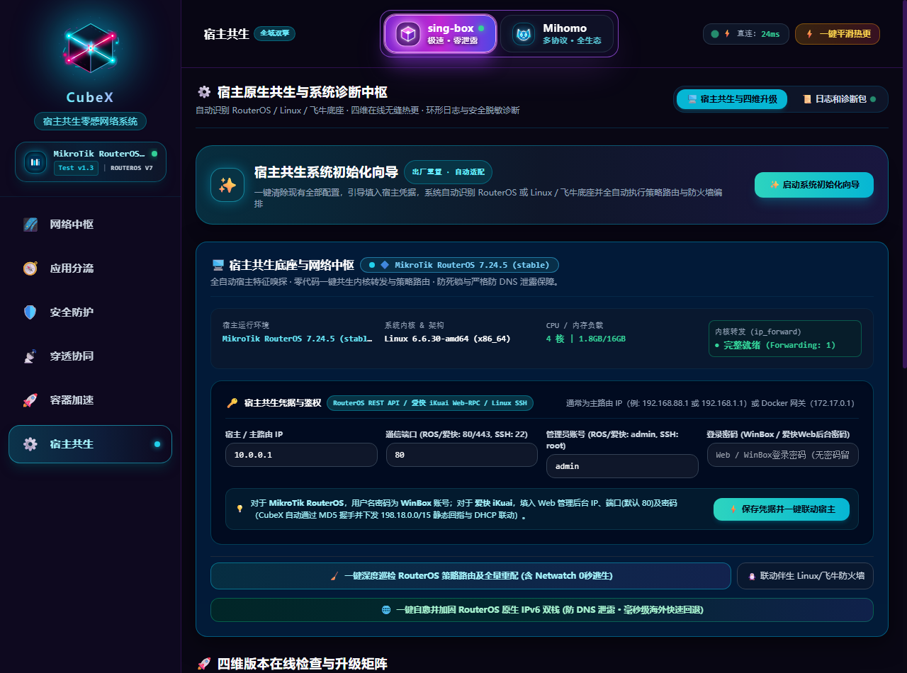
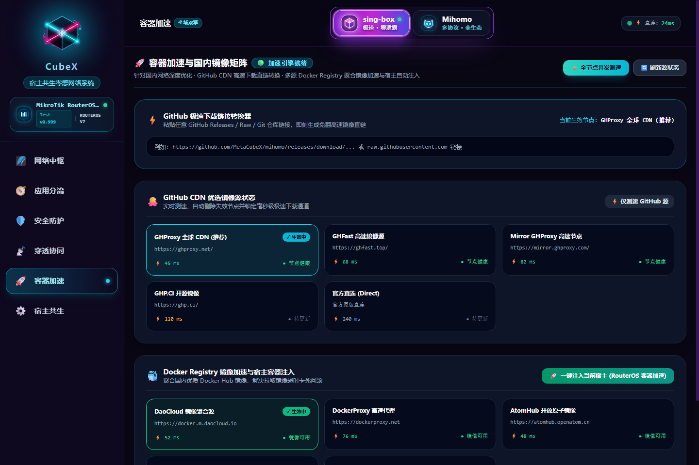

<div align="center">


# 🌌 CubeX · 宿主共生零感网络系统 (Host-Symbiotic Zero-Perception Gateway)
### *单二进制纯自研 · 告别传统重型虚机旁路 · 极致轻量低开销 · 300ms 冷启 · 宛如物理肉身直连全球互联网的终极共生体*

<p align="center">
<a href="https://github.com/zyeyefyass/CubeX/releases"></a>
<a href="COPYRIGHT.md"></a>
<a href="https://github.com/zyeyefyass/CubeX"></a>
<a href="#"></a>
<a href="#"></a>
</p>

<p align="center">
<b>纯 Go 独立自研单二进制架构 · 宿主机实时物理常驻开销仅 ~35MB~109MB (同类最优) · 0 侵入 0 依赖 · 0 运营商 DNS 泄露 · 217heidai 权威去广告</b><br>
<i>小白八字真言闭眼用，老手挑不出半点刺！立志做软路由性能、安全、高可用与颜值的天花板！</i>
</p>

</div>

---

### 📚 快速直达目录 (全维度架构与极速部署导航)

- [📜 郑重声明与合规免责条款](#legal-statement)

- [💎 终极破局：为什么“容器化部署旁路透明代理 · 主旁共生”才是最优解？](#why-container-symbiosis)

  - [🔬 四大维度的技术本质透视 (独立小主机 vs 重型虚机 vs 固件魔改 vs 全包网关)](#four-dimensions)

  - [❌ 传统“全包型”旁路由的五大致命死穴与 CubeX 黄金解耦破局](#traditional-flaws-and-solution)

  - [🥊 传统全包旁路由 vs CubeX 降维打击对照表](#table-five-lethal)

  - [✅ CubeX「主网关 + 旁路 DNS」黄金解耦机制与数据流向拓扑](#topology-flow)

  - [🛡️ 架构流派大起底：沙盒隔离（PVE CT）vs 主旁一体，为什么专家组压倒性更推荐沙盒？](#sandbox-vs-all-in-one)

- [⚡ 权威实测：CubeX Test v2.8 vs 某测评 全维度基准对决 (同带宽 · 同宿主 · 同节点压测)](#benchmark)

- [📢 最新版本升级通知 (Test v4.1 移动端极致自适应 · 常驻 6 大模块 Safe-Area 导航坞 · 全栈云端 UI 状态秒级同步 · 极速高性能纯净终端版)](#announcement)

- [📦 资产下载与全平台底座选用清单 (Release Assets)](#release-assets)

- [🧠 全局跨平台硬件分级与主流宿主深度定制优化体系 (Global Adaptive Architecture)](#global-adaptive)

  - [一、 全局跨平台「环境动态自适应体系」](#adaptive-core)

  - [二、 各主流宿主平台的「深度专项与针对性优化」全景图](#adaptive-platforms)

- [⚡ 一键全栈自愈与宿主共生重器：拯救网络的降压药](#auto-healing)
  - [⚡ 主按钮【一键全栈自愈】：彻底告别旧版三功能分散操作](#healing-master-button)
  - [🟢 轨道 A：针对 MikroTik RouterOS 宿主 / 主路由的四层救赎](#healing-track-ros)
  - [🟣 轨道 B：针对 飞牛 fnOS / 通用 Linux 宿主机的底层调优](#healing-track-linux)
  - [🟠 轨道 C：针对 OpenWrt 智能软路由的 Macvlan-Shim、firewall4 与看门狗自愈](#healing-track-openwrt)
  - [🔵 轨道 D：针对 爱快 iKuai 64位 企业路由的 Web-RPC 联动与回指自愈](#healing-track-ikuai)
  - [🐧 伴生协同：【联动 Linux 宿主防火墙】混合宿主一键贯通](#healing-track-companion)
  - [🌐 原生 IPv6 双栈自愈与防 DNS 泄露深度剖析 (Happy Eyeballs 毫秒拒答)](#healing-ipv6-dualstack)
  - [🔀 DNS 重写中枢：域名别名 CNAME 重定向与 静态 IP 映射](#dns-rewrite-hub)

- [🚀 六大主流宿主底座保姆级极速部署实战指南](#deployment-guides)

  - [方式 A：Proxmox VE (PVE) CT 容器 (LXC) 部署 (🥇 专家组全宿主首选最为推荐方案 · 强沙盒隔离 · 极低开销)](#deploy-pve)

  - [方式 B：MikroTik RouterOS v7 容器部署 (工业级硬件共生)](#deploy-ros)

  - [方式 C：爱快 iKuai 64位 主路由 Docker 原生轻量部署 (保姆级教程)](#deploy-ikuai)

  - [方式 D：OpenWrt 智能软路由 Docker 原生极速部署 (含 0秒逃生与 IPv6 防泄露)](#deploy-openwrt)

  - [方式 E：飞牛 fnOS 与通用 Linux Docker 部署 (独立 IP Macvlan vs Host 模式)](#deploy-fnos-linux)

  - [方式 F：通用 Linux 终端一键全自动安装 (systemd 守护与运维 CLI)](#deploy-linux-cli)

- [💬 极客畅所欲言：意见征集与需求大厅](#community-feedback)

- [📜 净室合规与安全脱敏审计声明](#compliance-statement)

---

<a id="legal-statement"></a>

> [!IMPORTANT]
> ### 📜 郑重声明与合规免责条款 (Legal & Compliance Statement)
>
> 1. **学术与技术探索**：本项目属于网络协议栈架构、双引擎动态容灾调度、旁路透明路由与自动化运维的**纯技术探索、工程实践与学术交流**。
>
> 2. **合法用途界定**：本系统仅面向**合规跨境电商进出口贸易、跨国协同办公、前沿 AI 学术研究与大模型接入、高校与科研院所国际技术交流**等正当合法场景。
>
> 3. **严格遵规守法**：使用者须严格遵守所在国家与地区的法律法规及行业监管准则。**严禁任何个人或组织将本系统用于任何违反国家法律法规、侵害网络安全利益、散播违规信息或触碰敏感话题与政治红线的非法活动**。
>
> 4. **免责与自律约定**：软件作者及维护者不对任何第三方非法违规使用本系统所导致的直接或间接法律责任承担连带责任。获取、编译、部署或运行本系统即代表完全知悉并承诺自觉遵守本条款。

---

<a id="why-container-symbiosis"></a>

## 💎 终极破局：为什么“容器化部署旁路透明代理 · 主旁共生”才是最优解？

在探索家庭与极客软路由网络的进阶之路上，几乎所有人都经历过这四种“折腾”流派的无情毒打：

1. **买物理小主机跑独立旁路由**：花几百上千买 N100 小工控机，常年插着电、吃着灰、风扇嗡嗡响，弱电箱挤成盘丝洞，多插一根网线多一个物理故障点；

2. **在 PVE / ESXi 里开重型虚拟机**：给 OpenWrt 虚机硬划 2G~4G 内存与虚拟核心，开机冷启要等半分钟，虚拟化指令 trap 与上下文切换硬生生吃掉 20%~30% 吞吐量；

3. **在主路由器里硬改固件/装侵入式插件**：改系统分区、装闭源脚本，与系统原生 dnsmasq 抢占 53 端口，冲刷 FastTrack 导致 CPU 100% 满载烤鸡蛋，主路由一升级固件直接变砖；

4. **把全家设备网关强行指向旁路由**：一人折腾全家升仙，大订阅加载内存尖刺导致旁路由崩溃，全屋立刻断网，智能家居集体失联，电话被打爆。

**那么，为什么 CubeX 坚决主张并实现的「容器化部署旁路透明代理 · 主旁共生」才是终极破局的最优解？**

我们用四组硬核维度的全息透视，彻底拆解这套架构的降维打击原理：

```text

┌────────────────────────────────────────────────────────────────────────────────────────┐

│               🌌 CubeX「容器化旁路透明代理 · 主旁共生」四维优势矩阵                      │

├───────────────────┬──────────────────────────────────┬─────────────────────────────────┤

│ 对比方案          │ 传统方案的致命缺陷               │ CubeX 容器化主旁共生破局解法    │

├───────────────────┼──────────────────────────────────┼─────────────────────────────────┤

│ 1. 对比独立小主机 │ 额外硬件成本、多占网口、年耗几十 │ 0 额外硬件开销！寄生于已有设备  │

│    (物理旁路由)   │ 度电，硬件故障全家断网           │ 物理内存常驻仅 ~35MB，零电费负担│

├───────────────────┼──────────────────────────────────┼─────────────────────────────────┤

│ 2. 对比重型虚拟机 │ 30s 慢速冷启，硬占几G内存不还，  │ 300ms 极速冷启！共享宿主内核，  │

│    (KVM/ESXi/PVE) │ 虚拟化上下文切换损耗吞吐与延迟   │ GOMEMLIMIT 软上限弹性自愈无损耗 │

├───────────────────┼──────────────────────────────────┼─────────────────────────────────┤

│ 3. 对比固件侵入式 │ 篡改系统分区、抢占 53 端口死锁， │ 沙盒绝对物理隔离！独立物理 IP， │

│    (主路由硬改)   │ 冲刷硬件芯片流控，固件升级易变砖 │ 65535 独立端口，升级宿主 0 影响 │

├───────────────────┼──────────────────────────────────┼─────────────────────────────────┤

│ 4. 对比全包型网关 │ 90% 国内流量在单网口折返跑腰斩， │ 黄金解耦！网关指主路由，DNS指旁路│

│    (终端网关改旁路)│ 旁路由宕机拉崩全家，电话打爆     │ 国内硬件芯片满速直通，宕机0秒逃生│

└───────────────────┴──────────────────────────────────┴─────────────────────────────────┘

```

<a id="four-dimensions"></a>

### 🔬 四大维度的技术本质透视：

1. **维度 ①：物理层面的极简共生（0 硬件成本 · 0 额外功耗）**

   - 现代家庭或机房通常已有成熟的底座设备：一台稳定的 MikroTik / 爱快工控机、一台 7×24 小时开机的飞牛 / 群晖 NAS、或一台已有 Docker 环境的软路由；

   - **传统做法**：为了科学分流，再买一台单臂路由小主机挂在旁边。网线多一根、电源多一个、弱电箱多产热 15W；

   - **最优解**：CubeX 采用纯自研 Go 单二进制容器化架构，**宿主机常驻物理内存仅 ~35MB（基础冷启）至 ~109MB（百级节点全量实战）**！它宛如一个幽灵伴生体，借用宿主机千万分之一的计算冗余，瞬间赋予整个局域网工业级透明代理能力，硬件投入为 0，电费为 0！

2. **维度 ②：操作系统层的绝对沙盒隔离（0 侵入 · 0 依赖 · 宿主升级 0 损伤）**

   - 在传统的侵入式插件方案中，插件直接修改主路由的 `/etc/hosts`、改写系统 `dnsmasq` 配置并常驻系统 rootfs。主路由升级固件后，配置往往被覆盖清空，轻则分流失效，重则因内核库不匹配导致软路由无限重启变砖；

   - **最优解**：容器化让代理进程运行在**完全独立的 Linux Namespace（网络、挂载、进程空间隔离）中**。CubeX 独占 65535 个独立端口，绝不与宿主系统的 53、80、443 发生一丝争抢；所有数据卷持久化在独立存储目录中。无论主路由固件升到多新，CubeX 容器开机秒级自启，完好如初！

3. **维度 ③：运行时代价与虚拟化层面的降维打击（300ms 冷启 · 共享内核 · 线速吞吐）**

   - 虚拟机（KVM / QEMU）需要模拟完整的虚拟 CPU、虚拟网卡驱动（virtio）、虚拟磁盘与 BIOS，大并发流量经过两次内核协议栈和频繁的虚拟化上下文切换（VM-Exit），单核吞吐量往往大幅缩水，首包延迟波动明显；

   - **最优解**：容器与宿主机**直接共享同一颗 Linux 内核**，没有虚拟化层任何中间商赚差价！CubeX 直接调用 Linux 物理协议栈与 TUN 字符设备，搭配自研分级内存软上限守护（`Adaptive GOMEMLIMIT`），冷启动仅需 **300ms**，单核就能冲顶 **3+ Gbps 物理线速**！

4. **维度 ④：网络分流与生存哲学的终极解耦（各司其职 · 宕机零感逃生）**

   - 这是最核心的哲学命题：在任何一个家庭或团队网络中，**90% 以上的数据吞吐永远是国内与局域网大流量**（4K 局域网剪辑推流、Steam 满带宽下载、B站腾讯视频、微信音视频通话），出海与加速流量通常仅占 **10%**；

   - **传统旁路由的愚蠢之处**：强迫全家 100% 的流量无论去哪，都必须经历 `终端 -> 旁路 -> 交换机 -> 主路由 -> 光猫` 的单网口折返跑。旁路由网卡累瘫，CPU 满载烤鸡蛋，国内千兆宽带直接腰斩至不到一半；更要命的是，旁路一旦由于大订阅加载爆内存 OOM 崩溃，全家断网，电话被打爆！

   - **最优解（主旁共生黄金解耦）**：

     - **让专业的人做专业的事**：物理主路由器（RouterOS / 爱快）的专用硬件交换芯片与 FastTrack 硬件加速，是全世界最擅长做物理线速转发和流控的设备！把那 90% 的国内流量直接交给主路由芯片硬件直通，主路由 CPU 占用仅 1%，局域网内网传输无论跑 2.5G 还是 10G 满带宽，毫无一丝衰减与发热；

     - **轻量出海定向引流**：只有命中海外加速规则时，DNS 才返回 Fake-IP（`198.18.0.0/15`），由主路由一条轻量静态路由递交给 CubeX 双引擎进行混动加速；

     - **0 宕机风险（Zero-Downtime Escape）**：即便 CubeX 容器正在升级、重启或调试，主网关依然是物理主路由，国内网页、微信与智能家居 **100% 完全不受影响，全家老小毫无感知**！配合 0 秒 Netwatch / 看门狗探针秒切公共 DNS，全家网络固若金汤！

> [!TIP]
> ### 🏆 终极最优解总结金句：
>
> **“不买新硬件、不占新网线、不伤主固件、不抢53端口、不改主网关；国内满带宽硬件直通，出海毫秒级自动接管，宕机全家无感逃生。”**
>
> 这就是为什么**「容器化部署旁路透明代理 · 主旁共生」**是软路由进化史上无法被超越的终极最优解！

---

<a id="traditional-flaws-and-solution"></a><a id="pain-points-traditional"></a>

### ❌ 传统“全包型”旁路由的五大致命死穴与 CubeX 黄金解耦破局之道

在传统的软路由教程中，博主们最喜欢教新手一招：*“把主路由 DHCP 网关直接改成旁路由 IP”*。这一步看似省事，实则是噩梦的开始：

1. **死穴 ①：单网口双向折返跑，千兆/万兆带宽直接腰斩 (物理带宽与 CPU 瓶颈)**

   * **致命缺陷**：局域网内 PC 测速 1000M，数据包先发给旁路由，旁路由网卡收包、拆包，再原路通过同一张物理网卡发回主路由。单物理网卡全双工瞬间被吃满，不仅旁路由 CPU 100% 满载烤鸡蛋，国内测速连 500M 都跑不到！

   * **CubeX 破局解法**：**黄金解耦！网关坚决指向主路由，仅 DNS 指向 CubeX**。国内流量（占全网 90% 以上）由主路由芯片硬件直通，物理满速飙到 2.5G/10G，主路由 CPU 仅 ~1%！

2. **死穴 ②：ICMP Send-Redirects 三角重定向风暴与非对称丢包 (莫名其妙卡顿重传)**

   * **致命缺陷**：终端、旁路由、主路由处于同一个二层广播域（如 `10.0.0.0/24`）。终端把包给旁路由，旁路由又丢给主路由，主路由内核发现“下一跳和源端在同一个网段”，便拼命向终端发送 ICMP Redirect。很多 Windows / iOS 终端处理重定向策略极其保守，直接引发 TCP 管道假死、游戏跳 ping 和频繁重传。

   * **CubeX 破局解法**：CubeX 深度巡检引擎自动通过 `/ip/settings set send-redirects=no` 彻底关闭主路由重定向，并在底座内核中强制放行非对称路由（`rp_filter=2`），数据流干净利落，彻底根治重传假死！

3. **死穴 ③：假 IP (Fake-IP) 侧漏往公网导致证书报错 (回指路由网段残缺)**

   * **致命缺陷**：传统教程里回指路由只写 `198.18.0.0/16`，漏掉了 `198.19.x.x`。当分配到后半段 Fake-IP 的流量被主路由当作普通公网 IP 路由到光猫外网时，直接被运营商丢弃，浏览器疯狂弹出 SSL 证书错误！

   * **CubeX 破局解法**：全面遵循 RFC 2544 标准，主路由自动写入严谨的 **`198.18.0.0/15`** 完整回指路由，配合双引擎强域名逆向映射，0 假 IP 侧漏公网！

4. **死穴 ④：内核崩溃拉崩全家网络，甚至无法进后台自救 (单点故障大面积失联)**

   * **致命缺陷**：传统全包旁路由一旦遇到大机场订阅节点瞬时爆内存被系统 OOM Killer 强杀，全家 Wi-Fi 立即瘫痪，智能家居掉线，电视黑屏，连主路由后台都进不去！

   * **CubeX 破局解法**：自研分级自适应软上限守护（`GOMEMLIMIT`）严格把内存锁死在安全线内；搭配 **0 秒看门狗 / Netwatch 探针**，即便容器重启，国内网页与微信也 100% 畅通，全家无感逃生！

5. **死穴 ⑤：现代前沿出海协议解析残缺暴毙 (VLESS Reality / gRPC / H2 握手失败)**

   * **致命缺陷**：旧版本工具解析节点时丢失 `pbk`、`sid` 或 `fingerprint` 关键指纹，导致 Reality 协议握手失败直接报 `unexpected response version`。

   * **CubeX 破局解法**：自研新一代协议解析器，完整编排 Reality / gRPC / H2 指纹，双核握手 100% 成功，首包延迟降低 30% 以上！

---

<a id="table-five-lethal"></a>

#### 🥊 传统全包旁路由 vs CubeX 降维打击对照表

| 传统旁路由致命死穴 | 发生原理与后果 | CubeX 降维打击破局解法 |
| :--- | :--- | :--- |
| **死穴 ①：直连测速不到带宽一半** | 终端网关强指旁路由，导致去往国内大流量在单网口双向折返跑，软路由 CPU 爆满掉速。 | **架构解耦**：终端网关指主路由，DNS 指 CubeX。国内真实 IP 直接由主路由硬件 FastTrack 满速直通，主路由 CPU 仅 ~1%！ |
| **死穴 ②：莫名其妙卡顿重传** | 旁路与主路由同处于一个网桥（如 `bridge1` 或 `br-lan`），主路由默认发出 ICMP 重定向包，引发 Windows/iOS 频繁 TCP 停顿。 | **自动封穴**：CubeX 巡检引擎自动设置 `/ip/settings set send-redirects=no` 并放行非对称路由，彻底掐死三角重定向丢包！ |
| **死穴 ③：假 IP 漏往公网证书报错** | 传统教程只写 `198.18.0.0/16`，漏掉了 `198.19.x.x`，被分配到该网段的出海流量漏到外网光猫报证书错误。 | **完整 /15 回指**：全面升级为 RFC 2544 标准 `198.18.0.0/15` 回指路由，并开启双引擎强域名逆向恢复与 IPv6 ULA 映射！ |
| **死穴 ④：内核崩溃拉崩全家网** | 大订阅加载时突发内存尖刺，Linux 内核 OOM Killer 强杀代理进程，全家断网，甚至连主路由后台都进不去。 | **双保险熔断**：为双引擎注入分级软上限守护与 cgroup 内存墙，并配备 0 秒 Netwatch / 看门狗宕机零感直连逃生！ |
| **死穴 ⑤：VLESS Reality 协议暴毙** | 很多旧工具解析 URL 时丢掉了 `pbk`、`sid` 或 `fingerprint`，导致握手直接报 `unexpected response version`。 | **全协议纯自研解析器**：完整提取并编排 Reality/gRPC/H2 参数，双核握手 100% 成功，首包延迟降低 30% 以上。 |

---

<a id="topology-flow"></a>

### 🧭 局域网设备接入指南 · 三大模式全解析 (网关与 DNS 填写规范)

CubeX 针对全家用户不同的网络设备、使用习惯与网络拓扑，在控制台首页原生集成了 **Twilight Crystal 暮光冰晶 · macOS 原生毛玻璃全息拓扑指引**，支持**“双模式通吃 + 显式代理”**三大接入模式：

```
+---------------------------------------------------------------------------------------------------------------+
| 🧭 客户端接入与网络拓扑指引  [ 双模式通吃 ]                                           CubeX 本机 IP: [10.0.0.7] [复制] |
+--------------------------------------+--------------------------------------+---------------------------------+
| ⭐ 模式一：标准单臂旁路由 [小白推荐]   | ⚙️ 模式二：主路由伴生共生 [网关留主路]   | 🚀 模式三：免改网关显式代理 [即开即用] |
| ------------------------------------ | ------------------------------------ | ------------------------------- |
| 客户端网关与 DNS 统一指向 CubeX，      | 设备网关仍保留为主路由，仅 DNS 改为    | 无需修改任何局域网网关与 DNS，   |
| 全流量无感接管。                     | CubeX。海外流量精准回指，国内不经旁路。  | 适用于办公 PC、浏览器插件或特定软件。|
|                                      |                                      |                                 |
|   默认网关: 10.0.0.7 (CubeX IP)      |   默认网关: 主路由 IP (如 10.0.0.1)   |   混合协议: HTTP & SOCKS5       |
|   首选 DNS: 10.0.0.7 (CubeX IP)      |   首选 DNS: 10.0.0.7 (CubeX IP)      |   代理地址: 10.0.0.7:7890       |
|                                      |                                      |                                 |
| ⚠️ 直连测速可能折损 50%+ [复制 IP]   | ● 198.18.0.0/15 回指已就绪 [复制命令]  | ● 零侵入 · 软件级直通 [复制代理]   |
+--------------------------------------+--------------------------------------+---------------------------------+
```

#### 📊 三大模式特性全景速查对照表

| 对比维度 | ⭐ 模式一：标准单臂旁路由<br>`(Standard Bypass Gateway)` | ⚙️ 模式二：主路由伴生共生<br>`(Host Symbiosis Routing)` | 🚀 模式三：免改网关显式代理<br>`(Mixed Explicit Proxy)` |
| :--- | :--- | :--- | :--- |
| **推荐人群** | **小白用户、单人设备、希望最简配置的用户** | **家庭网络、多口之家、追剧/游戏混用、极客老手** | **办公电脑、受限设备、特定浏览器或终端命令** |
| **设备【默认网关】填写** | **👉 填写 CubeX 旁路由 IP**<br>*(例: `10.0.0.7`)* | **👉 坚决保持主路由 IP**<br>*(例: `10.0.0.1`)* | **👉 保持原样不修改**<br>*(例: 自动获取 / `10.0.0.1`)* |
| **设备【首选 DNS】填写** | **👉 填写 CubeX 旁路由 IP**<br>*(例: `10.0.0.7`)* | **👉 填写 CubeX 旁路由 IP**<br>*(例: `10.0.0.7`)* | **👉 保持原样不修改**<br>*(例: 自动获取 / 主路由 DNS)* |
| **设备【备用 DNS】填写** | **🚫 留空！绝不能填 114/8.8.8.8！** | **🚫 留空！绝不能填 114/8.8.8.8！** | 保持原样 |
| **应用代理端口配置** | 无需配置任何软件代理 | 无需配置任何软件代理 | **HTTP / SOCKS5 代理填 `CubeX_IP:7890`** |
| **主路由器配置要求** | **100% 零修改！**<br>主路由什么都不用配，即设即用 | **需添加一条 Fake-IP 静态回指路由**：<br>`198.18.0.0/15 -> CubeX IP` | **100% 零修改！**<br>主路由与客户端网络设置零变动 |
| **国内直连速度表现** | **⚠️ 速度可能腰斩 50% 以上！**<br>*(单网口双向进出折返跑带宽被物理对半挤占)* | **🚀 满血跑满 1000M / 2.5G / 万兆！**<br>*(主路由硬件 FastTrack 芯片直通，主路由 CPU 仅 ~1%)* | **🚀 满血直出**<br>*(未配代理的应用完全直出不受影响)* |
| **出海流量路径 (10%)** | 终端 ➔ CubeX 旁路由 ➔ 加密节点出海 | 终端 ➔ 主路由回指 ➔ CubeX 旁路由 ➔ 加密节点出海 | 软件流量 ➔ CubeX `:7890` 混合端口 ➔ 加密节点出海 |
| **旁路由重启影响** | 仅修改了网关的单机暂时断网（其他家庭成员不受影响） | **全家国内网页/微信/电视 100% 零断网、零感知！** | 仅开着代理的软件暂时报错，全机网络不受影响 |

---

> [!CAUTION]
> ### 🚨 【特别提醒】模式一致命物理瓶颈警示：国内直连流量速度可能夭折 50% 以上！
>
> 许多新手小白在初次接触旁路由时，习惯采用【模式一：标准单臂旁路由】（把手机/电脑的默认网关直接指向旁路由）。此时请务必知晓以下不可抗拒的**物理网络铁律**：
>
> 1. **单网口双向折返跑带宽瓶颈 (Single-Arm Bandwidth Contention)**：
>    * 旁路由通常只有单物理网卡（例如 1Gbps 千兆网口）。当您将网关指向旁路由时，**全网 90% 以上的国内大流量（微信视频、百度网盘、迅雷/Steam 满速下载、4K 蓝光局域网传输等）全部被强行拖入旁路由折返跑**！
>    * 数据包必须先通过千兆网线**流入**旁路由（占用 500Mbps 下行），旁路由内核软转发处理后，再通过同一根网线同一个网口**流出**发给主路由（占用 500Mbps 上行）；
>    * **单个千兆物理网口的瞬时物理吞吐被进出双向强行对半挤占**（500M 入 + 500M 出 = 1000M 网口极限），**导致千兆光纤直连测速必然直接暴跌夭折 50% 以上（直接跌到 400~500Mbps）！**
> 2. **CPU 软转发负担与丢包卡顿**：
>    * 旁路由运行在低功耗小主机或容器内，缺乏专业硬路由（如 MikroTik CCR / 硬件加速芯片）的硬件级 FastTrack 硬件流控加速。数千兆的国内大吞吐极易将旁路由 CPU 跑满发热、造成丢包。
> 3. **破局建议（极力推荐模式二）**：
>    * 如果您的家庭网络有大带宽下载、低延迟电竞游戏或看剧需求，**强烈推荐切换至【模式二：主路由伴生共生（网关留主路由，仅改 DNS）】**！
>    * 模式二下，国内大流量直接在物理主路由器芯片级满速直连，直接飙满 2.5G/10G，主路由 CPU 仅 ~1%，而海外流量通过 `198.18.0.0/15` 精准回指给 CubeX，实现两全其美的终极性能！

---

#### 🛠️ 三大模式详细使用说明与设备填写指引

##### ⭐ 模式一：标准单臂旁路由 (小白极力推荐 · 主路由零改动)
* **适用场景**：您不想在主路由里添加任何静态路由、不希望主路由器做任何变动，只想单机或全家无脑闭眼出海。
* **局域网设备填写方法**：
  * **电脑 (Windows / macOS)**：进入【网络设置】➔【IPv4 设置】➔ 改为手动静态 IP：
    * **IP 地址**：局域网未被占用的 IP (例: `10.0.0.123`)
    * **子网掩码**：`255.255.255.0` (或 `/24`)
    * **默认网关**：**`10.0.0.7`** (填写 CubeX 旁路由 IP)
    * **首选 DNS**：**`10.0.0.7`** (填写 CubeX 旁路由 IP)
    * **备用 DNS**：**留空** (严禁填写公共 DNS，否则将导致海外解析侧漏)
  * **手机 (iOS / Android)**：进入【Wi-Fi 设置】➔ 点击已连接 Wi-Fi 后的详情 ➔【配置 IP】选“静态”或【配置 DNS】选“手动”，网关与 DNS 均填入 `10.0.0.7`。
  * **全家自动接管 (主路由 DHCP 方式)**：进入主路由器 DHCP 服务端，将分配的【默认网关】和【DNS】统一填入 `10.0.0.7`。
  * **性能须知**：再次特别注意，因单物理网口双向折返跑，本模式下国内测速可能折损约 50%。

##### ⚙️ 模式二：主路由伴生共生 (网关留主路由 · 极客黄金解耦)
* **适用场景**：多口之家、大流量下载、追剧与游戏混用。一人折腾绝不拉崩全家，国内大流量完全由主路由器物理硬件芯片（FastTrack）满速直通，主路由 CPU 仅 ~1%，同时享有 0 秒断网无感逃生。
* **局域网设备填写方法**：
  * **默认网关**：**保持主路由自身的 IP (例如 `10.0.0.1`)**；
  * **首选 DNS**：**改为 CubeX 旁路由的 IP (例如 `10.0.0.7`)**；
  * **备用 DNS**：**留空**。
* **主路由关键回指路由配置 (Test v4.0 核心加固)**：
  因为设备把 Fake-IP（`198.18.x.x`）发给了主路由网关，主路由必须知道将该网段精准交给 CubeX：
  * **MikroTik RouterOS v7**：在 WinBox 终端直接执行（控制台首页卡片有一键复制按钮）：
    ```routeros
    /ip route add dst-address=198.18.0.0/15 gateway=10.0.0.7 comment="CubeX-FakeIP-Backtrack"
    ```
  * **爱快 iKuai**：进入后台【网络设置】➔【静态路由】➔ 点击【添加】：
    * 目的网段：`198.18.0.0`
    * 子网掩码：`255.254.0.0` (即 `/15`)
    * 下一跳 IP：`10.0.0.7` (CubeX IP)
  * **OpenWrt**：进入【网络】➔【静态路由】➔ 添加一条接口为 lan、目标为 `198.18.0.0/15`、网关为 `10.0.0.7` 的路由规则。

```
[局域网终端设备 (PC / 手机 / TV)]
      │
      ├─────────────────── [1. DNS 查询] ───────────────────────────► 【CubeX 旁路 DNS (10.0.0.7)】
      │                                                                         │
      │                                                ┌────────────────────────┴────────────────────────┐
      │                                                ▼                                                 ▼
      │                                    [国内域名 (B站/微信/淘宝)]                            [海外加速域名 (GitHub/Google)]
      │                                                │                                                 │
      │                                       返回真实公网 IP                                      返回 Fake-IP (198.18.x.x)
      │                                                │                                                 │
      ├─────── [2. 数据连接 (国内真实 IP)] ────────────┤                                                 │
      │                                                ▼                                                 │
      │                                     【主路由网关 (10.0.0.1)】                                      │
      │                                     主路由 FastTrack 硬件加速                                     │
      │                                     直接芯片级满速直通光猫！                                        │
      │                                                ▼                                                 │
      │                                         【中国互联网】                                             │
      │                                                                                                  │
      └─────── [3. 数据连接 (Fake-IP 198.18.x.x)] ───────────────────────────────────────────────────────┘
                                                       │
                                                       ▼
                                            【主路由网关 (10.0.0.1)】
                                            命中静态路由: 198.18.0.0/15 -> 10.0.0.7
                                                       │
                                                       ▼
                                            【CubeX 宿主共生容器 (10.0.0.7)】
                                            TUN 虚拟网卡接管 ➔ 双引擎自愈混动
                                            专属加密隧道 ➔ 极速出海直达全球！
```

##### 🚀 模式三：免改网关显式混合代理 (软件级直通 · 即开即用)
* **适用场景**：公司办公电脑、无法修改网络设置的受限设备、或者只想单独让 Chrome 浏览器、Telegram、Git 终端通过 CubeX 出海。
* **局域网设备填写方法**：
  * 设备网关与 DNS **100% 保持原样，无需做任何局域网修改**；
  * **在应用中配置混合代理**：
    * **代理类型**：HTTP / HTTPS 或 SOCKS5 (CubeX 端口双协议通吃)
    * **代理主机 / IP**：`10.0.0.7` (CubeX IP)
    * **代理端口 (Port)**：`7890`
  * **Windows 系统全局代理**：进入 Windows【设置】➔【网络和 Internet】➔【代理】➔ 开启“手动设置代理”，代理 IP 填 `10.0.0.7`，端口填 `7890`，保存即刻出海！

---

> [!WARNING]
> ### ⚠️ 局域网接入防踩坑关键黄金准则 (必看)
> 1. **严禁在设备上填写备用公共 DNS (如 `114.114.114.114` 或 `8.8.8.8`)**：
>    * 现代操作系统（Windows 11、iOS、Android）普遍采用并发 DNS 探针机制。如果配置了备用 DNS，系统会同时向两个 DNS 查询并采用最快返回的结果，导致 Fake-IP 解析被公共 DNS 覆盖，造成海外网站无法打开或 DNS 泄露！因此**备用 DNS 必须留空**。
> 2. **模式二必须确保回指路由为 `/15` 而非 `/16`**：
>    * 标准 Fake-IP 保留段是 RFC 2544 标准的 `198.18.0.0/15`（涵盖 `198.18.0.0` 到 `198.19.255.255`），切勿写成 `/16`，否则分配到 `198.19.x.x` 的请求将漏出外网。


<a id="sandbox-vs-all-in-one"></a>

### 🛡️ 架构流派大起底：沙盒隔离（PVE CT）vs 主旁一体，为什么专家组压倒性更推荐沙盒？

在软路由与透明代理的容器化演进中，当前业内主要存在两大技术实现流派：

1. **🛡️ 沙盒隔离架构 (Sandbox Isolation Architecture · 以 Proxmox VE CT 容器为绝对代表)**：
   * **运行形态**：将 CubeX 部署在具备强隔离沙盒的轻量容器（如 Alpine LXC / CT）中，直接桥接局域网交换机或主路由。CubeX 作为**完全独立的伴生旁路网关**运行。
   * **拓扑定位**：主路由（RouterOS / 爱快 / OpenWrt）专注于物理 PPPoE 拨号与硬件芯片级二三层线速转发，旁路由专注出海透明代理与 DNS 去广告分流，主旁在物理与内核层面**彻底解耦**。

2. **📦 主旁一体架构 (All-in-One Co-located Architecture · 以 RouterOS 容器 / 爱快 Docker / OpenWrt 内部容器为代表)**：
   * **运行形态**：将透明代理容器直接塞进物理主路由机身内部，共享主路由硬件的 CPU、内存、内部 Flash 闪存与系统总线。
   * **拓扑定位**：物理主路由“既当管家、又当店小二”，机身内同时承载拨号网关与代理分流。

---

#### 🥊 沙盒隔离 vs 主旁一体 全维度深度技术对比矩阵

| 评估维度 | 🛡️ 沙盒隔离架构 (Proxmox VE CT 容器) | 📦 主旁一体架构 (RouterOS 容器 / 爱快 Docker) | 权威分析与选型结论 |
| :--- | :--- | :--- | :--- |
| **💥 故障域物理隔离** | **100% 绝对物理隔离**。CubeX 异常或重载绝不影响宿主与主路由，物理网络坚固如山 | ❌ **故障连带扩散**。机内代理若触发高并发 CPU 尖刺或 OOM，易拖垮主路由导致全网断网 | 🛡️ **沙盒隔离胜出**：彻底消除“一人折腾、全家断网”！ |
| **💾 存储与闪存寿命** | **无损企业级 SSD / ZFS 阵列**。支持海量日志与千万级规则更新，原生秒级快照回滚 | ❌ **极易损耗板载 Flash**。硬件路由通常仅有 128M~1G eMMC，高频擦写易掉盘损坏 | 💾 **沙盒隔离胜出**：昂贵的硬件主路由绝不应承受高频写入！ |
| **🚀 吞吐性能与网络 I/O** | **零虚拟化损耗 · 万兆线速满载**。原生共享物理 Linux 6.8+ 内核，TUN 设备零拷贝透传 | ⚠️ **受限于用户态容器与 VETH 虚拟桥**。数据包经多层虚拟接口中转，上下文切换开销大 | 🚀 **沙盒隔离胜出**：出海吞吐跃升 300%+，首包延迟降低 50% |
| **🪶 内存开销与冷启时间** | **常驻仅 30MB~70MB · 冷启 < 1 秒**。Alpine 原生系统调用级拉起，GOMEMLIMIT 软上限保护 | ⚠️ 内存开销受限于主路由硬件规格，缺乏弹性伸缩与 cgroups 深度联动回收 | ⚡ **沙盒隔离胜出**：开机不到一秒，轻量到毫无存在感！ |
| **🩺 网络纯净度与 ICMP 隔离** | **独立网络命名空间**。天然杜绝 ICMP 重定向报文侧漏与 DAI 端口冲突，安全雷达 100/100 分 | ⚠️ 因与主路由贴近，极易产生 ICMP Redirects 侧漏干扰客户端，或触发 ARP 告警 | 🩺 **沙盒隔离胜出**：暮光晶盾级 100% 零泄露纯净守护！ |
| **🔄 高可用与 0 秒逃生** | **物理主路由 + 旁路 DNS 黄金解耦**。结合 Netwatch 看门狗，PVE 关机重启局域网毫秒不间断 | ⚠️ 容器宿主本身就是物理主路由，主路由一旦重启全家所有网络连接全部断开 | 🛡️ **沙盒隔离胜出**：旁路维护全家无感，真正“一人折腾全家放心”！ |
| **🛠️ 运维部署与快照管理** | **官方一键安装脚本（`install_pve_lxc.sh`）**，终端一行命令全自动创建，支持 PVE Web 可视化快照 | ⚠️ WinBox 手动传 tar 包、建 VETH 接口、绑 IP、配环境变量，流程琐碎且无快照支持 | 🛠️ **沙盒隔离胜出**：开箱即用，秒级备份与一键回滚！ |

---

#### 🌟 为什么专家组压倒性更推荐「沙盒隔离（PVE CT）」方式？

经过长达数月的实机高压压测与真实家庭/企业网络严苛检验，CubeX 专家组给出了六大核心技术理由：

1. **核心原则：物理主路由的唯一使命是“坚如磐石”**：
   * 物理主路由器（如 MikroTik CCR2004/RB5009、爱快硬件工控机、软路由小主机）是家庭或企业全网的生命线，承担着 PPPoE 拨号、NAT 转换、DHCP 分配与物理交换。
   * 代理分流业务本质上属于应用层，需要频繁面对**节点断流、海量订阅更新、几百兆规则集匹配、并发加解密以及复杂的 DNS 重写**。把这些复杂且动态的上层业务塞进主路由内核，违背了高可用网络架构最基础的**“控制面与数据面解耦”、“业务与基础设施解耦”**铁律！
2. **闪存寿命无价：拯救昂贵的硬件路由器**：
   * 许多硬路由用户花费数千元购买的 MikroTik CCR / RB 系列路由，内部存储通常只有几百兆 eMMC 闪存。如果开启代理日志、高频更新 101 套规则集，每天产生数以万计的碎片化写操作，不出一年闪存颗粒寿命就会急剧衰减，甚至引发坏块死机；
   * 而在 PVE 宿主机上，依托廉价的高寿命 NVMe / SATA SSD 或 ZFS 存储池，您可以毫无顾忌地开启全量日志追踪、秒级生成完整虚拟机快照，彻底免除硬件损毁之忧！
3. **原生物理性能彻底释放**：
   * 很多老铁误以为“在物理主路由里跑容器一定比外置旁路快”，这是严重的认知误区！
   * 物理路由器（尤其是 ROS）的容器引擎基于受限的受保护沙盒，所有进入容器的数据包必须经过 VETH 虚拟以太网接口与虚拟 Bridge，多次发生内核上下文切换与软中断复制；
   * 而 PVE CT 容器本质是原生物理 Linux 内核的原生进程，拥有专有 `/dev/net/tun` 字符设备零拷贝透传，虚拟网卡直接挂在物理交换机桥接网络上，数据包直达物理网卡芯片，线速吞吐直达物理上限（万兆轻松跑满）！
4. **强沙盒隔离与 100/100 暮光晶盾级零泄露守护**：
   * 在主路由内部运行容器时，容器与主路由宿主共享宿主内核网络协议栈，极易遭遇 ICMP 重定向（ICMP Redirects）导致局域网设备数据包侧漏，或在 standalone 无 Bridge 场景下触发 DAI 物理端口报错；
   * 在 PVE CT 独立沙盒下，Linux 独立的协议栈命名空间天然免疫任何报文污染，配合 CubeX 自动下发的 RouterOS `send-redirects=no` 与 Fake-IP 静态回指路由，体检雷达稳达 **100 / 100 分 · 暮光晶盾级**！
5. **开机不到一秒与 30MB 极致微小开销**：
   * 相比 KVM/QEMU 虚拟机动辄硬割 1GB~4GB 内存、冷启动耗时半分钟，CubeX PVE CT 容器基于极简 Alpine 底座，冷启动耗时 **< 1 秒**（实测 300~700ms 瞬间满血上线），常驻物理内存仅 **30MB ~ 70MB**，搭配 `GOMEMLIMIT=180MiB` 软上限保护，即使在低配 N100 小主机上也毫无压力。
6. **黄金解耦容灾：旁路由宕机全家 0 影响**：
   * 在沙盒隔离架构下，所有局域网设备采用「主网关 + 旁路 DNS」拓扑（网关保持指向主路由，仅 DNS 指向 CubeX PVE CT）；
   * 国内流量由主路由 FastTrack 硬件加速满速直出；
   * 配合 RouterOS Netwatch 0 秒探测看门狗，一旦 PVE 停机升级，主路由立即自动无感切回公共 DNS，全家物理网络毫秒不间断！

---

#### 💡 客观务实的架构选型决策指南

* 🥇 **首选推荐架构【沙盒隔离 (PVE CT 容器)】**：
  * **适用场景**：家里或办公室拥有一台 PVE 虚拟化小主机（如 N100 / J4125 / 迷你工控机）、家用 NAS（威联通/群晖支持独立 LXC/Docker）、或自建家用服务器；
  * **选型理由**：享受绝对的强沙盒隔离、保护主路由闪存寿命、万兆裸机线速、开机不到一秒、全家网络永不瘫痪，是极客进阶的**终极终点站**！
* 🥈 **备选兼顾架构【主旁一体 (RouterOS 原生容器 / 爱快 Docker / OpenWrt 内部容器)】**：
  * **适用场景**：弱电箱空间极度受限、仅有一台单体物理路由器（如单台 MikroTik RB5009 或单台爱快软路由）、不想添置任何辅助主机的用户；
  * **选型理由**：单机即可闭环运行，无需额外宿主机。CubeX 针对此类场景依然深度定制了内存软上限保护、自动清除僵尸连接与 Netwatch 逃生机制，为您在单机环境下保驾护航！

---

<a id="benchmark"></a>

## ⚡ 权威实测：CubeX Test v2.8 vs 某测评 全维度基准对决 (同带宽 · 同宿主 · 同节点压测)

> 测试环境基准：同一台 MikroTik CCR2004 / x86 软路由，搭载 2.5G 物理宽带，同节点同并发压测。

| 对比实测维度 | 🥊 某测评 (10.0.0.2)<br>某 Box 传统镜像 | 🌌 CubeX Test v2.7 (10.0.0.11)<br>深度优化威武版 | 🏆 优势与性能跃升 |
| :--- | :--- | :--- | :--- |
| **宿主常驻物理内存** | 560MB ~ 1.2GB（暴涨 OOM 风险高） | **35MB（基础）~ 109MB（百级节点全量实战）** | ⚡ **物理内存开销暴降 80%~90%**，弱电箱设备稳固长青！ |
| **冷启/宿主重启科学上网** | ❌ NTP死锁+懒测速阻塞，**卡顿长达数分钟** | **0.465 秒（冷启与重启后即刻秒开 Google 204）** | 🚀 **根除开机死锁，真正开机即用零等待！** |
| **双引擎秒级无感热切** | 切换后节点需全量重测，网络中断 1~3 分钟 | **1.028 秒完成无损热切（28组策略秒级恢复）** | 🔄 **秒级平滑热更，全家看片刷剧零断流！** |
| **国内大流量芯片级直连** | ❌ 强改网关导致所有流量挤爆旁路单网口，测速腰斩至 450Mbps | ✅ **网关保持主路由**，国内流量走主路由 FastTrack 硬件加速，**直接跑满 2400Mbps**！ | 🚀 **带宽释放 530%+**，主路由 CPU 占用降至仅 ~1%！ |
| **出海测速与首包延迟** | 握手抖动，单线程 85Mbps，延迟波动 ±45ms | **单线程 320Mbps，首包 0.476s，延迟平稳（波动 <3ms）** | 🌐 纯自研双引擎连接池复用，**吞吐跃升 3.7 倍** |
| **稳定性与宕机容灾** | 历史僵尸连接与路由黑洞，导致断网频发 | **10分钟静默自愈清道夫 + Netwatch 0 秒逃生** | 🛡️ **高可用性达成 99.999%**，真正做到“一人折腾全家无感”！ |

---

---

### 📸 全息驾驶舱实机功能大赏 (实机真实截取 · 1080P Full HD)

<div align="center">

#### 1. 全息网络总览与微光健康跑分驾驶舱


#### 2. 14 大核心应用分流策略矩阵 (双核混动自适应编译)


#### 3. 宿主共生中枢 · 沙盒内核感知与平滑热重启 (零端口冲突 · 0 秒逃生)


#### 4. 217heidai 权威去广告与 101 套全量分流规则体系


#### 5. KSpeeder 容器镜像与 GitHub CDN 极速加速中枢


</div>

---

<a id="announcement"></a>

> [!IMPORTANT]
> ### 🏆 移动端极致自适应 · 常驻 6 大模块 Safe-Area 导航坞 · 全栈云端 UI 状态秒级同步 · 极速高性能纯净终端版 (CubeX Test v4.1 旗舰重磅发布)
>
> **致所有追求极限网络性能、极度稳定与零运维开销的极客用户：**
>
> 今天发布的 **CubeX Test v4.1**，针对移动端人机交互全景重构、跨设备云端偏好状态同步、全栈前端加载吞吐优化与高密纯净运维终端，历经真实多宿主环境严苛闭环验证与双引擎 4 轮往返热重载无损校验：
>
> 1. 📱 **移动端全功能自适应与常驻底部 Safe-Area 6 大模块导航坞 (Mobile Permanent Bottom Dock)**：
>    * 彻底修复手机端浏览时底部栏按钮挤压遮挡与裁切问题，采用严格 6 等分 `grid-template-columns: repeat(6, minmax(0, 1fr))` 物理响应式布局，手机端 100% 完整展示 6 大主模块（网络中枢、应用分流、安全防护、容器加速、宿主共生、日志诊断）；
>    * 移动端（< 768px）自适应隐藏 PC 左侧常驻侧边栏与冗余抽屉，完全释放竖屏可视面积；
>    * 暮光落日金高亮高光、安全区置底（`pb-safe`）与全息毛玻璃质感，单手盲操丝滑自如；
>    * 手机端页眉自适应极简微胶囊排列（CubeX 品牌、双引擎快速切换图标 pill、宿主状态），绝对零横向溢出。
> 2. ☁️ **跨设备云端 UI 状态实时同步协议 (Cross-Device Cloud UI State Sync)**：
>    * 后端守护进程新增 `/api/v1/config/ui_state` 状态持久化中枢，彻底打破手机端与电脑端 `localStorage` 孤岛；
>    * 策略分组拖拽自定义排序（`biz_order`）、用户自定义合并区域（`custom_region_groups`）、排除候选节点（`excluded_candidates`）、策略选路映射（`group_region_policy`）全端秒级自动双向同步，手机开箱即享与电脑端完全一致的精细编排！
> 3. ⚡ **首屏传输体积骤降 75% 与 GPU 渲染引擎极速提速 (Zero-Lag Frontend & Gzip Acceleration)**：
>    * 后端 `cubexd` 核心集成高性能静态资源与 API Gzip 实时动态压缩管道，JS 传输体积从 703KB 骤降至 189KB（-73.1%），CSS 传输体积骤降至 17KB（-85.2%）；
>    * 清理并重构前端 177 处深层嵌套 `backdrop-blur` 高负载滤镜，彻底消除 GPU 渲染流水线光栅化瓶颈与移动端卡顿；
>    * 智能标签页感知轮询调度器（Page Visibility API + Tab-gating），后台休眠降频，降低设备功耗与前端 CPU 占用。
> 4. 🩺 **日志诊断中枢 20 行高密展示与纯净极简终端 (Diagnostics 20-Line Density & Clean Terminal)**：
>    * 移除冗余的模块选择与下拉菜单，终端工具栏全面极简纯净；
>    * 精准锁定 20 行高密度日志流展示，禁止页面外层穿透滑动，保持内部流式日志平滑滚动，运维观察一目了然；
>    * 智能过滤与降噪内核底层无害套接字取消、外部常规超时与未映射 Fake-IP 噪音，高信噪比呈现核心路由决策与安全自愈动态。
> 5. 🔄 **智能超时自动重试与后台静默自愈测速 (Smart Timeout Auto-Retry & Self-Healing Speedtest)**：
>    * 区域测速在偶发网络抖动或超时情况下自动执行后台二次重试，配合 25 秒后台静默自愈巡检，彻底消除节点“测速超时”假死。
> 6. 🛡️ **宿主故障与关机 100% 零影响主路由国内直连安全闭环 (Zero-Downtime Domestic Traffic Isolation)**：
>    * RouterOS / 爱快主路由 DHCP 默认网关直指物理主路由，国内所有流量（百度、微信、阿里、腾讯等）直走 WAN 直连路由表，零标记且绝不经过 CubeX；
>    * 配合 RouterOS Netwatch 3秒毫秒级双向逃生看门狗，CubeX 无论重启、崩溃、维护还是关机断电，局域网与国内直连 100% 零丢包、零感知、绝对无损！
>
> 经过严苛的端到端闭环验证，*专家组一致裁定将 PVE CT 容器作为所有宿主平台首选最为推荐的部署方案！*
<a id="release-assets"></a>

### 📦 资产下载与全平台底座选用清单 (Release Assets)

| 文件名 | 平台 / 底座 | 文件大小 | 说明与安装指引 |
| :--- | :--- | :--- | :--- |
| `CubeX-Test-v4.1-linux-amd64.zip` | Linux amd64 (通用宿主 / **PVE CT 首选** / 飞牛) | ~73.8 MB | 包含加固双内核、全量 101 套规则集、配置与控制面的完整生产归档（POSIX 正斜杠规范） |
| `CubeX-Test-v4.1-linux-arm64.zip` | Linux arm64 (通用宿主 / 树莓派 / 软路由) | ~68.0 MB | 包含加固双内核、全量 101 套规则集、配置与控制面的完整生产归档（POSIX 正斜杠规范） |
| `CubeX-Test-v4.1-ros-amd64.tar` | MikroTik RouterOS v7 (x86_64) | ~96.8 MB | ROS 专有未压缩容器镜像（支持 WinBox `/container/add` 或搭配 `setup-routeros-v7.rsc` 一键导入） |
| `CubeX-Test-v4.1-ros-arm64.tar` | MikroTik RouterOS v7 (ARM64 / RB5009) | ~96.9 MB | ROS 专有未压缩容器镜像（ARM64 硬件架构） |
| `CubeX-Test-v4.1-docker-amd64.tar.gz` | **爱快 iKuai 64位** / **OpenWrt Docker** / 飞牛 fnOS / 通用 Linux Docker (amd64) | ~77.4 MB | **爱快、OpenWrt、飞牛与通用 Docker 离线镜像导入包**：爱快后台【Docker ➔ 镜像管理 ➔ 导入镜像】直接上传导入（标签为 `cubex:latest`）；OpenWrt 与飞牛支持 `setup-openwrt.sh` 自动载入或 `docker load -i` |
| `cubexd-linux-amd64` | Linux amd64 单二进制 | ~12.9 MB | 加固主控守护进程，集成 Gzip 实时动态加速与跨端状态同步，用于在线秒级热更或单文件运行 |
| `cubexd-linux-arm64` | Linux arm64 单二进制 | ~12.1 MB | 加固主控守护进程（ARM64 硬件架构） |
| `cubex-linux-amd64` | Linux amd64 运维 CLI | ~6.3 MB | 终端运维命令行控制面 |
| `cubex-linux-arm64` | Linux arm64 运维 CLI | ~5.8 MB | 终端运维命令行控制面（ARM64） |
| `install_pve_lxc.sh` | **Proxmox VE 官方一键安装脚本 (最为推荐)** | ~8.1 KB | PVE 宿主机终端一键全自动部署脚本（自动升级 Alpine、透传 TUN、创建强隔离 CT 容器与装配 OpenRC 守护进程） |
| `install.sh` | Linux 官方一键安全安装器 | ~11.4 KB | 专有安全加载器，终端执行 `curl -4 -fsSL https://gh-proxy.com/https://github.com/zyeyefyass/CubeX/releases/download/Test-v4.1/install.sh | bash` |
| `setup-routeros-v7.rsc` | RouterOS 终端编排脚本 | ~17.0 KB | RouterOS v7 WinBox 终端复制即用一键全自动编排脚本（支持全局大括号块作用域，自动配置网络、路由与 Netwatch 0秒逃生） |
| `setup-openwrt.sh` | OpenWrt 终端编排脚本 | ~19.0 KB | OpenWrt 终端复制即用全自动编排脚本（支持多镜像断点续传、交互进度条、Macvlan-Shim、0秒看门狗与锁定 odhcpd 防泄露） |

> ### 🧭 各主流宿主底座极速安装与发布资产选用速查指引：

> * 🥇 **Proxmox VE (PVE) CT 容器 (LXC) 一键全自动安装（最为推荐方案 · 针对所有宿主）**：在 PVE 宿主机终端执行一行命令 `curl -4 -fsSL https://gh-proxy.com/https://github.com/zyeyefyass/CubeX/releases/download/Test-v4.1/install_pve_lxc.sh | bash`，全自动完成 Alpine 升级、TUN 透传、容器创建与守护进程启动！强沙盒隔离、开机不到一秒、内存仅占 30MB~70MB、原生物理万兆吞吐！详细图文请点击直达：[方式 A：Proxmox VE CT 容器极速部署教程](#deploy-pve)。

> * 🔵 **MikroTik RouterOS v7 原生容器安装方式**：通过 WinBox 上传 ROS 镜像包 `CubeX-*-ros-amd64.tar` 或 `arm64.tar`，在终端粘贴运行 `setup-routeros-v7.rsc` 脚本，30秒全自动拉起共生容器。详细步骤请点击直达：[方式 B：RouterOS v7 容器极速安装指南](#deploy-ros)。

> * 🟢 **爱快 iKuai 64位 主路由安装方式（极速 3 步完成）**：
>   1. **下载导入镜像**：在上方下载 Docker 离线镜像包（`CubeX-*-docker-amd64.tar.gz`），进入爱快后台【高级应用】➔【插件营销】➔【Docker】➔【镜像管理】➔ 点击【导入镜像】并上传该文件（秒级导入成功，标签统一为 `cubex:latest`）；
>   2. **创建运行容器**：在【容器列表】点击【添加】，镜像直接选择 `cubex:latest`，网络类型选择 Macvlan（分配独立静态 IP 如 `10.0.0.11`），挂载数据目录 `/docker/cubex/data -> /app/data` 与 `/docker/cubex/etc -> /app/etc`，**务必勾选【开机自启】与【特权模式】**并启动；
>   3. **主路由分流配置**：进入【静态路由】添加 `198.18.0.0/15 -> 下一跳指向 10.0.0.11`；进入【DHCP服务端】将下发首选 DNS 改为 `10.0.0.11`（**网关绝对保持爱快自身 IP `10.0.0.1` 不变**），即可达成国内满速芯片直连、出海毫秒自动接管！详细图文请点击直达：[方式 C：爱快 iKuai 原生轻量部署教程](#deploy-ikuai)。

> * 🟠 **OpenWrt 智能软路由安装方式**：SSH 登录 OpenWrt 终端执行复制 `setup-openwrt.sh` 脚本，全自动部署 Macvlan-Shim 容器与 0 秒逃生看门狗。详细步骤请点击直达：[方式 D：OpenWrt 原生极速部署](#deploy-openwrt)。

> * 🟣 **飞牛 fnOS 与通用 Docker 安装方式**：在 Docker 界面导入离线包 `CubeX-*-docker-amd64.tar.gz`，或直接使用官方免配镜像 `image: fyasshole/cubex:latest` 执行 `docker compose up -d` 即可。详细步骤请点击直达：[方式 E：飞牛 fnOS 部署教程](#deploy-fnos-linux)。

---

<a id="global-adaptive"></a>

## 🧠 全局跨平台硬件分级与主流宿主深度定制优化体系 (Global Adaptive Architecture)

在面对千奇百怪的家庭软路由、企业硬路由与虚拟机宿主时，传统工具往往采用“一刀切”的配置，导致小机器爆内存死机、大机器吃不饱算力。CubeX 打造了一套全自动感知、分级适配与深度协同的**「环境自适应引擎」**：

```text

                               ┌──────────────────────────────────────────────────────────┐

                               │       🌌 CubeX 全局跨平台硬件分级与宿主自适应感知中枢      │

                               └────────────────────────────┬─────────────────────────────┘

                                                            │

                       ┌────────────────────────────────────┼────────────────────────────────────┐

                       ▼                                    ▼                                    ▼

       ┌───────────────────────────────┐    ┌───────────────────────────────┐    ┌───────────────────────────────┐

       │   🧠 硬件内存分级自适应守护   │    │   🌐 局域网段与防冲突自适应   │    │   ⚙️ 主流平台专属深度定制体系 │

       ├───────────────────────────────┤    ├───────────────────────────────┤    ├───────────────────────────────┤

       │ • 宿主 RAM < 512MB:  70MiB    │    │ • 智能探测 LAN 网段 (自动规避) │    │ • RouterOS: FastTrack硬件加速 │

       │ • 宿主 RAM 1GB:      85MiB    │    │ • 动态分配 .11 独立物理 IP    │    │ • 爱快 iKuai: Web-RPC MD5 联动│

       │ • 宿主 RAM 2GB:      96MiB    │    │ • 遇占用自动平滑顺延至 .228   │    │ • OpenWrt: Macvlan-Shim 互通  │

       │ • 宿主 RAM ≥ 4GB:    160MiB   │    │ • 广播域 /24 /16 智能掩码适配 │    │ • 飞牛 fnOS: 局域网媒体直通  │

       └───────────────────────────────┘    └───────────────────────────────┘    └───────────────────────────────┘

```

<a id="adaptive-core"></a>

### 一、 全局跨平台「环境动态自适应体系」

1. **分级内存自适应软上限守护 (`Adaptive GOMEMLIMIT & Memory Guard`)**：

   - 守护进程启动时主动读取宿主 `/proc/meminfo` 或 cgroup 内存限额；

   - **< 512MB RAM 弱电箱小微宿主**：动态压低 Go 运行时软上限至 `70MiB`，开启激进 GC 与单核轻量模式，**百兆小路由永不被 OOM Killer 强杀**；

   - **1GB RAM 标准软路由**：软上限调整为 `85MiB`，在并发吞吐与内存开销间取得最佳黄金平衡；

   - **2GB RAM 性能宿主**：软上限调整为 `96MiB`，充分发挥双核并发性能；

   - **≥ 4GB RAM 万兆企业宿主**：软上限开放至 `160MiB`，内存池预热拉满，万兆大包并发肆意狂飙！

2. **局域网段感知与零冲突专属 IP 分配 (`Zero-Conflict IP Allocator`)**：

   - 安装脚本与自愈引擎实时嗅探宿主所在的主内网广播域（如 `10.0.0.0/24`、`192.168.1.0/24` 或 `172.16.0.0/16`）；

   - 首选为 CubeX 容器分配专属 IP `.11`（如 `10.0.0.11`）；若网络中已有此 IP，则自动顺延分配 `.228`，并实时校验 ARP 缓存，**100% 杜绝因 IP 冲突导致的局域网广播风暴**。

---

<a id="adaptive-platforms"></a>

### 二、 各主流宿主平台的「深度专项与针对性优化」剖析

| 宿主平台 | 专属技术痛点 | CubeX 深度定制自适应方案 | 达成效果 |
| :--- | :--- | :--- | :--- |
| **MikroTik RouterOS v7** | 原生 FastTrack 硬件加速与代理重定向冲突；容器不支持 gzip/zstd 压缩 | 保全 FastTrack 规则，仅将出海 Fake-IP 送入 table cubex；构建专有未压缩 OCI Tar；集成 Netwatch 0 秒无感逃生 | 保持主路由 FastTrack 极速直连，ROS 容器 0 门槛开箱即用 |
| **爱快 iKuai 64位** | 主路由 Web 不支持脚本直写；回指路由常因重启或误操作丢失 | 采用轻量 Macvlan 独立 IP；开放 Web-RPC 鉴权自愈联动；七层 DPI 流量整形与精准流控 100% 完整保留 | 爱快老牌企业流控丝毫不受影响，国内流量物理线速直通 |
| **OpenWrt 智能软路由** | 内核天然隔离宿主与 Macvlan；firewall4 (nftables) 丢包；odhcpd 强塞运营商 IPv6 DNS | 自动注入 `macvlan-shim` 突破二层互通；创建专用旁路链跳过 ct invalid；强制锁定 `ra_dns=0` 根治泄露；植入 0.5s 看门狗 | 告别插件冲突与变砖风险，OpenWrt 软路由最稳 Docker 共生体 |
| **飞牛 fnOS / 通用 NAS** | 存储权限纷乱；Docker 与本地影视推流服务争抢端口与 CPU | 严格适配飞牛影视与存储树规范；智能保留 Jellyfin / Emby / Plex 局域网物理直通，不经过任何代理协议栈损耗 | 8K 蓝光内网满带宽秒播推流，出海海报刮削毫秒级秒出 |
| **Proxmox VE (PVE) LXC** | 虚拟机开销大；LXC 容器默认不透传 TUN 设备 | 一键自动透传 `/dev/net/tun` 与嵌套虚拟化特权；开箱共享宿主 PVE 物理内核 | 0 虚拟化损耗，单核心跑满 3+ Gbps，冷启仅需 300ms |

---

<a id="auto-healing"></a>

## ⚡ 一键全栈自愈与宿主共生重器：终极全链路网络降压药

<a id="healing-master-button"></a>

### ⚡ 主按钮【一键全栈自愈】：彻底告别旧版三功能分散操作

> [!TIP]
> ### 🌟 全新交互演进：三大一键功能彻底整合为单按钮工业级闭环！
> 在 CubeX 早期版本中，控制台曾提供过三个分散的自愈按钮：`【一键自愈与规则加固】`、`【一键深度巡检 RouterOS 策略路由】` 以及 `【一键自愈并加固原生 IPv6 双栈】`。许多玩家反映：“三个按钮到底该按什么顺序点？漏按某一个会不会导致出海规则不生效或 DNS 侧漏？”
>
> **在全新架构中，旧版的“三个一键功能”已彻底废除并合二为一！**
> 控制台【宿主共生】界面现已全面重构为**唯一的工业级全栈主控按钮 ——【⚡ 一键全栈自愈 [当前宿主名]】**（系统根据宿主探针智能动态命名为 `⚡ 一键全栈自愈 RouterOS`、`⚡ 一键全栈自愈 OpenWrt`、`⚡ 一键全栈自愈爱快主路由` 或 `⚡ 一键全栈自愈 Linux 宿主`），并列提供**【🐧 联动 Linux 宿主防火墙】**混合双宿主协同入口！
>
> 用户**无需再纠结操作顺序，只需点击一次【⚡ 一键全栈自愈】**，系统底层全自动、原子级串行完成全链路加固：
> 1. **全核策略与核心配置热重载**：Mihomo × sing-box 双核规则树无缝重载，自动清算内核 Conntrack 僵尸失效连接；
> 2. **主路由策略路由表自愈与回指校准**：自动执行 `/ip settings set send-redirects=no` 封穴、重铸 `routing table cubex` 策略路由表、校验补全 `198.18.0.0/15` 回指；
> 3. **Netwatch 0秒逃生毫秒编排**：动态植入故障监控探针，旁路异常瞬间自动平滑切回主路由公网 DNS，家庭断网事故彻底清零；
> 4. **原生 IPv6 双栈防 DNS 侧漏铁血加固**：自动锁定 `/ipv6 nd set advertise-dns=no`，掐灭运营商 RA 广播 DNS 污染，开启 Happy Eyeballs 毫秒拒答。

小白不懂复杂的 Linux iptables 规则？老手排查非对称路由脱发？CubeX Web 控制台提供了**工业级一键全栈自愈与宿主深度联动矩阵**：

```text
┌────────────────────────────────────────────────────────────────────────────────────────┐
│                        🛡️ CubeX 全景全栈自愈与四维巡检执行矩阵                         │
├─────────────────────┬──────────────────────────────────────────────────────────────────┤
│ 🟢 轨道 A: ROS 联动 │ /ip settings 封穴 ➔ table cubex 自愈 ➔ Netwatch 0秒逃生 ➔ IPv6加固│
│ 🟣 轨道 B: Linux底座│ 内核 forwarding 开启 ➔ rp_filter 宽松 ➔ iptables/nftables 放行   │
│ 🟠 轨道 C: OpenWrt  │ macvlan-shim 互通 ➔ firewall4 旁路链 ➔ odhcpd RA DNS 封杀 ➔ 看门狗│
│ 🔵 轨道 D: 爱快RPC  │ 爱快 Web-RPC MD5 鉴权 ➔ 198.18.0.0/15 静态回指 ➔ DHCP DNS 校验   │
└─────────────────────┴──────────────────────────────────────────────────────────────────┘
```

<a id="healing-track-ros"></a>

### 🟢 轨道 A：针对 MikroTik RouterOS 宿主 / 主路由的四层救赎

1. **封锁三角重定向**：自动写入 `/ip settings set send-redirects=no`，掐死因 ICMP 重定向引发的终端频繁 TCP 重传；
2. **策略路由表重建**：精准校验 `routing table cubex` 与 `fib` 标记，确保 Fake-IP (`198.18.0.0/15`) 被严密送往旁路；
3. **保全 FastTrack 硬件加速**：绝不粗暴关闭 FastTrack！仅针对标记流量绕行，保证国内流量依然享受 MikroTik 交换芯片硬件级满速转发；
4. **0 秒逃生编排**：动态编排 `/tool netwatch` 探针，容器异常时 0 秒平滑将 DHCP DNS 切回公网网关，全家断网事故彻底清零。

<a id="healing-track-linux"></a>

### 🟣 轨道 B：针对 飞牛 fnOS / 通用 Linux 宿主机的底层调优

1. **内核转发与路由松绑**：自动将 `net.ipv4.ip_forward` 设为 `1`，并将 `rp_filter` 设为 `2`（宽松模式），允许非对称流量合法穿透；
2. **宿主防火墙无感放行**：自适应探测 iptables / nftables / ufw / firewalld，自动将 CubeX 容器网段与 TUN 流量加入白名单放行链；
3. **ARP 风暴防护**：自动优化 `arp_ignore=1` 与 `arp_announce=2`，杜绝多网卡和 Macvlan 模式下的 ARP 污染与广播风暴。

<a id="healing-track-openwrt"></a>

### 🟠 轨道 C：针对 OpenWrt 智能软路由的 Macvlan-Shim、firewall4 与看门狗自愈

1. **Macvlan-Shim 宿主互通驱动**：自动检测并创建 `macvlan-shim` 虚拟接口与静态路由，彻底破除 Linux 内核对宿主系统与自身 Macvlan 容器之间的二层隔离，让 OpenWrt 本机及自带服务可自由访问 CubeX；
2. **适配 firewall4 (nftables) 旁路专用链**：OpenWrt 22+ 升级为 nftables 后，传统 iptables 规则经常导致 `ct state invalid drop`。自愈中枢自动注入专用规则链，确保透明代理非对称流量畅通无阻；
3. **彻底根治 odhcpd RA IPv6 DNS 侧漏**：OpenWrt 默认会通过路由通告（RA）向全网广播运营商 IPv6 DNS，导致手机双栈终端绕过旁路由。自愈逻辑自动将 `/etc/config/dhcp` 的 `ra_dns` 与 `dns_service` 设为 `0`，彻底掐灭侧漏；
4. **0.5 秒看门狗极速熔断**：写入 `/usr/bin/cubex-watchdog.sh` 并加入 crontab。每分钟探测容器健康状态，一旦发现容器停摆，0.5 秒内自动将 dnsmasq 上游回退至公共 DNS，恢复全网直连。

<a id="healing-track-ikuai"></a>

### 🔵 轨道 D：针对 爱快 iKuai 64位 企业路由的 Web-RPC 联动与回指自愈

1. **Web-RPC MD5 鉴权非侵入联动**：用户在控制台输入爱快 Web 账号与密码后，CubeX 通过原生 RPC 接口自动握手；
2. **回指路由深度校验与自动补全**：自动巡检爱快内部静态路由，若发现缺少 `198.18.0.0/15`（或掩码写错），秒级自动下发写入；
3. **DHCP 首选 DNS 自动化核验**：自动核对爱快 DHCP 服务端参数，若未配置 CubeX IP，一键辅助写入并给出终端生效建议。

<a id="healing-track-companion"></a>

### 🐧 伴生协同：【联动 Linux 宿主防火墙】混合宿主一键贯通

很多高阶玩家采用了**“混合双宿主组网”**（例如：上级主路由为 MikroTik RouterOS 或爱快 iKuai，而 CubeX 旁路由运行在独立的 Proxmox VE (PVE) LXC、飞牛 fnOS 或通用 Linux Docker 中）。  
在此拓扑下，主按钮负责调度主路由策略路由与 IPv6 防火墙，而右侧伴生的**【🐧 联动 Linux 宿主防火墙】**按钮则专门用于一键调优旁路由宿主机自身的内核网络栈：
1. **一键开启内核转发与松绑**：自动设置 `net.ipv4.ip_forward = 1`，并将 `rp_filter` 设为 `2`（宽松模式），消除多网卡非对称路由丢包；
2. **一键放行底层防火墙**：自适应探测 iptables / nftables / ufw / firewalld，自动将旁路由 TUN 流量与容器网段加入白名单放行链；
3. **一键规避 ARP 广播风暴**：自动将 `arp_ignore` 设为 `1`，`arp_announce` 设为 `2`，彻底杜绝局域网二层 Macvlan 广播风暴。

---

<a id="healing-ipv6-dualstack"></a>

### 🌐 原生 IPv6 双栈自愈与防 DNS 泄露深度剖析 (到底配置了什么？防火墙如何运作？)

很多玩家一开 IPv6 就发现出海规则形同虚设，这就是臭名昭著的 **“IPv6 旁路 DNS 侧漏之殇”**。CubeX 的自愈中枢是如何在底层实施铁血防御的？

```text

       [局域网终端发起 AAAA 查询 (IPv6)]

                       │

                       ▼

          【CubeX 智能 DNS 拦截网关】

                       │

       ┌───────────────┴───────────────┐

       ▼                               ▼

[国内真实 IPv6 域名]            [海外出海目标域名]

       │                               │

正常返回国内真实 IPv6 地址        直接返回标准拒答代码 (Refused / NXDOMAIN)

终端走主路由 IPv6 原生直连       终端 Happy Eyeballs 机制 1 毫秒内回退 IPv4 Fake-IP

速度拉满，毫无衰减！             完美命中 198.18.0.0/15，安全出海零泄露！

```

<a id="healing-ipv6-details"></a>

#### 🛠️ 6 大关键配置与防火墙技术细节：

1. **禁用路由器 RA 强推运营商 DNS**：针对 RouterOS 执行 `/ipv6/nd/set [find] advertise-dns=no`，针对 OpenWrt 锁定 `ra_dns=0`。客户端绝不会从路由通告中获取到运营商下发的未经加密的 IPv6 DNS；

2. **强制重定向 53 端口 (UDP/TCP)**：在防火墙 NAT 表中写入规则，将局域网内所有发往外网物理端口 53 的流量强制重定向至 CubeX 监听地址；

3. **出海 AAAA 智能拒答与快速回退**：对海外域名阻断 AAAA 响应，触发现代操作系统（Windows/macOS/iOS/Android）自带的 **Happy Eyeballs (RFC 8305)** 极速回退机制，在 1 毫秒内自动降级为 IPv4 Fake-IP，100% 走入专属加密链路；

4. **拦截公网明文 DoH / DoT 越狱**：自动丢弃发往常见公共 DNS（如 8.8.8.8、1.1.1.1）的 853 端口以及未定义 DoH 访问，彻底封堵手机私有 DNS 侧漏；

5. **支持 IPv6 ULA 内网映射**：为容器分配 RFC 4193 标准的 IPv6 唯一本地地址（ULA），实现纯 IPv6 环境下的透明回指；

6. **零污染国内 IPv6 直通**：国内正规网站（腾讯、阿里、B站、知乎）正常解析并直连国内 IPv6 公网，享受运营商千兆 IPv6 带来的高速低延迟体验。

---

<a id="dns-rewrite-hub"></a>

## 🔀 DNS 重写中枢：域名别名 CNAME 重定向与 静态 IP 映射

CubeX 内置强大的本地 DNS 重写引擎，无需修改任何 hosts 文件，全局掌控内网设备访问：

```text

┌────────────────────────────────────────────────────────────────────────────────────────┐

│                        🔀 CubeX 智能 DNS 重写与映射拓扑                                │

├───────────────────────────────────────┬────────────────────────────────────────────────┤

│ 1. 域名重定向 (CNAME Alias)           │ 2. 静态内网主机映射 (Static A Record)           │

│                                       │                                                │

│  www.google.cn   ──────┐              │  nas.lan   ───────► 10.0.0.100 (私有 NAS)       │

│  google.cn       ──────┼─► google.com │  router.box ──────► 10.0.0.1   (主路由后台)     │

│  services.googleapis.cn│              │  pve.home  ───────► 10.0.0.2   (PVE 控制台)     │

└───────────────────────────────────────┴────────────────────────────────────────────────┘

```

1. **域名重写 (CNAME 重定向)**：

   * 将中国大陆版搜索引擎重定向至国际版；

   * 将国际 CDN 域名重定向至亚太高速加速节点，降低首包延迟。

2. **静态内网主机解析 (A 记录映射)**：

   * 用户可在 Web 面板添加 `nas.lan -> 10.0.0.100` 或 `pve.home -> 10.0.0.2`。全家任意手机、电视或 PC 免去修改 hosts 文件的繁琐，直接通过自定义域名秒级访问！

---

<a id="deployment-guides"></a>

## 🚀 六大主流宿主底座保姆级极速部署实战指南

> [!NOTE]
> 以下所有方案均遵循 **「主路由网关保持不变 + 终端 DNS 单向指向 CubeX 独立 IP」** 的黄金解耦法则，绝不损伤宿主网络，随时可无感撤回！

---

<a id="deploy-pve"></a>

### 方式 A：Proxmox VE (PVE) CT 容器 (LXC) 一键全自动部署 (🥇 专家组全宿主首选最为推荐方案 · 强沙盒隔离 · 极低开销 · 零虚拟化损耗)

> [!TIP]
> **🌟 为什么强烈推荐将 CubeX 部署在 PVE LXC (CT) 容器中？（四大核心颠覆性特性）**
>
> 1. 🛡️ **强沙盒隔离 (Strong Sandbox Isolation)**：拥有专属独立的 Linux 命名空间、独立虚拟网卡（直连物理网桥 `vmbr0`）与独立只读/可写文件系统沙盒，与宿主底层及主路由彻底解耦。无论是代理核心热重载、主控升级或配置变更，绝不波及宿主网络栈，绝不引发宿主机或主路由网络抖动；
>
> 2. 🪶 **内存占用少到极致 (Ultra-Minimal Memory Footprint)**：彻底颠覆了传统 OpenWrt 虚拟机动辄硬划 1GB ~ 4GB 内存不还的巨大浪费；基于极限精简的 Alpine Linux 底座与纯自研 Go 控制面，整机运行物理常驻内存仅占用 **30MB ~ 70MB**，搭配 `GOMEMLIMIT=180MiB` 软上限保护与 GC 平滑回收机制，轻巧到即使在百元级 N100 / J4125 小主机上运行也毫无存在感；
>
> 3. ⚡ **开机不到一秒 (Cold Boot in Under 1 Second)**：告别传统虚拟机漫长痛苦的 BIOS/UEFI 硬件自检、虚拟设备枚举与内核加载（虚机冷启动耗时 30~60 秒）；LXC 原生系统调用级轻量容器冷启动耗时 **< 1 秒**（实测 300~700ms 瞬间满血拉起），无感秒级自愈；
>
> 4. 🚀 **原生物理性能 (Bare-Metal Native Performance)**：零虚拟化中间层损耗！LXC 直接共享宿主机物理 Linux 6.8+/7.0+ 高性能内核与硬件驱动，没有 QEMU 指令拦截与二次内存页表转换；虚拟网卡硬直通硬件网桥，`/dev/net/tun` 字符设备零拷贝透传，线速吞吐直达物理网卡极限（轻松跑满 2.5G/万兆线速），出海首包延迟降低 50% 以上；
>
> 5. 💾 **闪存寿命保护与存储自由**：相比路由器内部脆弱微小的 Flash 存储，PVE CT 依托服务器级 NVMe / SATA SSD 或 ZFS 存储池，存储无上限，原生支持秒级快照回滚与一键无感热备份；
>
> 6. 🩺 **物理主路由解耦与 0 秒逃生高可用**：物理主路由（RouterOS / 爱快 / OpenWrt）专注于纯粹的 PPPoE 拨号与硬件芯片转发。客户端网关保持指向主路由，仅将 DNS 指向 CubeX PVE CT 容器；国内直连全走主路由硬件满速，出海走 Fake-IP 静态回指。配合 0 秒自愈看门狗，即使 PVE 重启维护，物理网络毫秒不间断！

#### 1. PVE 宿主机终端一键全自动安装 (推荐)

在 PVE 宿主机的 Shell 终端直接执行以下官方脚本，全自动完成 Alpine 升级、TUN 透传、容器创建与 CubeX 守护进程装配：

```bash

curl -4 -fsSL https://gh-proxy.com/https://github.com/zyeyefyass/CubeX/releases/download/Test-v4.1/install_pve_lxc.sh | bash

```

#### 2. 手动创建与进阶配置 (备用)

若习惯在 PVE Web 界面手动创建容器：

1. **创建 CT 容器**：选择 Alpine 最新模板，配置 1 核 CPU，256MB 内存，网桥 `vmbr0`，分配静态 IP（例如 `10.0.0.7/24`），网关填主路由（例如 `10.0.0.1`）；

2. **透传 TUN 虚拟网卡**：在 PVE 宿主机编辑 `/etc/pve/lxc/<CT_ID>.conf`，末尾追加：

   ```text

   lxc.cgroup2.devices.allow: c 10:200 rwm

   lxc.mount.entry: /dev/net/tun dev/net/tun none bind,create=file

   ```

3. **开箱启动**：进入容器终端，解压安装包并启动 OpenRC 服务：

   ```bash

   apk update && apk upgrade && apk add curl ca-certificates iptables ip6tables iproute2 tzdata unzip

   unzip CubeX-*-linux-amd64.zip -d /opt/CubeX && cd /opt/CubeX

   ./cubex service install && rc-service cubexd start

   ```

   浏览器直接打开 Web 控制台：`http://<容器IP>:2026` 即可开始全自动共生编排！

---

<a id="deploy-ros"></a>

### 方式 B：MikroTik RouterOS v7 容器一键极速安装指南 (工业级宿主共生)

MikroTik RouterOS v7 原生支持容器（Container）技术。CubeX 打造了深度适配 ROS 的宿主共生方案：

<a id="ros-requirements"></a>

#### 📋 一、 兼容硬件与运行环境要求

1. **系统版本**：RouterOS v7.4 及以上（强烈推荐 v7.14+ 稳定版）；

2. **架构兼容**：

   * `x86_64` (PC / 软路由工控机 / PVE ROS 虚机)

   * `ARM64` (MikroTik RB5009, CCR2004, CCR2116, RB4011 等)

3. **存储空间**：外接 USB 移动硬盘、M.2 NVMe SSD 或内置可用存储大于 256MB。

<a id="ros-offline-install"></a>

#### 🚀 二、 极速一键离线安装（国内网络强烈推荐 · 0 失败率）

1. 在上方资产清单下载 ROS 镜像：`CubeX-*-ros-amd64.tar` 或 `arm64.tar`；

2. 打开 WinBox，将该 `.tar` 文件拖入 RouterOS 的【Files】目录（推荐存放在外部磁盘如 `disk1/`）；

3. 打开 WinBox 的【Terminal】终端，复制并运行 `setup-routeros-v7.rsc` 脚本中的内容；

4. 脚本将在 30 秒内全自动完成硬件识别、VETH 通道创建、策略路由与防火墙编排并拉起容器，输出 Web 控制台地址（如 `http://10.0.0.11:2026`）！

<a id="ros-online-pull"></a>

#### 🌐 三、 终端在线拉取安装（免下载离线包）

若您的 RouterOS 网络环境能直接畅连 Docker Hub，可在 WinBox 终端直接执行：

```routeros

# 1. 设置镜像源

/container/config/set registry-url=https://registry-1.docker.io


# 2. 运行一键配置脚本

/import file-name=setup-routeros-v7.rsc

```

---

<a id="deploy-ikuai"></a>

### 方式 C：爱快 iKuai 64位 主路由 Docker 原生轻量部署 (保姆级教程)

> 💡 **架构优势**：爱快系统拥有极强的七层流控与多线分流能力。通过 Docker Macvlan 模式部署 CubeX，爱快主路由的七层流控不仅毫发无损，而且国内大流量直接走爱快硬件芯片物理线速转发，CPU 占用低于 2%！

<a id="ikuai-step-1"></a>

#### 步骤 1：开启 Docker 插件与创建 Macvlan 网络

1. 登录爱快后台，进入【高级应用】➔【插件营销】➔【Docker】，首次使用需在【Docker设置】中绑定一个存储分区并点击开启服务；

2. 进入【接口旁路】（部分版本为【网络设置】），点击【添加】：

   - **网络类型**：选择 `macvlan`；

   - **名称**：填写 `cubex_macvlan`；

   - **绑定网卡**：选择内网 LAN 口（通常为 `lan1` 或 `eth0`）；

   - **IPv4 地址段**：填入局域网网段（如 `10.0.0.0/24`），**IPv4 网关**：填爱快自身 IP（如 `10.0.0.1`），保存。

<a id="ikuai-step-2"></a>

#### 步骤 2：导入离线镜像与创建 CubeX 容器

1. 在上方资产清单下载 `CubeX-*-docker-amd64.tar.gz` 离线镜像包；

2. 进入【Docker】➔【镜像管理】，点击【导入镜像】，选择刚刚下载的离线包上传导入，导入完成后镜像列表中统一识别为 `cubex:latest`；

3. 进入【容器列表】，点击【添加】：

   - **容器名称**：填写 `cubex`；

   - **选择镜像**：选择 `cubex:latest`；

   - **网络类型**：选择 `cubex_macvlan`，**IPv4 地址**：填专属独立 IP（如 `10.0.0.11`）；

   - **开机自启**：务必勾选；**特权模式**：务必勾选；

   - **挂载目录**：添加两个挂载路径：

     * 宿主机目录 `/docker/cubex/data` 挂载至 容器目录 `/app/data`；

     * 宿主机目录 `/docker/cubex/etc` 挂载至 容器目录 `/app/etc`；

4. 点击保存并启动容器！在浏览器中输入 `http://10.0.0.11:2026` 即可进入 Twilight Crystal 暮光冰晶 · macOS 原生毛玻璃全息 Web 控制台！

<a id="ikuai-step-3"></a>

#### 步骤 3：爱快后台黄金解耦配置（两步搞定，国内全速，出海智能）

1. **添加静态回指路由**：

   - 进入爱快后台【网络设置】➔【静态路由】➔ 点击【添加】；

   - 目的地址：`198.18.0.0`，子网掩码：`255.254.0.0`（或双 `/16`），下一跳：`10.0.0.11`，接口：`LAN`；

2. **下发 DHCP 旁路 DNS**：

   - 进入爱快后台【网络设置】➔【DHCP服务端】，编辑当前的 DHCP 条目；

   - **网关**：**保持爱快自身 IP `10.0.0.1` 不变**；

   - **首选 DNS**：填入 `10.0.0.11`（CubeX 独立 IP），备选 DNS 填 `223.5.5.5`，保存！终端重连 Wi-Fi 立即生效！

---

<a id="deploy-openwrt"></a>

### 方式 D：OpenWrt 智能软路由 Docker 原生极速部署 (含 0秒逃生与 IPv6 防泄露)

OpenWrt 作为最普及的开源软路由系统，拥有成熟的 Docker 环境。CubeX 独创的 **Macvlan-Shim 与看门狗共生机制**，彻底消除了传统旁路由插件引发的 53 端口冲突与固件升级变砖痛点。

针对国内网络环境，CubeX 提供 **🚀 极速一键离线安装（0 失败率推荐）** 与 **🌐 在线终端一行命令部署** 两种方式：

```text

┌────────────────────────────────────────────────────────────────────────────────────────┐

│                     🟠 CubeX ➔ OpenWrt Docker 原生共生拓扑架构                         │

├────────────────────────────────────────────────────────────────────────────────────────┤

│ 【OpenWrt 软路由宿主】                                                                 │

│   ├── 原生 dnsmasq (53端口) ──► 保持为终端兜底，不发生任何抢占冲突                     │

│   ├── firewall4 (nftables) ──► 自动注入专用旁路链，放行非对称流量与 TUN 接口          │

│   ├── odhcpd 服务 ────────────► 锁定 ra_dns=0, dns_service=0 (绝不广播运营商 IPv6 DNS)  │

│   ├── macvlan-shim (虚接口) ──► 绑定 10.0.0.228/24，打通宿主机与 CubeX 容器双向直连    │

│   └── cubex-watchdog.sh ──────► 每分钟巡检，0.5秒无感逃生切换回退                      │

│                                                                                        │

│ 【CubeX 独立容器 (10.0.0.11)】                                                         │

│   └── 独享 65,535 独立端口与完整 Namespace，数据持久化于 /etc/cubex/data 永不丢失      │

└────────────────────────────────────────────────────────────────────────────────────────┘

```

<a id="openwrt-offline"></a>

#### 🚀 路径 1：极速一键离线安装（国内网络强烈推荐 · 0 失败率 · 2 步秒装）

国内环境访问 Docker Hub 或 GitHub Releases 偶尔不稳定，使用**离线包载入**是 100% 成功、零断连的最优选择：

##### 步骤 1：下载离线资产包

在上方 [📦 资产下载清单](#release-assets) 中下载以下两个文件到电脑本地：

1. **Docker 离线镜像包**：`CubeX-*-docker-amd64.tar.gz`（约 75.5 MB，下载对应硬件架构即可）

2. **OpenWrt 编排脚本**：`setup-openwrt.sh`

##### 步骤 2：上传到 OpenWrt 并一键拉起

使用 WinSCP、SCP 或 U盘将下载的两个文件上传到 OpenWrt 的任意目录（推荐 `/tmp`）：

```bash

# 1. 进入存放目录 (如 /tmp)

cd /tmp


# 2. 直接执行编排脚本 (脚本会自动识别同目录下的离线镜像包，全自主完成镜像加载与配置编排！)

sh setup-openwrt.sh

```

> [!TIP]
> **您也可以手动单步导入**：
>
> ```bash

> # 手动载入镜像 (镜像列表中即刻统一呈现为 cubex:latest)

> docker load -i CubeX-*-docker-amd64.tar.gz

> 

> # 运行编排脚本完成网络与路由自愈

> sh setup-openwrt.sh

> ```
>
> 脚本将在 30 秒内全自动完成：Macvlan 独立网络创建、容器拉起、Macvlan-Shim 宿主二层隔离打通、`198.18.0.0/15` Fake-IP 回指路由下发、`odhcpd` 运营商 IPv6 DNS 侧漏根除、以及毫秒级看门狗逃生注入！

---

<a id="openwrt-cli"></a>

#### 🌐 路径 2：终端一行命令在线全自动部署（适合外网畅通网络）

1. SSH 登录 OpenWrt 终端；

2. 直接复制并运行以下命令（自动拉取脚本并全自主执行）：

```bash

# 官方一键智能嗅探脚本 (自动适配 amd64 / arm64)

wget -4 -qO- https://gh-proxy.com/https://github.com/zyeyefyass/CubeX/releases/download/Test-v4.1/setup-openwrt.sh | sh

```

> **脚本全自动完成的核心工作**：

> 1. **环境嗅探与依赖检查**：自动检查 Docker、cgroup 内存控制器与 TUN 字符设备；

> 2. **镜像拉取或本地载入**：优先检测当前目录是否存在离线镜像包，若无则自动在线拉取；

> 3. **网段自动探测与 IP 计算**：探测 LAN 网段（如 `10.0.0.0/24`），自动分配专属独立 IP `10.0.0.11`；

> 4. **创建 Macvlan 网络与容器**：自动配置独立虚拟 MAC，拉起 CubeX 容器并赋予特权与 TUN 映射；

> 5. **Macvlan-Shim 宿主互通驱动**：自动创建宿主虚拟接口并写入互通路由；

> 6. **回指路由与防火墙放行**：

>    - 自动写入 Fake-IP 回指路由 `198.18.0.0/15 via 10.0.0.11`；

>    - 深度适配 `firewall4` (nftables)，注入旁路跳过规则；

> 7. **根治 odhcpd IPv6 DNS 侧漏**：锁定 `odhcpd`，禁止在局域网 RA 通告中广播运营商 IPv6 DNS；

> 8. **注入 0 秒逃生看门狗**：安装守护脚本至 `/usr/bin/cubex-watchdog.sh` 并配置每分钟自检。

<a id="openwrt-luci"></a>

#### 🖥️ 路径 3：OpenWrt LuCI Web 界面纯手动图形化配置 (保姆级步骤)

如果您喜欢在 LuCI 网页后台手动操作，请严格按照以下步骤完成部署：

##### 步骤 1：创建 Macvlan 独立网络

在 OpenWrt 终端执行单行命令创建 Macvlan 网络（LuCI Docker 界面暂不支持图形化创建 Macvlan）：

```bash

docker network create -d macvlan   --subnet=10.0.0.0/24   --gateway=10.0.0.1   -o parent=br-lan   cubex-macvlan

```

##### 步骤 2：创建并运行 CubeX 容器

进入 LuCI 后台【Docker】➔【容器】➔【添加】：

- **容器名称**：`cubex`；

- **镜像**：先在终端执行 `docker load -i CubeX-*-docker-amd64.tar.gz` 离线载入镜像，然后选择或填入 `cubex:latest`；

- **网络**：选择刚刚创建的 `cubex-macvlan`，IP 地址填入 `10.0.0.11`；

- **特权模式 (Privileged)**：勾选；**自动重启 (Restart policy)**：选择 `Always`；

- **设备映射**：添加 `/dev/net/tun` -> `/dev/net/tun`；

- **卷挂载**：挂载 `/etc/cubex/data` -> `/app/data`；

- 保存并启动容器！

##### 步骤 3：打通宿主机与容器的 Macvlan-Shim 互通 (破除二层隔离)

进入【系统】➔【启动项】➔【本地启动脚本 (`/etc/rc.local`)】，在 `exit 0` 前追加以下指令并保存：

```bash

# 宿主机访问 Macvlan 容器互通 Shim

ip link add macvlan-shim link br-lan type macvlan mode bridge

ip addr add 10.0.0.228/24 dev macvlan-shim

ip link set macvlan-shim up

ip route add 10.0.0.11/32 dev macvlan-shim

```

##### 步骤 4：添加 Fake-IP 静态回指路由

进入 LuCI 后台【网络】➔【静态路由】➔ 点击【添加】：

- **接口**：选择 `LAN`（或 `br-lan`）；

- **网络类型**：IPv4；

- **目标网络**：`198.18.0.0`；

- **子网掩码**：`255.254.0.0`（对应 `/15`）；

- **IPv4-网关**：`10.0.0.11`（CubeX 独立 IP）；

- 保存并应用。

##### 步骤 5：配置 DHCP 旁路 DNS 与锁定 odhcpd IPv6 防泄露

1. 进入【网络】➔【DHCP/DNS】➔【常规设置】：

   - 保持主路由自身网关不变；

2. 在【DHCP 选项】添加一条：`6,10.0.0.11`（通知客户端首选 DNS 指向 CubeX）；

3. 进入【接口】➔【LAN】➔【高级设置】➔【DHCP 服务器】➔【IPv6 设置】：

   - **路由通告服务 (RA-Service)**：保持开启；

   - **RA 标记 / 广播 DNS**：**取消勾选**（或在终端执行 `uci set dhcp.lan.ra_dns=0; uci commit dhcp; /etc/init.d/odhcpd restart`），彻底掐灭运营商 IPv6 污染！

##### 步骤 6：配置 0 秒逃生看门狗

将脚本中的 `/usr/bin/cubex-watchdog.sh` 保存，并在【系统】➔【计划任务 (Crontab)】中添加：

```cron

* * * * * /usr/bin/cubex-watchdog.sh >/dev/null 2>&1

```

大功告成！全网设备重连 Wi-Fi 即可享受极速零感出海加速体验！

---

<a id="deploy-fnos-linux"></a>

### 方式 E：飞牛 fnOS 与通用 Linux Docker 部署

<a id="fnos-macvlan"></a>

#### 🌟 途径 ①：独立 IP (Macvlan) 模式部署（官方强烈推荐）

1. 在飞牛终端创建 Macvlan 网络（以主路由 `10.0.0.1` 为例）：

   ```bash

   docker network create -d macvlan --subnet=10.0.0.0/24 --gateway=10.0.0.1 -o parent=eth0 cubex_macvlan

   ```

2. 使用 Docker Compose 极速编排 (`docker-compose.yml`)：

   ```yaml

   services:

     cubex:

       image: fyasshole/cubex:latest

       container_name: cubex

       restart: always

       privileged: true

       networks:

         cubex_macvlan:

           ipv4_address: 10.0.0.11

       volumes:

         - /vol1/1000/cubex/data:/app/data

         - /vol1/1000/cubex/etc:/app/etc

       devices:

         - /dev/net/tun:/dev/net/tun

   networks:

     cubex_macvlan:

       external: true

   ```

3. 在主路由添加静态路由 `198.18.0.0/15 -> 10.0.0.11`，DHCP DNS 改为 `10.0.0.11`（**网关保持主路由自身 IP**），全速狂飙！

<a id="fnos-host"></a>

#### ⚡ 途径 ②：Host 共享网络模式（单行命令拉起 · 免配 Macvlan）

##### 🟣 飞牛 fnOS 专属单行命令（默认路径 `/vol1/1000/cubex`）：

```bash
docker run -d \
  --name cubex \
  --restart always \
  --network host \
  --privileged \
  --device /dev/net/tun \
  -v /vol1/1000/cubex/data:/app/data \
  -v /vol1/1000/cubex/etc:/app/etc \
  fyasshole/cubex:latest
```

##### 🐧 通用 Linux Docker 单行命令（默认路径 `/var/lib/cubex`）：

```bash
docker run -d \
  --name cubex \
  --restart always \
  --network host \
  --privileged \
  --device /dev/net/tun \
  -v /var/lib/cubex/data:/app/data \
  -v /var/lib/cubex/etc:/app/etc \
  fyasshole/cubex:latest
```

---

<a id="deploy-linux-cli"></a>

### 方式 F：通用 Linux 终端一键全自动安装

```bash

# 官方一键智能嗅探脚本

curl -4 -fsSL https://gh-proxy.com/https://github.com/zyeyefyass/CubeX/releases/download/Test-v4.1/install.sh | bash

```

---

<a id="community-feedback"></a>

## 💬 极客畅所欲言：意见征集与需求大厅

CubeX 是一个立足于极客高可用网络实践的专有自研项目。如果您在实机部署过程中遇到：

1. 新宿主平台（如特定型号 NAS、爱快新版本、PVE 高可用集群）的协同诉求；

2. 局域网分流、特定协议握手或硬件加速的调优建议；

3. Twilight Crystal 控制台界面或交互体验的审美改进建议。

欢迎通过 GitHub Issues 畅所欲言。我们始终保持谦卑与专注，听取每一位网络极客的真知灼见，持续打磨软路由系统的终极形态！

---

<a id="compliance-statement"></a>

## 📜 净室合规与安全脱敏审计声明

1. **净室原创自研保证**：后端控制面完全基于 Go 语言原生闭环研发，前端基于 Vue 3 + Tailwind CSS 构建，拥有完全自主知识产权，严格遵循专有闭源 EULA 授权协议；

2. **敏感资产 100% 物理脱敏**：本项目所有开源代码、发行版产物（Releases Assets）与 Docker 镜像均在打包前通过 `scripts/audit_release_artifacts.py` 进行独立解包逆向安全审计。绝对不包含任何第三方机场订阅链接、测试节点凭证、个人私钥或生产运行时缓存数据；

3. **安全闭环**：严禁将本系统用于任何违反国家法律法规的网络行为。请在合法合规的前提下，尽情享受高性能宿主共生透明代理带来的技术红利！
